<div align="center">

# 조각김치 이물 객체검출 (YOLO11)


</div>

식품 공장의 조각김치 이물 사진 900장으로 YOLO11n 검출 모델을 만들고, **라벨링 → 학습 → 평가 → 자동 라벨링**까지 한 사이클을 완성했습니다.
실패 원인을 데이터로 찾아 **변수 하나만 바꿔 개선**했고, 처음 보는 테스트 세트로 **한 번만 평가**해 점수가 낮아진 원인(검증 세트 편중 · 검증에 없던 촬영일)까지 확인했습니다.

<p align="center">
  
</p>

<details>
<summary><b>팀</b> — 최용훈 PM · 심준형 Data / QA · 박건 Evaluation · Experiment · 김하민 Inference · Document</summary>

| 팀원 | 역할 | 주요 작업 |
|:-:|:-:|---|
| <br>최용훈<br> [`@yonghoonchoi88`](https://github.com/yonghoonchoi88) | **PM / Integrator** | Split 정책 · `kimchi_v1` 확정 · Baseline 학습 · 평가 · exp001 · Final Model · Frozen Test 1회 · Acceptance 33/33 · Handoff |
| <br>심준형<br> [`@simpson92`](https://github.com/simpson92) | **Data / QA** · **Training** | 검수 완료 데이터셋 통계 · 환경 확인 · A PC 재현(08 → 09 PASS 19) · 코드 리뷰 문서 · branch 오검출 확인 · **Auto Label 공식 검수** |
| <br>박건<br> [`@howolcat`](https://github.com/howolcat) | **Evaluation / Failure** · **Experiment** | 검수 완료 데이터셋 확보 · 900장 Audit(03) · Split Freeze(06) · YOLO 데이터 구성 · 검증(08 · 09) · Smoke Test · `.gitignore` 보안 규칙 · 산출물 지도 |
| <br>김하민<br> [`@hxxdxm`](https://github.com/hxxdxm) | **Inference / Document** | README 초안 · Class 이름 통일 · 촬영 세션 · Leakage 분석(04) · Split 배정(05) · Dataset 요약(07) · branch 오검출 확인 · 요약 이미지 · Auto Label 검수 |

> 역할은 발표 · 책임 기준이고, 실제 작업은 PR 리뷰와 교차 확인으로 함께 진행했습니다. 날짜별 기록: [`daily_csv/`](daily_csv/)

</details>

## 개요 · 데이터

<details>
<summary><b>1. 프로젝트 목적</b> — 라벨링 → 학습 → 평가 → Auto Label → Human Review까지 한 사이클</summary>

- 검수 완료 데이터셋(JPG 900장 + YOLO TXT 900개)을 학습용 Dataset으로 구성한다.
- YOLO11n Baseline을 학습하고 Validation에서 Precision · Recall · mAP · FP · FN을 분석한다.
- 실패 원인 하나만 바꾼 Improved Model을 같은 Validation에서 비교해 Final Model을 고르고, Frozen Test로 최종 성능과 한계를 확인한다.
- Final Model로 Detection · Auto Label 후보를 만들고 라벨 검수 도구로 Human Review까지 연결한다.

</details>

<details>
<summary><b>2. 라벨 검수 → 검출 모델 연결</b> — 검수 완료 데이터셋 900장 · BBox 4,601 · 전체 QA PASS를 읽기 전용으로 사용</summary>

- 검수 완료 데이터셋: `data/subject7_final/` (원본: `master_data/final` · Git 미포함 · 읽기 전용)
- JPG 900장 / YOLO TXT 900개 · Pair 900 · 동일 이미지(md5) 0쌍
- scene_type: kimchi_with_target 750장 / object_only 150장 (normal_kimchi 0장 · other_review 0장)
- Empty Label 0개 · Class 4(고무장갑) 0건 (라벨 검수 단계에서 enabled: false)
- BBox 4,601개 (`kimchi_v1` · 아래 Class 표)
- QA 상태: 900장 전체 QA PASS · 라벨 검수 단계 QA 결과: `labeling-qa-tool/reports/qa_summary.md`

</details>

<details>
<summary><b>3. Dataset 설명</b> — 원본 3묶음 900장 (학습데이터1 500 · 학습데이터2 400)</summary>

| source_dataset | original_split | 수량 |
|---|---|---:|
| 이물검출_학습데이터1 | train | 500 |
| 이물검출_학습데이터2 | train | 220 |
| 이물검출_학습데이터2 | validation | 180 |
| **합계** | | **900** |

</details>

<details>
<summary><b>4. Class</b> — 이물 6종 사용 · 플라스틱류 41% · 고무장갑 0건(미사용)</summary>

| ID | 이물 종류 | 영문 이름 | 사용 | BBox | 비율 |
|---|---|---|---|---:|---:|
| 0 | 나뭇잎·종이류 | leaf_paper | O | 924 | 20.1% |
| 1 | 플라스틱류·돌·금속류 | plastic_stone_metal | O | 1,897 | 41.2% |
| 2 | 나뭇가지류 | branch | O | 711 | 15.5% |
| 3 | 벌레류 | insect | O | 378 | 8.2% |
| 4 | 고무장갑 | rubber_glove_unused | X (발견 시 REVIEW 확인) | 0 | 0.0% |
| 5 | 병해·갈변 | disease_browning | O | 439 | 9.5% |
| 6 | 파·고추 | green_onion_pepper | O | 252 | 5.5% |
| | **합계** | | | **4,601** | 100% |

> **Dataset Version: `kimchi_v1`** · 라벨 지문(sha256 앞 12자리): `5c2b4fc2c3e6` · 5명 일치 확인 (2026-10-12)
> 라벨 검수 단계 문서(qa_summary · handoff)는 4,602개로 적혀 있지만, 10/08 라벨 추가 수정(Class 2→0 56개 등)을 반영한 4,601개를 기준으로 한다. 상세: `reports/issue_log.md`, `docs/split_policy.md`

</details>

## 환경 · 실행 · 구조

<details>
<summary><b>5. 실행환경</b> — Python 3.10 · PyTorch 2.14.1+cu130 · Ultralytics 8.4.175 · RTX 3060</summary>

| 항목 | 값 |
|---|---|
| OS | Windows + WSL Ubuntu 22.04 · VS Code |
| Python | 3.10.12 |
| PyTorch | 2.14.1+cu130 |
| Ultralytics | 8.4.175 |
| GPU | NVIDIA GeForce RTX 3060 (12GB) |
| YOLO11n Load | 성공 |

### 팀원 환경 확인 (2026-10-12)

| 팀원 | Ultralytics | CUDA | GPU | YOLO Load | 라벨 지문 |
|---|---|---|---|---|---|
| 최용훈 | 8.4.175 | True | RTX 3060 | 성공 | `5c2b4fc2c3e6` |
| 박건 | 8.4.175 | True | RTX 3060 | 성공 | `5c2b4fc2c3e6` |
| 이승훈 | 8.4.175 | True | RTX 3060 | 성공 | `5c2b4fc2c3e6` |
| 김하민 | 8.4.175 | True | RTX 3060 | 성공 | `5c2b4fc2c3e6` |
| 심준형 | 8.4.175 | True | RTX 3060 | 성공 | `5c2b4fc2c3e6` |

</details>

<details>
<summary><b>6. 설치 · 실행 방법</b> — 가상환경 → torch → requirements → 데이터 복사 → scripts 01~18 실행</summary>

### 6.1 처음 한 번 (환경 · 데이터 준비)

```bash

# 가상환경
python3 -m venv .venv
source .venv/bin/activate

# ① torch 먼저: CUDA 13.0용 전용 주소에서 받기 (환경 구성 단계 환경표 2.14.1+cu130과 맞춤)
pip install torch==2.14.1 --index-url https://download.pytorch.org/whl/cu130
# ② 나머지 패키지 (ultralytics는 이미 깔린 torch를 그대로 사용)
pip install -r requirements.txt

# 검수 완료 데이터셋 복사 (Git에 없음 · FINAL 위치는 각자 PC 기준으로 바꾸기)
FINAL=~/exe_01/master_data/final
mkdir -p data/subject7_final
cp -r "$FINAL/images" "$FINAL/labels" data/subject7_final/
chmod -R a-w data/subject7_final             # 읽기 전용 잠금

# 데이터 버전 확인 → 5c2b4fc2c3e6 이어야 kimchi_v1
LC_ALL=C cat data/subject7_final/labels/*.txt | sha256sum | cut -c1-12
```

### 6.2 스크립트 실행 (모두 `detection-model/`에서)

| 순서 | 명령 | 정상 결과 |
|:-:|---|---|
| 1 | `python scripts/01_check_environment.py` | CUDA True · YOLO Load 성공 (Class 80개) |
| 2 | `python scripts/02_make_audit_fixture.py` | `data/audit_test/` 생성 · 버그 9종 목록 |
| 3 | `python scripts/03_audit_subject7_final.py --fixture` | 9종 각 1건 검출 |
| 4 | `python scripts/03_audit_subject7_final.py` | PASS 19 / FAIL 0 (기대값 v2 · kimchi_v1 기준 · 이력은 `reports/audit_expected.md` 9장) |
| 5 | `python scripts/04_split_analysis.py` | Leakage PASS 4 / FAIL 1 (136 vs 135 경계값 · 정상 · 10/14 팀 결정: 지금처럼 FAIL 1 유지) |
| 6 | `python scripts/05_make_split.py` | 합격 기준 8 / 8 PASS · Frozen Test 지문 `4f9291849fe6` |
| 7 | `python scripts/06_freeze_split.py` | 검사 13항목 전부 PASS 후 `manifests/` 생성 (이미 Freeze 되어 있고 같으면 확인만) |
| 8 | `python scripts/07_dataset_summary.py` | 검사 8항목 전부 PASS (manifest 스키마 v2 · Dataset Version 포함) |
| 9 | `python scripts/08_build_yolo_dataset.py --overwrite` | `data/yolo` 구성 (train 600 / val 74 / test 80 · Bridge 제외 · Freeze 전 리허설은 `--from-split`) · 검사 1~3 PASS |
| 10 | `python scripts/09_verify_yolo_dataset.py` | 19항목 모두 PASS · FAIL 0 |
| 11 | `python scripts/10_train_baseline.py --dry-run` | 학습 전 검사 12항목 PASS (학습 안 함 · 몇 초 · `configs` · `src` · `scripts` · `manifests`가 커밋 전이면 WARN) · `reports/baseline_training_condition.md` 미리 작성 |
| 12 | `python scripts/10_train_baseline.py` | 검사 12항목 PASS → Baseline 학습 → 완료 epoch · loss NaN/inf 0 확인 → `models/baseline/baseline_best.pt` 보관 · 조건 문서 상태 `완료` (`configs` · `src` · `scripts` · `manifests`가 커밋된 상태여야 시작) |
| 13 | `python scripts/11_evaluate_baseline.py` | 평가 전 검사 10항목 PASS → Val 평가 · `reports/baseline_metrics.csv` · 그림 3장 · `reports/baseline_val_image_check.csv` · `reports/baseline_class_check.csv` (Val만 · Test · Bridge 미사용) |
| 14 | `git status --short` | **아무것도 안 나오면** 내 결과 = 팀 기준 결과 (확인 후 `git restore reports/ splits/`) |
| 15 | `python scripts/12_branch_fp_check.py` | 실패 분석 단계 · 실행 전 검사 6항목 PASS → Val branch 예측 5종 분류 · 용훈 PC 결과와 비교 `다름 0` · `reports/branch_pred_check.csv` (사람 확인 칸은 비어 있음 · **확인을 채운 뒤에는 다시 돌리지 않기** · 덮어씀 · Val만 · Test · Bridge 미사용) |
| 16 | `python scripts/13_failure_images.py` | 실패 분석 단계 · `baseline_best.pt` sha 확인 → `reports/failure_analysis.csv` 대표 실패 사진(Val만 · 중복 제거) 14장 비교 그림 `demo/failure_analysis/*_compare.jpg` (Git 제외 · NDA) · 목록 `reports/failure_image_list.csv` |
| 17 | `python scripts/14_train_experiment.py --config configs/exp001.yaml --smoke` | 개선 실험 단계 · 1 epoch 시험 → `runs/exp001_smoke/` · 시간 · GPU 메모리만 확인 (기록 안 남김 · exp001은 최대 9.97GB < 11GB → imgsz 1280 채택) |
| 18 | `python scripts/14_train_experiment.py --config configs/exp001.yaml --dry-run` | 학습 전 검사 PASS (Baseline과 다른 학습 설정 **정확히 1개** · `reports/improvement_experiment.md` **상태: 확정** · 덮어쓰기 방지) · `reports/exp001_training_condition.md` 초안 |
| 19 | `python scripts/14_train_experiment.py --config configs/exp001.yaml` | 검사 PASS → exp001 학습 50 / 50 epoch · loss NaN/inf 0 → `models/improved/exp001_best.pt` 보관 · 조건 문서 상태 `완료` (`configs` · `src` · `scripts` · `manifests`가 커밋된 상태여야 시작) |
| 20 | `python scripts/15_evaluate_experiment.py --config configs/exp001.yaml` | 평가 전 검사 10항목 PASS → 11 채점 함수 그대로 Val 평가 · `reports/exp001_metrics.csv` · `exp001_class_check.csv` · `exp001_val_image_check.csv` · 그림 3장 · `reports/experiment_log.csv` 갱신 (decision 칸은 보존) · `reports/baseline_vs_improved.md`는 없을 때만 초안 (Val만 · Test · Bridge 미사용) |
| 21 | `python scripts/16_evaluate_final_test.py --dry-run` | Final 선정 단계 · Frozen Test 평가 전 검사 15항목 (`reports/final_model_selection.md` **상태: 확정 · 커밋됨** · `final_best.pt` sha = 선택 문서 = exp001 기록 · Test 지문 `4f9291849fe6` · 1회 잠금) · Test는 열지 않음 |
| 22 | `python scripts/16_evaluate_final_test.py` | **딱 1회** · Final Model(imgsz 1280)로 Frozen Test 80장 평가 → `reports/final_metrics.csv` · `final_class_check.csv` · `final_test_image_check.csv` · `final_test_runs.csv` · 그림 `reports/figures/final_test_*.png` (`final_metrics.csv`가 있으면 다시 실행 거부 · Bridge 미사용) |
| 23 | `python scripts/17_auto_label.py --dry-run` | Final 선정 단계 · Auto Label 준비 검사 (Frozen Test 평가 끝남 · Final sha · 고른 사진이 전부 Test · 검수 시작 전) + 사용할 Test 사진 8장 목록 (새 사진이 없어, 평가를 모두 끝낸 뒤 Test 사진으로 시연 · 요구사항 §21.3) |
| 24 | `python scripts/17_auto_label.py` | Final Model(imgsz 1280 · conf 0.25)로 `demo/prediction_images/` Detection 결과 · `demo/auto_label/candidate_labels/` 후보 TXT · 라벨 검수 도구 검수 폴더 `demo/auto_label/review_workspace/` (정답은 `gt_hidden/`에 따로 · 전부 Git 제외) · `reports/auto_label_candidates.csv` |
| (사람) | `cd ../labeling-qa-tool && python main.py` | 라벨 검수 도구 v4.1 → **data 폴더 열기** `detection-model/demo/auto_label/review_workspace` → 후보 박스 확인 · 수정 · 삭제 · 추가 → 저장 (그대로 = DONE · 고침 = EDITED · 애매함 = REVIEW) |
| 25 | `python scripts/18_auto_label_review.py` | 후보 vs 사람 검수 비교 → 승인 · Class 수정 · BBox 수정 · 삭제 · 누락 추가 · REVIEW 집계 `reports/auto_label_review.csv` · 검수 라벨 `demo/auto_label/reviewed_labels/` |
| (참고) | Smoke Test 명령 | `reports/smoke_test.md` 2장 · 1 epoch · `runs/smoke_day3/` (Git 제외) · 재현용이 아니라 파이프라인 연결 확인용 |

> `scripts/archive/upgrade_manifest_schema_v1_to_v2.py`는 10/13 `manifests/`를 v1(3칸) → v2(9칸)로 바꿀 때 **한 번** 쓴 스크립트입니다. 지금 main의 `manifests/`는 이미 v2라 실행할 필요가 없습니다. (실행해도 "이미 v2" 확인만 하고 아무것도 쓰지 않음)

> `14_train_experiment.py`는 **① `--smoke` → `improvement_experiment.md`를 `상태: 확정`으로 → ② `--dry-run` → ③ 본 학습** 순서로 씁니다. `runs/exp001/` · `models/improved/exp001_best.pt`가 이미 있으면 덮어쓰지 않고 멈추므로, 다음 실험은 `configs/exp002.yaml`처럼 **새 이름**으로 만듭니다. 14 · 15는 둘 다 `--config`로 같은 실험 설정 파일을 받습니다.

### 6.3 스크립트 번호 규칙 · 옛 번호 대응표

- **번호 = 실행 순서** (6.2 실행표 순서 그대로). 예전에는 중간에 추가한 스크립트에 `02a` · `05a` · `09a`처럼 알파벳을 붙였지만, 10/16에 실행 순서대로 다시 매겼습니다.
- 다시 실행할 필요가 없는 1회성 스크립트는 번호 없이 `scripts/archive/`에 둡니다.

| 옛 이름 (10/16 이전) | 새 이름 |
|---|---|
| `01_check_environment` | `01_check_environment` |
| `02a_make_audit_fixture` | `02_make_audit_fixture` |
| `02_audit_subject7_final` | `03_audit_subject7_final` |
| `03_split_analysis` | `04_split_analysis` |
| `04_make_split` | `05_make_split` |
| `05_freeze_split` | `06_freeze_split` |
| `05a_dataset_summary` | `07_dataset_summary` |
| `05b_upgrade_manifest_schema` | `archive/upgrade_manifest_schema_v1_to_v2` (1회성 · 실행 완료) |
| `06_build_yolo_dataset` | `08_build_yolo_dataset` |
| `07_verify_yolo_dataset` | `09_verify_yolo_dataset` |
| `08_train_baseline` | `10_train_baseline` |
| `09_evaluate_baseline` | `11_evaluate_baseline` |
| `09a_branch_fp_check` | `12_branch_fp_check` |
| `09b_failure_images` | `13_failure_images` |
| `10_train_experiment` | `14_train_experiment` |
| `11_evaluate_experiment` | `15_evaluate_experiment` |
| `12_evaluate_final_test` | `16_evaluate_final_test` |
| `13_auto_label` | `17_auto_label` |
| `14_auto_label_review` | `18_auto_label_review` |

> 태그 `subject8_final_v1`(인계 단계 확정본)은 옛 이름 기준입니다. 그 시점 코드로 확인할 때는 이 표를 참고합니다.

</details>

<details>
<summary><b>7. 폴더 구조</b> — 필수 산출물 8종 · 우리 산출물 · 전체 폴더 트리</summary>

### 7.1 필수 산출물

| No. | 산출물 | 요구사항 지정 파일 |
|--:|---|---|
| 1 | 학습용 Dataset Version | `configs/dataset.yaml` · `manifests/split_manifest.csv` · `manifests/train.csv` · `val.csv` · `test.csv` · `bridge_holdout.csv` · `docs/split_policy.md` · `reports/dataset_summary.csv` |
| 2 | Baseline Model | `models/baseline/baseline_best.pt` · `runs/baseline_v1/results.csv` · `reports/baseline_training_condition.md` · `reports/baseline_metrics.csv` |
| 3 | Failure Analysis | `reports/failure_analysis.csv` · `demo/failure_analysis/*.jpg` · `reports/failure_hypothesis.md` |
| 4 | Improved / Final Model | `models/improved/exp001_best.pt` · `models/final/final_best.pt` · `reports/improvement_experiment.md` · `reports/final_model_selection.md` |
| 5 | 성능·실험 기록 | `reports/experiment_log.csv` · `reports/final_metrics.csv` · `reports/baseline_vs_improved.md` · `reports/baseline_metrics.csv` · `reports/figures/` (학습곡선 · Confusion Matrix) |
| 6 | Detection · Auto Label | `demo/prediction_images/` · `demo/auto_label/candidate_labels/` · `demo/auto_label/reviewed_labels/` · `reports/auto_label_review.csv` |
| 7 | 문서·후속 프로젝트 연결 | `README.md` · `reports/acceptance_test.md` · `docs/handoff_subject14.md` |
| 8 | 최종 발표·시연 | `presentation/final_presentation.pdf` · `presentation/qna_guide.md` · `demo/final_detection_demo.mp4` · `demo/auto_label_human_review_demo.mp4` (또는 실시간 시연) |

> ⚠ `models/` · `runs/` · `demo/`는 NDA · 용량 때문에 Git에서 제외합니다 (17장 데이터 보안).

### 7.2 우리 산출물

| 위치 | 개수 |
|---|---|
| `reports/` | 44 (그림 9 포함) |
| `configs/` | 2 |
| `splits/` | 1 |
| `daily_csv/` | 4 |
| `docs/` | 그림 8 · `code_flow.md` 1 · `code_review/` 26 |

> 파일별로 왜 만들었는지는 [`docs/deliverables_map.md`](docs/deliverables_map.md)에 정리했습니다.

### 7.3 전체 폴더 트리

★ = 요구사항 필수 산출물 (7.1) · ⚠ = Git 제외 (NDA · 용량)

```
detection-model/
├── ★README.md · requirements.txt
│
├── configs/          ★dataset.yaml · baseline.yaml · exp001.yaml
│
├── src/              # 공통 함수 (scripts가 import)
│   └── __init__.py · dataset_audit.py · capture_group.py · manifest.py
│       train_detector.py · evaluate_detector.py
│
├── scripts/          # 번호 = 실행 순서
│   ├── 01_check_environment.py      # 환경 확인
│   ├── 02_make_audit_fixture.py     # 버그 심은 테스트 데이터
│   ├── 03_audit_subject7_final.py   # 900장 검사
│   ├── 04_split_analysis.py         # 촬영 세션 분석
│   ├── 05_make_split.py             # Split 배정
│   ├── 06_freeze_split.py           # Split 고정 → manifests/
│   ├── 07_dataset_summary.py        # Dataset 요약표
│   ├── 08_build_yolo_dataset.py     # data/yolo 구성
│   ├── 09_verify_yolo_dataset.py    # data/yolo 검증
│   ├── 10_train_baseline.py         # Baseline 학습
│   ├── 11_evaluate_baseline.py      # Baseline Val 평가
│   ├── 12_branch_fp_check.py        # branch 오검출 확인
│   ├── 13_failure_images.py         # 실패 비교 그림
│   ├── 14_train_experiment.py       # 개선 실험 학습
│   ├── 15_evaluate_experiment.py    # 개선 실험 Val 평가
│   ├── 16_evaluate_final_test.py    # Frozen Test (1회)
│   ├── 17_auto_label.py             # Detection · Auto Label 후보
│   ├── 18_auto_label_review.py      # 사람 검수 집계
│   └── archive/upgrade_manifest_schema_v1_to_v2.py   # 1회성 (실행 완료)
│
├── docs/
│   ├── ★split_policy.md · ★handoff_subject14.md · deliverables_map.md · code_flow.md
│   ├── code_review/  # scripts · src · configs 와 같은 이름의 리뷰 .md
│   └── figures/      # README · code_flow.md 에 들어가는 이미지 (파이프라인 그림 · 대시보드)
│
├── reports/          # 결과 · 검사 기록 (숫자만)
│   │  ── 데이터 검사 ──
│   ├── audit_expected.md · audit_check.csv · audit_issue.csv · audit_label_stats.csv
│   ├── class_scene_distribution.csv · filename_time_check.csv
│   ├── capture_groups.csv · capture_group_compare.csv · capture_group_summary.csv
│   │  ── Split · Freeze · YOLO 폴더 ──
│   ├── split_check.csv · split_summary.csv · freeze_check.csv · ★dataset_summary.csv
│   ├── manifest_schema_check.csv · yolo_build_summary.csv · yolo_verify_check.csv
│   ├── label_preview.md · smoke_test.md
│   │  ── Baseline Baseline ──
│   ├── ★baseline_training_condition.md · baseline_results.csv · ★baseline_metrics.csv
│   ├── baseline_val_image_check.csv · baseline_class_check.csv
│   │  ── 실패 분석 ──
│   ├── ★failure_analysis.csv · ★failure_hypothesis.md · failure_image_list.csv
│   ├── branch_pred_check.csv
│   │  ── 개선 실험 ──
│   ├── ★improvement_experiment.md · exp001_training_condition.md · exp001_results.csv
│   ├── exp001_metrics.csv · exp001_val_image_check.csv · exp001_class_check.csv
│   ├── ★experiment_log.csv · ★baseline_vs_improved.md
│   │  ── Final · Frozen Test · Auto Label ──
│   ├── ★final_model_selection.md · ★final_metrics.csv · final_class_check.csv
│   ├── final_test_image_check.csv · final_test_runs.csv
│   ├── auto_label_candidates.csv · ★auto_label_review.csv
│   │  ── 인계 단계 · 공통 ──
│   ├── ★acceptance_test.md · issue_log.md
│   └── ★figures/     # 학습곡선 · Confusion Matrix · PR 곡선 (Baseline · exp001 · Final Test)
│
├── manifests/        ★split_manifest.csv (900) · ★train.csv (600) · ★val.csv (74)
│                     ★test.csv (80) · ★bridge_holdout.csv (146)
├── splits/           kimchi_v1_split.csv
├── daily_csv/        # 일일 작업 기록 (날짜별 CSV)
│
├── ⚠ data/           subject7_final/ (원본 900장) · audit_test/ · yolo/ (학습 폴더)
├── ⚠ models/         baseline/ · improved/ · final/ (.pt)
├── ⚠ runs/           Ultralytics 학습 · 평가 결과
├── ⚠ demo/           failure_analysis/ · prediction_images/ · auto_label/
└── presentation/     발표 자료
```

> 파일별로 만든 이유는 [`docs/deliverables_map.md`](docs/deliverables_map.md), 스크립트별 입력 · 출력은 [`docs/code_flow.md` 4장](docs/code_flow.md#4-글로-적은-전체-지도--파일별-입력--출력)을 참고합니다.

</details>

<details>
<summary><b>8. 실행 순서와 데이터 흐름</b> — 9단계 파이프라인 그림</summary>



> 위 그림은 **단계만** 보여 줍니다 (주황 = 사람이 정한 지점 · 검정 = 실행 스크립트). 단계별 상세 그림은 [`docs/code_flow.md`](docs/code_flow.md) 1장, import 관계는 3장, 글로 적은 전체 지도와 스크립트별 입력 · 출력 표는 [4장](docs/code_flow.md#4-글로-적은-전체-지도--파일별-입력--출력)에 있습니다.
> 함수 단위 설명과 리뷰는 [`docs/code_review/README.md`](docs/code_review/README.md)를 참고합니다.

</details>

## 실험 · 결과

<details>
<summary><b>9. Dataset Split</b> — 5분 촬영 세션 단위 600 / 74 / 80 / 146 · 세션 누수 0건</summary>

**상태**: 정책 확정 (2026-10-12 · 팀 회의) · 배정 선행 완료 · **Freeze 완료** (2026-10-13 · `manifests/` v2 · 검사 13항목 PASS)

| 역할 | 목표 | 현재 배정 | 용도 |
|---|---:|---:|---|
| Train | 600 | 600 | 학습 (Baseline · Improved) |
| Val | 75 | 74 | 모델 비교 · 개선 실험 |
| Frozen Test | 75 | 80 | Final Model 선택 후 **마지막에 한 번** |
| Bridge Holdout | 150 | 146 | 후속 프로젝트 연결용 보존 · 검출 모델 단계 사용 금지 · `dataset.yaml` 미포함 |

- **배정 단위**: 5분 촬영 세션(capture_group) 18개 · 한 세션은 한 역할에만 (기존 validation 180장은 전부 train과 같은 세션 → 그대로 사용하지 않음)
- **object_only 150장(G18)**: 한 세션이라 전부 Train
- **예외 E1**: 파·고추 252개 중 251개가 G01에만 있어 G01만 2분 하위 세션으로 분할 배정 (Class 6 점수는 참고값)
- **검증**: 합격 기준 8 / 8 PASS (`reports/split_check.csv`) · Frozen Test 지문 `4f9291849fe6`
- **data/yolo 구성 · 검증**: 08이 Train · Val · Test만 복사하고(Bridge는 `data/yolo`에 넣지 않음) 09가 `manifests/`와 같은지 확인 (이미지 600 / 74 / 80 · BBox 2,957 / 389 / 477)
- **Frozen Test 보호**: 10 · 14는 test 평가 코드가 없고, 11 · 15의 평가 함수는 `val`만 허용하며, 12 · 13은 Val 사진만 씁니다 (`test`는 Final 선정 단계에 `allow_test=True`를 명시해야 열림 · 16만 사용 · 1회 · 17은 16이 끝난 뒤 Test 사진 8장만 시연에 사용 · `bridge_holdout`은 막힘)
- 근거와 결정 기록: `docs/split_policy.md`

</details>

<details>
<summary><b>10. Baseline</b> — YOLO11n · imgsz 640 → Val mAP50 0.622 · 놓침 159</summary>

**상태**: 학습 완료 · Validation 평가 완료 (`scripts/11_evaluate_baseline.py`)

팀 회의로 확정한 학습 조건 (`configs/baseline.yaml` · 2026-10-14):

| 항목 | 값 |
|---|---|
| Model | YOLO11n |
| Epochs | 50 |
| Batch | 16 |
| Image Size | 640 |
| Optimizer · Learning Rate · Momentum | AdamW · 0.000909 · 0.9 (auto 대신 명시 고정) |
| Seed | 42 |
| 데이터 | Train 600 · Val 74 · Dataset Version `kimchi_v1` · 라벨 지문 `5c2b4fc2c3e6` |

- **optimizer를 고정한 이유**: Smoke Test에서 `optimizer=auto`가 `lr0=0.01`을 무시하고 `AdamW(lr=0.000909)`를 자동으로 골랐고, epoch 수가 바뀌면 자동 선택도 바뀌기 때문 (`reports/smoke_test.md` 4장 ③)
- **학습 스크립트**: `scripts/10_train_baseline.py` (요구사항 문서의 이름은 `06_train_baseline.py` · 우리 번호는 실행 순서) · 학습 전 검사 12항목을 모두 통과해야 시작
- **산출물**: `reports/baseline_training_condition.md` (실제 학습 조건 · 실행 기록 · Gate) · `reports/baseline_results.csv` (Git) · `models/baseline/baseline_best.pt` · `runs/baseline_v1/` (Git 제외)
- **사용하지 않은 데이터**: Frozen Test · Bridge Holdout (학습 · 평가 모두 미사용)
- **학습 결과**: 50 / 50 epoch 완료 · 13.9분 (10:18 → 10:32) · loss NaN 0 · GPU_mem 2.48G · Weight sha `22f35d20a5ea` (`reports/baseline_training_condition.md` 3장)
- **학습곡선**: Val mAP50이 30~40 epoch에서 천장(0.600 → 0.621)에 닿고 50 epoch에서 0.578로 내려감 · val loss는 40 이후 다시 오름 → `best.pt`는 40 근처 가중치 · 학습량은 충분 (`reports/figures/baseline_results.png`)
- **성능 결과** (Val 74장 · 전체): **P 0.655 · R 0.595 · mAP50 0.622 · mAP50-95 0.462** → Failure Analysis의 출발점 (Class별 값은 `reports/baseline_metrics.csv` · 이미지별 FP/FN은 `reports/baseline_val_image_check.csv`)
- **Val GT 라벨 오류 2건** 발견 → `reports/issue_log.md` 10/14 참고 (평가 해석 시 함께 확인)
- **Confusion Matrix 읽는 법**: `reports/figures/baseline_confusion_matrix.png`는 Ultralytics 평가 기본값 **conf 0.001** 기준이라 background 칸에 저신뢰 예측 수천 개가 포함됨 → 실제 오검출(FP) 수는 conf 0.25 기준인 `reports/baseline_val_image_check.csv`로 확인

</details>

<details>
<summary><b>11. Failure Analysis</b> — 놓침의 96%가 작은 객체 → 가설 H1 확정</summary>

Baseline(baseline_v1 · imgsz 640)을 Val 74장에서 conf 0.25 로 예측해 보니 **놓침(FN) 159개 · 오검출(FP) 92개**가 나왔다.
FN · FP 가 많은 사진 14장을 골라 정답(초록) · 놓친 정답(노랑, MISSED) · 예측(빨강)을 한 장에 겹친 비교 이미지(`scripts/13_failure_images.py`)로 직접 보고, 실패를 다음 가설로 나눴다.
(H1~H4 · L 은 우리 팀이 붙인 이름이며, 요구사항의 실패 유형 · 원인 분류와의 대응은 `reports/failure_hypothesis.md` 에 정리)

| 가설 | 내용 | 근거 (Baseline) |
|---|---|---|
| **H1** 작은 객체 | 작은 이물이 640 입력에서 너무 작아져 놓침 | FN 159 중 **153개**가 작은 객체 (작은 객체 363개 중 153개 놓침) · plastic_stone_metal FN 147 |
| H2 Class 특정 FN | 갈변이 색 · 질감이 김치와 비슷해 구분 실패 | disease_browning FN 6/6 · FP 13 |
| H3 오검출 | 김치 줄기 등을 branch 로 착각 | branch FP 30 |
| H4 배경 같은 객체 | 배경과 비슷한 이물을 놓침 | 140005 사진 FN 6 |
| L 라벨 | 라벨 오류 2건 · 라벨 누락 후보 2건 | 사진 검토 중 발견 |

**10/15 팀 회의 결정**
1. 가장 영향이 큰 **H1 을 개선 대상으로 확정**했다. 변수는 imgsz 하나만 바꾸며, smoke(1 epoch) 메모리가 11GB 미만이면 1280, 아니면 960 으로 정했다.
2. Dataset 은 **kimchi_v1 을 그대로 유지**한다. 라벨 문제(L)는 기록만 하고 후속 프로젝트 인수인계 목록으로 넘긴다. 실험 중에 데이터를 바꾸면 비교가 공정하지 않기 때문이다.

자세한 내용: `reports/failure_analysis.csv` · `reports/failure_hypothesis.md` · `reports/failure_image_list.csv`
(비교 이미지는 회사 데이터라 `demo/failure_analysis/` 에만 두고 Git 에 올리지 않음)

</details>

<details>
<summary><b>12. Improvement</b> — imgsz 1280 하나만 변경 → mAP50 0.756 · 놓침 60</summary>

실패 분석에서 놓침 159개 중 153개가 작은 객체(H1)였기 때문에, 변수 하나만 바꾼 실험 exp001 로 **imgsz 640 → 1280** 을 시험했다 (smoke 1 epoch 최대 메모리 9.97GB < 11GB 기준 → 1280 채택).
같은 kimchi_v1 · 같은 Val 74장에서 비교한 결과, mAP50 0.622 → **0.756**, mAP50-95 0.462 → **0.641**, Recall(conf 0.25) 0.591 → **0.846** 으로 올랐다.
놓침(FN)은 159 → 60, 오검출(FP)은 92 → 41 로 함께 줄었고, 작은 객체 FN 은 153 → 57, branch 오검출은 30 → 1 이 되었다.
반면 갈변(disease_browning)은 FN 6 → 6 으로 그대로여서 크기가 아닌 색·질감 문제(H2)로 보고 남은 약점으로 기록한다. 대가로 학습 시간은 13.9 → 18.8분, 메모리는 2.48 → 10.14GB 로 늘었다.
**Frozen Test 를 보지 않고** exp001 을 Final Model 후보로 정했으며, Final 선정 단계에 확정한 뒤 Frozen Test 를 imgsz 1280 으로 1회 평가한다.
자세한 내용: `reports/baseline_vs_improved.md` · `reports/experiment_log.csv`

</details>

<details>
<summary><b>13. Final Model</b> — Test를 보기 전에 exp001을 Final로 확정</summary>

**Final Model = exp001** (`models/final/final_best.pt` · sha `029c0e92e594` = `models/improved/exp001_best.pt` · Git 제외).
Frozen Test 를 보기 **전에** 같은 Val 74장 결과만으로 baseline_v1 과 exp001 중에서 골랐다 (`reports/final_model_selection.md` · 상태: 확정 · 커밋 후 Test).

| 근거 (Val · conf 0.25) | baseline_v1 (640) | **exp001 (1280)** |
|---|---|---|
| mAP50 · mAP50-95 | 0.622 · 0.462 | **0.756 · 0.641** |
| FN · FP | 159 · 92 | **60 · 41** |
| 작은 객체 FN (/363) | 153 | **57** |

- 선택 이유: 실패 분석 단계 반복 문제(H1 작은 이물 놓침)가 가설대로 줄었고, FN · FP 가 함께 줄었다.
- 알려진 약점: 갈변(disease_browning) 6개는 두 모델 모두 0개 검출 · 입력 1280 이라 메모리 · 처리 시간이 더 든다.
- Frozen Test 는 Final Model 과 같은 **imgsz 1280** 으로 **1회만** 평가한다 (`scripts/16_evaluate_final_test.py` · 두 번째 실행 거부).

</details>

<details>
<summary><b>14. Frozen Test</b> — Test 1회 → mAP50 0.606 · 원인: 검증 세트 편중 · 새 촬영일</summary>

Final Model(exp001 · sha `029c0e92e594`)을 확정 · 커밋한 **뒤** Frozen Test 80장(지문 `4f9291849fe6`)을 imgsz 1280 으로 **1회** 평가했다 (`scripts/16_evaluate_final_test.py` · 실행 기록 `reports/final_test_runs.csv`).

| 지표 | Val 74장 | **Frozen Test 80장** |
|---|---|---|
| P · R (Ultralytics) | 0.729 · 0.732 | **0.844 · 0.560** |
| mAP50 · mAP50-95 | 0.756 · 0.641 | **0.606 · 0.478** |
| Recall (conf 0.25) | 0.846 | **0.683** |
| 정답 · FN · FP (conf 0.25) | 389 · 60 · 41 | **477 · 151 · 168** |
| 작은 객체 FN | 57 / 363 | **124 / 315** |

| Class (Test · conf 0.25) | 정답 | FN | FP | Recall |
|---|---:|---:|---:|---:|
| leaf_paper | 143 | 33 | 86 | 0.77 |
| plastic_stone_metal | 147 | 39 | 9 | 0.73 |
| branch | 122 | 51 | 40 | 0.58 |
| insect | 24 | 2 | 17 | 0.92 |
| disease_browning | 21 | 18 | 14 | 0.14 |
| green_onion_pepper | 20 | 8 | 2 | 0.60 |

- **Val 보다 낮은 이유 ① Val 대표성**: Val 정답의 90% 가 플라스틱(351/389)이고 leaf · branch 는 7 · 8개뿐이라 Val mAP50 0.964 · 0.995 로 과대평가됐다. Test(143 · 122개)에서 0.565 · 0.649 로 처음 제대로 측정됐고, **이 두 Class 가 mAP50 하락(−0.150)의 83%** 다.
- **Val 보다 낮은 이유 ② 새 촬영 세션 일반화**: Test 를 Val 과 같은 Class 비율로 맞춰 계산해도 Recall(conf 0.25)은 0.726 (Val 0.846) — 플라스틱도 0.85 → 0.73 으로 떨어졌고 작은 객체 놓침이 16% → 39% 로 늘었다.
- **Confusion Matrix** (`reports/figures/final_test_confusion_matrix_normalized.png` · 비율만 참고): branch 의 39% → leaf · leaf 의 29% → branch (서로 혼동) · plastic 의 27% → leaf · 갈변의 43% 놓침 · 정답 없는 자리 오검출의 54% 가 갈변.
- 갈변은 21개 중 3개 검출 (Val 0개) — 여전히 가장 약한 Class.
- **결과를 보고 모델을 바꾸거나 다시 학습하지 않았다**. 한계로 기록하고 후속 프로젝트 로 넘긴다.

</details>

<details>
<summary><b>15. Detection / Auto Label</b> — AI 후보 43개 중 31개(72%) 수정 없이 승인</summary>

새 사진(학습 · Val · Test 에 안 쓴 사진)이 없어 **평가를 모두 끝낸 뒤 Test 사진으로 시연하는 방식**(요구사항 §21.3)으로, Frozen Test 평가를 끝낸 뒤 Test 사진 8장(Class · 촬영 세션 골고루 · `scripts/17_auto_label.py`)으로 시연했다. 정답 TXT 는 따로 보관하고(검수자 비공개), 이 결과로 모델을 다시 학습하지 않았다.

1. **Detection**: Final Model(imgsz 1280 · conf 0.25) → `demo/prediction_images/` (BBox · Class · Confidence · Git 제외)
2. **Auto Label 후보**: YOLO TXT 43개 박스 → `demo/auto_label/candidate_labels/` (Git 제외)
3. **Human Review**: 라벨 검수 도구 v4.1 로 `demo/auto_label/review_workspace` 를 열어 검수 (후보 = 원본 라벨 자리 · 그대로 저장 = DONE · 고침 = EDITED)
4. **집계**: `scripts/18_auto_label_review.py` → `reports/auto_label_review.csv` · 검수 라벨 `demo/auto_label/reviewed_labels/`

| 요구사항 §21.5 항목 | **공식 (심준형)** | 검수자 3명 범위 (김하민 · 심준형 · 박건) |
|---|---:|---|
| 사진 · AI 후보 BBox | 8장 · 43개 | 같음 |
| 그대로 승인 | **31 (72%)** | 30 ~ 32 (70 ~ 74%) |
| Class 수정 | 2 | 1 ~ 3 |
| BBox 수정 | 3 | 1 ~ 7 |
| 삭제 (오검출) | 7 | 5 ~ 7 |
| 누락 추가 | 7 | 3 ~ 7 |
| REVIEW | 0 | 0 |
| 검수 후 최종 BBox | 43 | 41 ~ 43 |
| (참고) 정답 46개와 일치 | AI 후보만 33 (72%) → 검수 후 **36 (78%)** | 검수 후 35 ~ 36 (76 ~ 78%) |

- **AI 후보의 약 3/4 을 사람이 손대지 않고 승인**했다 — 3명 모두 70% 이상으로 재현됨. 라벨 검수 단계 처럼 처음부터 그리는 대신, 4개 중 1개 정도만 고치고 놓친 것을 추가하면 된다.
- **사람마다 가장 많이 갈린 것은 BBox 수정(1 ~ 7) · 누락 추가(3 ~ 7)** — 박스를 얼마나 꼭 맞출지 · 작은 조각을 이물로 볼지의 판단 차이. 오검출 삭제(5 ~ 7)는 비교적 일치했다. → 라벨 검수 단계 의 Class · BBox 기준서를 검수 전에 다시 맞출 필요.
- 사람 검수 후에도 정답과의 일치는 76 ~ 78% (정답 46개 중 10 ~ 11개 불일치) — 4K 의 아주 작은 조각 · 나뭇잎 ↔ 나뭇가지 경계는 사람에게도 어렵다 (참고 비교 · 정답 자체 오류 가능성도 있음).
- 공식 결과 선정 규칙: 결과를 보기 전에 정한 대로 **3명의 중앙값에 가장 가까운 검수자**(정답 일치율로는 고르지 않음) → 심준형.

</details>

## 한계 · 보안 · 인계

<details>
<summary><b>16. 알려진 한계</b> — 정상 김치 0장 · 검증 세트 편중 · 나뭇잎↔나뭇가지 · 갈변</summary>

- **정상 김치(Negative) 0장** → 정상 김치를 이물로 잘못 찾는(FP) 경향을 평가할 수 없음 · Baseline 평가 단계 확인 결과 Val에도 정상 김치 사진이 없어 측정 불가 → 대신 이물 장면 안의 배경 오검출(정답 없는 자리)로 일부 확인 (`reports/baseline_val_image_check.csv`)
- **object_only 150장은 전부 Train** → "이물만 있는 장면"의 성능은 평가하지 않음
- **Class 6(파·고추)은 G01 한 세션에만 존재** → 예외 E1로 분할 · Class 6 점수는 참고값
- **Val이 Class 1 중심** (BBox 389개 중 351개) → 모델 비교 때 전체 mAP와 함께 Class별 AP 확인
- **Frozen Test 80장** → 작아서 점수 변동이 클 수 있음
- **Auto Label 시연은 Test 사진 8장 · 박스 43개** → 새 사진이 아니고 표본이 작아 승인율(70 ~ 74%)은 참고값 · 검수자 간 BBox 판단 차이가 큼 (BBox 수정 1 ~ 7)
- **Val 이 Test 분포를 대표하지 못함** → Val 은 플라스틱 90% · Test 는 leaf · branch 56% → Val 로 고른 Final 이 Test 에서 mAP50 0.756 → 0.606 · Split 때 'Class별 20개 이상' 기준을 Test · Bridge 에만 두고 Val 에는 두지 않았음 → 후속 프로젝트 에서는 Class 균형을 맞춘 검증 세트 필요
- **leaf_paper ↔ branch 혼동** (Test: branch 의 39% → leaf · leaf 의 29% → branch) · plastic 의 27% 도 leaf 로 예측 → 두 Class 기준 재확인 필요
- **갈변 ↔ 김치 배경 양방향 혼동** (Test: 갈변 43% 놓침 · 정답 없는 자리 오검출의 54% 가 갈변) · Val 0/6 · Test 3/21
- **Val GT 라벨 오류 2건** (`reports/issue_log.md` 10/14) → Baseline Val 점수에 영향을 줄 수 있어 Failure Analysis에서 함께 확인
- **촬영 조건이 단조로움** (4일 · 같은 트레이 · 같은 조명) → 다른 환경에서의 성능은 이 데이터로 알 수 없음

</details>

<details>
<summary><b>17. 데이터 보안</b> — 기업 데이터 · 가중치는 Git 제외 · 커밋 전 확인 명령</summary>

- 기업 제공 데이터(NDA)는 Git · 디스코드 · 외부 클라우드에 올리지 않는다. (`data/`, `*.jpg`, `*.pt`, `runs/`, `models/` 제외)
- **보안정책이 `.gitignore`보다 우선**한다
- 커밋 전 확인 (`git add` 한 뒤 · 레포 최상위에서):

```bash
# ① 아무것도 안 나와야 정상 (회사 이미지 · 가중치 · data · runs · models)
git diff --cached --name-only | grep -iE '\.(jpe?g|pt)$|/data/|/runs/|/models/'

# ② png 가 나오면 reports/figures/ 의 그래프인지 눈으로 확인 (김치 사진이 보이는 그림은 올리지 않음)
git diff --cached --name-only | grep -iE '\.png$'
```

</details>

<details>
<summary><b>18. 후속 프로젝트 인계</b> — Bridge 146장으로 재확인 · 약점과 할 일 인계 · ACCEPTED 33/33</summary>

**상태**: 확정 (10/15 · 인계 단계) — [`docs/handoff_subject14.md`](docs/handoff_subject14.md) · Acceptance **ACCEPTED** (33/33 · FAIL 0 · [`reports/acceptance_test.md`](reports/acceptance_test.md))

- **첫 연결점**: Bridge Holdout 146장 (BBox 778 · 검출 모델 단계 미사용 · `manifests/bridge_holdout.csv`)으로 Final Model(exp001 · imgsz 1280 · sha `029c0e92e594`)을 다시 확인
- **넘기는 약점**: 나뭇잎 ↔ 나뭇가지 혼동 · 갈변 · 새 촬영 세션(4/24 G11에 Test FP 81% · FN 68%) · 정상 김치 0장 · 라벨 이슈 3건
- **넘기는 할 일**: Class · 날짜 균형 검증 세트 · 두 Class 기준 재정리 → `kimchi_v2` · 갈변 데이터 · Negative 사진 · 현장 속도

</details>
