# 코드 흐름도 (Mermaid)

> 기준: `main` · PR #117 코드 (2026-10-15 · 인계 단계 완료) · `detection-model/`
> 이 문서는 **파일 사이**의 흐름(전체 지도)만 다룹니다. 파일 **안쪽** 흐름은 각 코드 리뷰 문서의 "흐름 그림"에 있습니다.
> GitHub에서 이 파일을 열면 그림으로 보입니다. VS Code는 "Markdown Preview Mermaid Support" 확장을 설치하면 미리보기에서 보입니다.

**범례**: 원통 = 데이터(읽기 전용) · 육각형 = `src` 기능 · 사각형 = `scripts` 실행 파일 · 평행사변형 = 결과 파일 · 둥근 사각형 = 사람의 결정 · 점선 = import / 규칙 반영

---


## 1. 전체 파이프라인 (파일 단위)

한 장에 모든 파일과 화살표를 넣으면 글자가 너무 작아져서, **단계별 그림 6장(2장씩 나란히)**으로 나눴습니다. 화살표는 "무엇이 무엇을 만드나"만 남겼고, `src` import 는 3장 표에서 봅니다. 모든 입력 · import 화살표가 다 들어 있는 예전 상세 그림은 이 장 맨 아래 **접기** 안에 그대로 있습니다.


### 단계별 그림 (① ~ ⑥ · 2장씩 나란히)

README 8장의 한눈에 보기 그림보다 자세하게, 단계마다 스크립트 · 결과 파일 · 사람의 결정을 모두 넣었습니다. GitHub 는 mermaid 그림을 옆으로 나란히 놓지 못해서 SVG 로 뽑아 2장씩 붙였습니다.

<p>
</p>

<p>
</p>

<p>
</p>

<details>
<summary><b>그림 원본 (mermaid) 펼치기</b> — 그림을 고칠 때는 여기를 고친 뒤 SVG 를 다시 뽑습니다</summary>

**① 환경 · Audit · 분포** → `figures/pipeline_1_day1_2.svg`

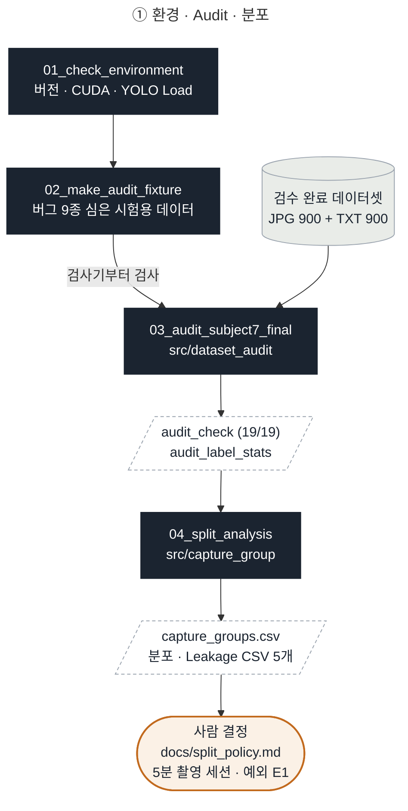

**② Split Freeze · YOLO 폴더** → `figures/pipeline_2_day3.svg`

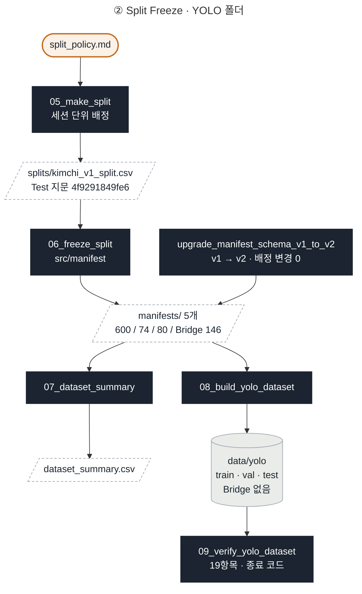

**③ Baseline 학습 · 평가** → `figures/pipeline_3_day4_5.svg`

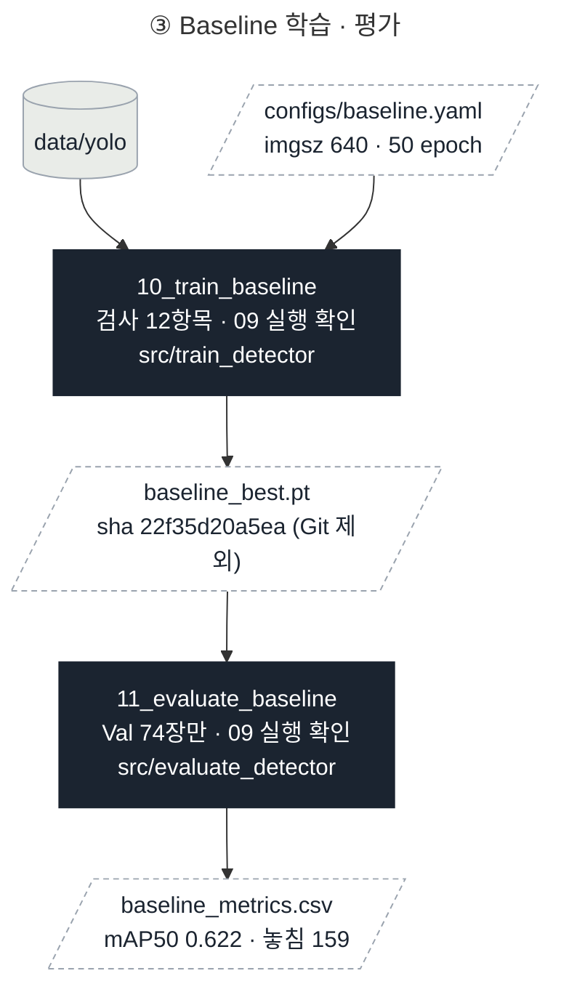

**④ 실패 분석 → 한 변수 개선** → `figures/pipeline_4_day6_7.svg`

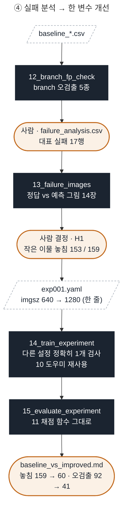

**⑤ Final 선정 단계 오전 · Final 확정 → Frozen Test 1회** → `figures/pipeline_5_day8_test.svg`

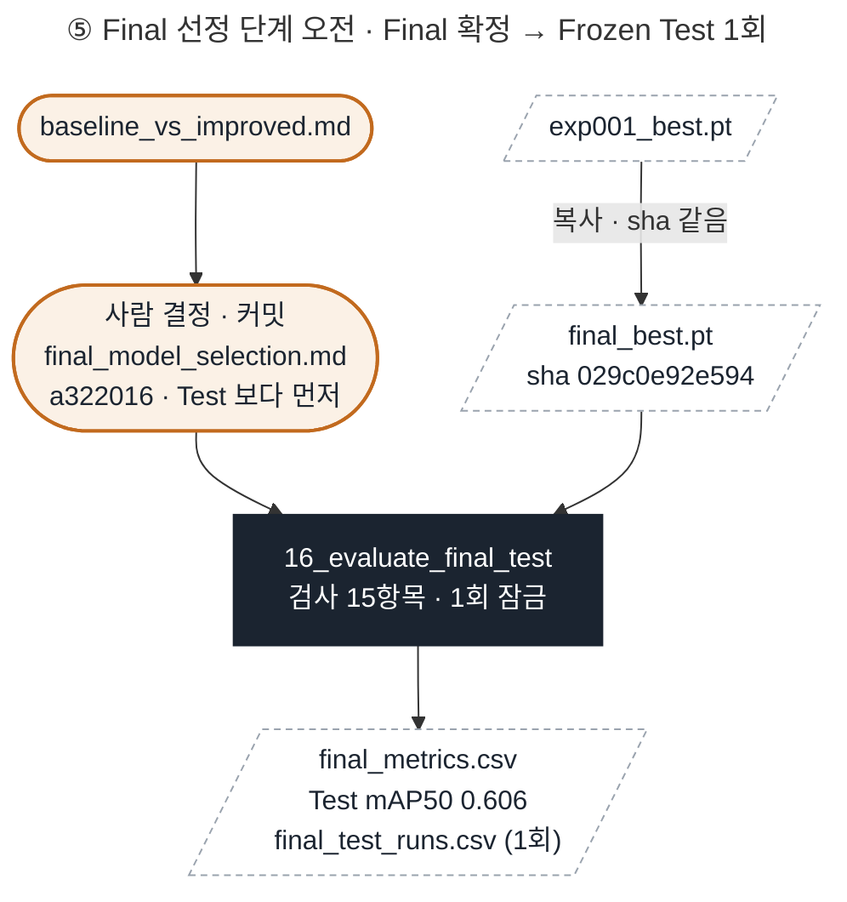

**⑥ Auto Label → 검수 → 인계** → `figures/pipeline_6_day8_9.svg`

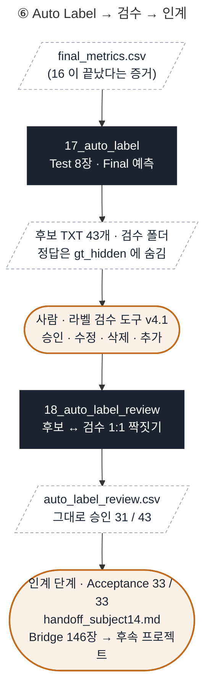

</details>

<details>
<summary><b>README 한눈에 보기 그림 원본 (mermaid) 펼치기</b> → <code>figures/pipeline_overview.svg</code></summary>

README 8장 맨 위 그림의 원본입니다. 그림을 고칠 때는 여기를 고친 뒤 SVG 를 다시 뽑습니다.

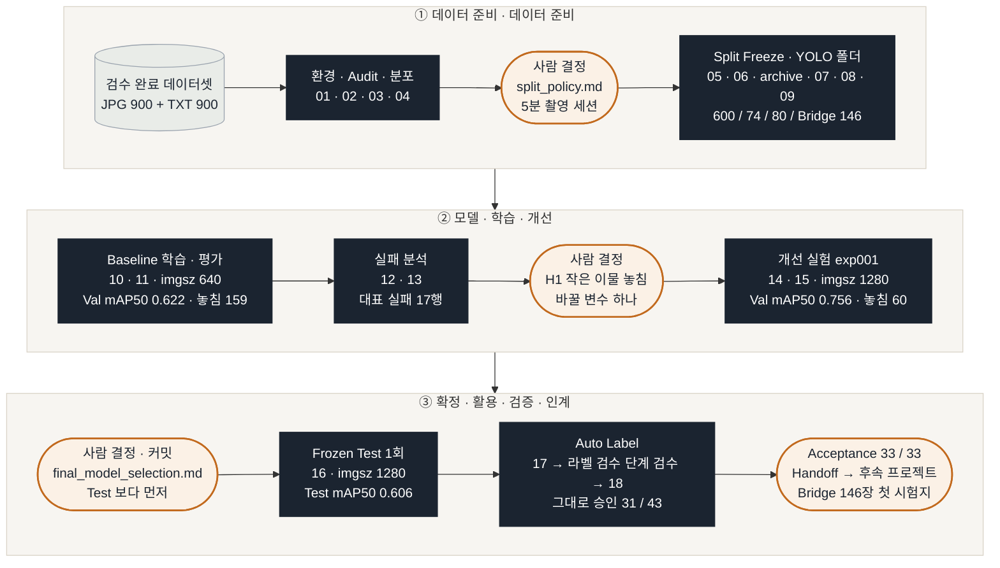

</details>

`data/yolo`는 원본(읽기 전용)이 아니라 **08이 만든 복사본**입니다. 같은 폴더를 08(만든 쪽)과 09(검사하는 쪽)가 따로 확인합니다.

`src/manifest.py`는 06 · 07 · archive · 08 · 09 · 10 · 11 · 12 · 13 · 14 · 15 · 16 · 17이 모두 `import`해서 manifest(v1 · v2 · split CSV)를 같은 모양으로 읽습니다. 10 · 11 · 12 · 14 · 15 · 16은 학습 전 · 평가 전 · 실행 전에 **09를 그대로 실행**해(import가 아니라 별도 실행) 종료 코드 0을 확인합니다. Split 단계 Smoke Test는 스크립트 없이 `yolo detect train` 명령으로 1 epoch만 돌려 파이프라인이 끝까지 이어지는지 확인한 것이고(기록: `smoke_test.md`), 그 Weight는 Baseline으로 쓰지 않습니다. 개선 실험 단계 14의 `--smoke`는 이와 별개로 **개선 실험 조건**의 GPU 메모리 · 시간만 보는 1 epoch 시험이며(`runs/exp001_smoke`), 기록을 남기지 않습니다. `runs/` · `models/` · `demo/`(Smoke · 10 · 11 · 12 · 13 · 14 · 15 · 16 · 17 · 18 결과)는 Git에 올리지 않고(NDA), `reports/`의 CSV · 그래프 · 조건 문서만 올립니다. 12의 `branch_pred_check.csv` · 13의 `failure_image_list.csv` · 17 · 18의 `auto_label_*.csv`는 이미지 없이 파일명 · 좌표 · 숫자와 사람이 적은 확인 결과뿐이라 Git에 올립니다.

개선 실험 단계는 **"같은 것은 같은 코드로"** 가 원칙입니다. 14는 Baseline과 같은 `train_detector()`로 학습하고 10의 도우미(라벨 지문 · git · 환경 · results 확인 · sha)를 그대로 불러 쓰며, 15는 Baseline을 채점한 11의 함수를 그대로 불러 같은 Val 74장 · 같은 conf 0.25 · 같은 짝짓기로 채점합니다. 그래서 Baseline과 exp001의 숫자 차이는 **바꾼 변수 하나** 때문이라고 말할 수 있습니다. 15는 Test를 평가하지 않고, Final Model 후보는 `baseline_vs_improved.md`에서 팀이 Frozen Test를 보지 않고 정합니다.

Final 선정 단계는 **"고른 다음에만 시험"** 이 원칙입니다. `final_model_selection.md`를 확정 · **커밋**한 뒤에만 16이 Frozen Test를 열고, 16은 프로젝트에서 유일하게 `allow_test=True`를 쓰며 `final_metrics.csv`가 있으면 두 번째 실행을 거부합니다(실행 기록 `final_test_runs.csv`). 17은 그 `final_metrics.csv`가 있어야만 Test 사진 8장으로 Auto Label 시연을 하고, 정답은 `gt_hidden/`에 숨깁니다. 사람이 라벨 검수 도구으로 검수한 뒤 18이 후보와 검수 결과를 비교해 승인 · 수정 · 삭제 · 추가를 셉니다.

<details>
<summary><b>상세 그림 펼치기</b> — 모든 입력 · import 화살표 (예전 1장 그림 · 큰 화면 · 확대해서 보기)</summary>

```mermaid
flowchart LR
    subgraph IN["② 입력 · 검수 완료 데이터셋 (Git 제외 · 읽기 전용)"]
        IMG[("data/subject7_final/images<br/>JPG 900장")]
        LBL[("data/subject7_final/labels<br/>TXT 900개 · 지문 5c2b4fc2c3e6")]
        MAN[("labeling-qa-tool/manifests/<br/>dataset_manifest.csv")]
    end

    EXP(["reports/audit_expected.md<br/>기대값 · Test Oracle"])
    YAML[/"configs/dataset.yaml<br/>Class 0~6 · Bridge 제외"/]
    BYAML[/"configs/baseline.yaml<br/>팀 확정 학습 조건"/]

    subgraph D1["① 환경 구성 단계 · 환경"]
        S01["scripts/01_check_environment.py"]
        ENV[/"README 팀원 환경 표"/]
    end

    subgraph AUD["③ 데이터 감사 단계 · Audit"]
        SRC1{{"src/dataset_audit.py"}}
        S02A["scripts/02_make_audit_fixture.py"]
        FIX[("data/audit_test<br/>8쌍 + 버그 9종")]
        S02["scripts/03_audit_subject7_final.py"]
        O02[/"audit_issue.csv<br/>audit_check.csv<br/>audit_label_stats.csv"/]
    end

    subgraph ANA["④ 데이터 감사 단계 · 분포 · Leakage"]
        SRC2{{"src/capture_group.py"}}
        S03["scripts/04_split_analysis.py"]
        O03[/"class_scene_distribution.csv<br/>capture_group_compare.csv<br/>capture_groups.csv<br/>capture_group_summary.csv<br/>filename_time_check.csv"/]
    end

    subgraph DEC["⑤ 사람의 결정"]
        POL(["docs/split_policy.md<br/>5분 세션 · 600/75/75/150 · E1"])
        LOG(["reports/issue_log.md"])
    end

    subgraph SPL["⑥ Split 단계 선행 · 배정"]
        S04["scripts/05_make_split.py"]
        O04[/"splits/kimchi_v1_split.csv<br/>split_check.csv · split_summary.csv<br/>Frozen Test 지문 4f9291849fe6"/]
    end

    subgraph FRZ["⑦ Split 단계 · Freeze · YOLO 폴더"]
        MFT{{"src/manifest.py<br/>read_manifest · assignment<br/>build_v2_rows · write_manifest_set"}}
        S05["scripts/06_freeze_split.py"]
        O05[/"manifests/split_manifest.csv (스키마 v2)<br/>train · val · test · bridge_holdout .csv<br/>reports/freeze_check.csv"/]
        S05B["scripts/archive/upgrade_manifest_schema_v1_to_v2.py<br/>v1(3칸) → v2(9칸)"]
        O05B[/"reports/manifest_schema_check.csv<br/>불변 조건 14항목"/]
        S05A["scripts/07_dataset_summary.py"]
        O05A[/"reports/dataset_summary.csv<br/>역할 4개 + 합계 · 8항목 검사"/]
        S06["scripts/08_build_yolo_dataset.py"]
        YOLO[("data/yolo<br/>images · labels / train · val · test<br/>Bridge 제외 · Git 제외")]
        O06[/"reports/yolo_build_summary.csv"/]
        S07["scripts/09_verify_yolo_dataset.py"]
        O07[/"reports/yolo_verify_check.csv<br/>19항목 · 종료 코드 0 / 1"/]
    end

    SMK["Split 단계 Smoke Test<br/>yolo CLI · 1 epoch · 스크립트 없음<br/>runs/smoke_day3 (Git 제외)"]

    subgraph TRAIN["⑧ Baseline 학습"]
        TRN{{"src/train_detector.py<br/>train_detector · TRAIN_KEYS"}}
        S08["scripts/10_train_baseline.py<br/>--dry-run · 학습 전 12항목"]
        O08[/"models/baseline/baseline_best.pt<br/>runs/baseline_v1 · reports/baseline_results.csv<br/>reports/baseline_training_condition.md"/]
    end

    subgraph EVAL["⑨ Baseline 평가"]
        EVL{{"src/evaluate_detector.py<br/>evaluate_detector · predict_images<br/>match_boxes"}}
        S09["scripts/11_evaluate_baseline.py<br/>Val만 · 평가 전 10항목"]
        O09[/"reports/baseline_metrics.csv<br/>reports/baseline_val_image_check.csv<br/>reports/baseline_class_check.csv<br/>reports/figures/*.png"/]
    end

    subgraph BRC["⑩ 실패 분석 단계 · branch 오검출 확인 (H3)"]
        S09A["scripts/12_branch_fp_check.py<br/>Val만 · 실행 전 6항목 · 예측 5종 분류"]
        O09A[/"reports/branch_pred_check.csv<br/>runs/predict/branch_check (Git 제외)"/]
        FA(["reports/failure_analysis.csv<br/>H3 행 · 사람이 branch 박스 확인"])
    end

    subgraph FIG["⑪ 실패 분석 단계 · 대표 실패 사례 그림"]
        S09B["scripts/13_failure_images.py<br/>Val만 · sha 확인 · GT vs 예측"]
        O09B[/"demo/failure_analysis/*_compare.jpg (Git 제외 · NDA)<br/>reports/failure_image_list.csv"/]
    end

    subgraph IMP["⑫ 개선 실험 단계 · 한 변수 개선 실험"]
        PLAN(["reports/improvement_experiment.md<br/>상태: 확정 · 바꿀 변수 하나"])
        EYAML[/"configs/exp001.yaml<br/>Baseline과 학습 설정 1개만 다름"/]
        S10["scripts/14_train_experiment.py<br/>--smoke · --dry-run · 본 학습"]
        O10[/"models/improved/exp001_best.pt<br/>runs/exp001 (Git 제외)<br/>reports/exp001_results.csv<br/>reports/exp001_training_condition.md"/]
        S11["scripts/15_evaluate_experiment.py<br/>평가 전 10항목 · 11 채점 함수 그대로"]
        O11[/"reports/exp001_metrics.csv<br/>exp001_class_check.csv · exp001_val_image_check.csv<br/>reports/figures/exp001_*.png<br/>reports/experiment_log.csv"/]
        CMP(["reports/baseline_vs_improved.md<br/>숫자 초안 → 팀이 해석 · Final Model 후보"])
    end

    subgraph FIN["⑬ Final 선정 단계 · Final Model · Frozen Test 1회 · Auto Label"]
        SEL(["reports/final_model_selection.md<br/>상태: 확정 · Test 전에 커밋"])
        FPT[/"models/final/final_best.pt<br/>= exp001_best.pt · sha 029c0e92e594 (Git 제외)"/]
        S12["scripts/16_evaluate_final_test.py<br/>평가 전 15항목 · 1회 잠금 · allow_test=True"]
        O12[/"reports/final_metrics.csv · final_class_check.csv<br/>final_test_image_check.csv · final_test_runs.csv<br/>reports/figures/final_test_*.png"/]
        S13["scripts/17_auto_label.py<br/>준비 검사 8항목 · Test 사진 8장"]
        O13[/"demo/prediction_images · auto_label/candidate_labels<br/>review_workspace · gt_hidden (Git 제외)<br/>reports/auto_label_candidates.csv"/]
        HR(["라벨 검수 도구 v4.1<br/>사람 검수 → work · final"])
        S14["scripts/18_auto_label_review.py<br/>후보 ↔ 검수 1:1 짝짓기"]
        O14[/"demo/auto_label/reviewed_labels (Git 제외)<br/>reports/auto_label_review.csv"/]
    end

    S01 --> ENV

    IMG --> S02A
    LBL --> S02A
    S02A --> FIX
    FIX -->|"fixture 모드"| S02

    IMG --> S02
    LBL --> S02
    MAN --> S02
    SRC1 -.->|import| S02
    EXP -.->|EXPECTED 19항목| S02
    S02 --> O02
    O02 -.->|v1 FAIL 5 원인| LOG

    O02 -->|audit_label_stats| S03
    IMG -->|EXIF 확인| S03
    SRC2 -.->|import| S03
    S03 --> O03

    O03 -.->|숫자 근거| POL
    POL -.->|정책 → 상수| S04
    O03 -->|capture_groups| S04
    O02 -->|audit_label_stats| S04
    S04 --> O04

    O04 -->|"split 목록"| S05
    O02 -->|"audit_label_stats<br/>(v2 칸을 채울 값)"| S05
    MFT -.->|import| S05
    IMG -->|"이미지 짝 확인"| S05
    LBL -->|"라벨 지문 확인"| S05
    POL -.->|"장수 · 지문 기준값"| S05
    S05 --> O05

    O04 -.->|"리허설 (from-split)"| S06
    O05 -->|"본 실행"| S06
    MFT -.->|import| S06
    IMG -->|"복사"| S06
    LBL -->|"복사"| S06
    S06 --> YOLO
    S06 --> O06

    O05 -->|"정답표"| S07
    YOLO -->|"읽기만"| S07
    LBL -->|"바이트 비교"| S07
    O04 -->|"split_summary BBox 합계"| S07
    S07 --> O07

    MFT -.->|import| S07

    O05 -->|"지금 manifest (v1)"| S05B
    O04 -->|"배정 비교"| S05B
    O02 -->|"audit_label_stats"| S05B
    MFT -.->|import| S05B
    S05B -->|"v2로 갱신 · 배정 변경 0"| O05
    S05B --> O05B

    O05 -->|"정답표 (v2)"| S05A
    O02 -->|"이미지별 통계"| S05A
    YAML -->|"Bridge 포함 여부"| S05A
    MFT -.->|import| S05A
    S05A --> O05A

    O07 -.-> SMK
    YAML -.-> SMK
    YOLO -.->|"Train 600 · Val 74"| SMK
    SMK -.->|"조건 확인용 · Weight는 쓰지 않음"| S08

    BYAML -->|"학습 조건"| S08
    YAML -->|"train · val"| S08
    O05 -->|"manifest · train.csv · val.csv"| S08
    YOLO -->|"학습 데이터"| S08
    LBL -->|"라벨 지문"| S08
    S07 -.->|"실행 · 종료 코드 0"| S08
    MFT -.->|import| S08
    TRN -.->|import| S08
    S08 --> O08

    O08 -->|"Weight · 조건 문서(상태 · sha)"| S09
    BYAML -->|"imgsz · batch"| S09
    YAML -->|"val 평가"| S09
    O05 -->|"val.csv"| S09
    YOLO -->|"val 이미지 · 라벨"| S09
    S07 -.->|"실행 · 종료 코드 0"| S09
    MFT -.->|import| S09
    EVL -.->|import| S09
    S09 --> O09

    O08 -->|"Weight · 조건 문서(sha)"| S09A
    YAML -->|"Class 이름"| S09A
    O05 -->|"val.csv"| S09A
    YOLO -->|"val 이미지 · 라벨"| S09A
    O09 -->|"baseline_val_image_check (용훈 PC 결과와 비교)"| S09A
    S07 -.->|"실행 · 종료 코드 0"| S09A
    MFT -.->|import| S09A
    EVL -.->|import| S09A
    S09A --> O09A
    O09A -->|"사람 확인 · 대표 사례"| FA
    O09 -.->|"baseline_class_check · branch 줄 교차 확인"| O09A

    FA -->|"대표 실패 사진 · 실패 유형"| S09B
    O08 -->|"Weight · 조건 문서(sha)"| S09B
    O05 -->|"val.csv"| S09B
    YOLO -->|"val 이미지 · 라벨"| S09B
    MFT -.->|import| S09B
    EVL -.->|"import (match_boxes)"| S09B
    S09B --> O09B
    O09B -.->|"Gate ② · 사람이 그림 확인"| PLAN

    FA -.->|"H1 · H2 · H3 근거"| PLAN
    PLAN -.->|"바꿀 변수 · 값"| EYAML
    EYAML -->|"실험 조건"| S10
    BYAML -->|"비교 기준 (차이 = 정확히 1개)"| S10
    PLAN -->|"**상태: 확정** 확인"| S10
    YAML -->|"train · val"| S10
    O05 -->|"manifest 스키마"| S10
    YOLO -->|"학습 데이터"| S10
    LBL -->|"라벨 지문"| S10
    S07 -.->|"실행 · 종료 코드 0"| S10
    MFT -.->|import| S10
    TRN -.->|"import (Baseline과 같은 학습 함수)"| S10
    S08 -.->|"모듈 로드 (importlib) · 지문 · git · 환경 도우미"| S10
    S10 --> O10

    O10 -->|"Weight · 조건 문서(상태 · sha · 날짜)"| S11
    EYAML -->|"imgsz · batch · name"| S11
    BYAML -->|"바꾼 것 계산"| S11
    YAML -->|"val 평가"| S11
    YOLO -->|"val 이미지 · 라벨"| S11
    O09 -->|"baseline_*.csv 3개 (비교 기준)"| S11
    FA -->|"대표 실패 사진 FN · FP 추적"| S11
    S07 -.->|"실행 · 종료 코드 0"| S11
    MFT -.->|import| S11
    EVL -.->|import| S11
    TRN -.->|"import (TRAIN_KEYS)"| S11
    S09 -.->|"모듈 로드 (importlib) · 채점 함수 그대로"| S11
    S11 --> O11
    S11 -->|"없을 때만 초안"| CMP
    O11 -.->|"decision 칸 · Frozen Test 안 봄"| CMP

    CMP -.->|"Val 근거로 선택"| SEL
    O10 -->|"exp001_best.pt 복사"| FPT
    SEL -->|"확정 · 커밋 · sha · 원본 설정"| S12
    FPT -->|"Final Weight"| S12
    EYAML -->|"imgsz 1280"| S12
    O10 -->|"exp001 학습 기록 sha"| S12
    YAML -->|"test 경로"| S12
    O05 -->|"Test 지문 4f9291849fe6"| S12
    YOLO -->|"test 이미지 · 라벨"| S12
    O11 -->|"exp001 Val 결과 (나란히 비교만)"| S12
    S07 -.->|"실행 · 종료 코드 0"| S12
    MFT -.->|"import (fingerprint)"| S12
    EVL -.->|"import (allow_test=True)"| S12
    S09 -.->|"모듈 로드 (importlib) · 채점 함수"| S12
    S08 -.->|"모듈 로드 (importlib) · git · sha"| S12
    S12 --> O12

    O12 -->|"final_metrics.csv = 16 완료 증거"| S13
    FPT -->|"Final Weight"| S13
    S12 -.->|"모듈 로드 (importlib) · 선택 문서 · Final 경로"| S13
    O05 -->|"test.csv · 4개 역할 확인"| S13
    YOLO -->|"test 사진 8장"| S13
    MFT -.->|import| S13
    EVL -.->|"import (predict_images)"| S13
    S13 --> O13
    O13 -->|"review_workspace"| HR
    HR -->|"work · final labels · 작업대장"| S14
    O13 -->|"후보 TXT · gt_hidden (참고만)"| S14
    EVL -.->|"import (iou_xywh · match_boxes)"| S14
    S14 --> O14

    classDef data fill:#E9ECE8,stroke:#9AA3AE,color:#1B2430
    classDef src fill:#FFFFFF,stroke:#2a78d6,stroke-width:2px,color:#1B2430
    classDef script fill:#1B2430,stroke:#1B2430,color:#FFFFFF
    classDef out fill:#FFFFFF,stroke:#9AA3AE,stroke-dasharray:4 3,color:#1B2430
    classDef human fill:#FBF1E6,stroke:#C26A1E,stroke-width:2px,color:#1B2430
    classDef next fill:#F3F4F1,stroke:#B8C2CF,stroke-dasharray:4 3,color:#6B7280

    class IMG,LBL,MAN,FIX,YOLO data
    class SRC1,SRC2,MFT,TRN,EVL src
    class S01,S02A,S02,S03,S04,S05,S05A,S05B,S06,S07,S08,S09,S09A,S09B,S10,S11,S12,S13,S14 script
    class O02,O03,O04,O05,O05A,O05B,O06,O07,O08,O09,O09A,O09B,O10,O11,O12,O13,O14,FPT,ENV,YAML,BYAML,EYAML out
    class EXP,POL,LOG,FA,PLAN,CMP,SEL,HR human
    class SMK next
```

</details>

---

## 2. 파일별 흐름 그림

파일 **안쪽** 흐름은 각 코드 리뷰 문서 3장에 있습니다. 같은 그림을 두 곳에 두지 않으려고 여기서는 링크만 둡니다.

| 파일 | 그림 내용 | 위치 |
|---|---|---|
| `configs/dataset.yaml` | path → images → labels 자동 치환 | [dataset_yaml.md](code_review/configs/dataset_yaml.md#흐름-그림) |
| `src/dataset_audit.py` | 짝 맞추기 → 한 줄 검사 → issues · stats | [dataset_audit.md](code_review/src/dataset_audit.md#흐름-그림) |
| `src/capture_group.py` | sort → diff → 비교 → cumsum | [capture_group.md](code_review/src/capture_group.md#흐름-그림) |
| `src/manifest.py` | 칸 이름으로 v1 · v2 판단 → `split` 키로 맞춤 → v2 칸 채우기 → 5개 파일 쓰기 | [manifest.md](code_review/src/manifest.md#흐름-그림) |
| `src/train_detector.py` | 절대경로 확인 → `TRAIN_KEYS`만 골라 `model.train()` → 실제 저장 폴더 | [train_detector.md](code_review/src/train_detector.md#흐름-그림) |
| `src/evaluate_detector.py` | split 허용 확인 → `model.val()` · 예측 제너레이터 · TP/FP/FN 짝짓기 | [evaluate_detector.md](code_review/src/evaluate_detector.md#흐름-그림) |
| `scripts/01_check_environment.py` | 버전 → CUDA → YOLO Load | [01_check_environment.md](code_review/scripts/01_check_environment.md#흐름-그림) |
| `scripts/02_make_audit_fixture.py` | 지우기 → 8쌍 복사 → 버그 9종 | [02_make_audit_fixture.md](code_review/scripts/02_make_audit_fixture.md#흐름-그림) |
| `scripts/03_audit_subject7_final.py` | fixture 분기 → Audit → 기대값 대조 | [03_audit_subject7_final.md](code_review/scripts/03_audit_subject7_final.md#흐름-그림) |
| `scripts/04_split_analysis.py` | main → 분석 5갈래 → CSV 5개 | [04_split_analysis.md](code_review/scripts/04_split_analysis.md#흐름-그림) |
| `scripts/05_make_split.py` | E1 → 전수 탐색 → 재현성 → verify | [05_make_split.md](code_review/scripts/05_make_split.md#흐름-그림) |
| `scripts/06_freeze_split.py` | 검사 13항목 → 전부 PASS면 Freeze(v2) · 이미 Freeze면 배정만 비교 | [06_freeze_split.md](code_review/scripts/06_freeze_split.md#흐름-그림) |
| `scripts/07_dataset_summary.py` | 입력 확인 → 역할별 집계 → 8항목 검사 → 저장 | [07_dataset_summary.md](code_review/scripts/07_dataset_summary.md#흐름-그림) |
| `scripts/archive/upgrade_manifest_schema_v1_to_v2.py` | 새 manifest 만들기 → 14항목 검사 → 이미 v2면 확인만 · v1이면 쓰기 | [upgrade_manifest_schema_v1_to_v2.md](code_review/scripts/archive/upgrade_manifest_schema_v1_to_v2.md#흐름-그림) |
| `scripts/08_build_yolo_dataset.py` | 입력 고르기 → 검사 1 · 2 → 복사 → 검사 3 | [08_build_yolo_dataset.md](code_review/scripts/08_build_yolo_dataset.md#흐름-그림) |
| `scripts/09_verify_yolo_dataset.py` | 전제 확인 → 검사 1~6 → 저장 · 종료 코드 | [09_verify_yolo_dataset.md](code_review/scripts/09_verify_yolo_dataset.md#흐름-그림) |
| `scripts/10_train_baseline.py` | 검사 12항목 → (dry-run이면 종료) → 학습 → 결과 확인 · 보관 → 조건 문서 | [10_train_baseline.md](code_review/scripts/10_train_baseline.md#흐름-그림) |
| `scripts/11_evaluate_baseline.py` | 검사 10항목 → ① Val 평가 → ② 그림 정리 → ③ 이미지별 FP/FN · Class별 TP/FN/FP | [11_evaluate_baseline.md](code_review/scripts/11_evaluate_baseline.md#흐름-그림) |
| `scripts/12_branch_fp_check.py` | 검사 6항목 → Val 예측 → ① 용훈 PC 비교 · ② branch 정답 · ③ 5종 분류 → CSV 저장 | [12_branch_fp_check.md](code_review/scripts/12_branch_fp_check.md#흐름-그림) |
| `scripts/13_failure_images.py` | 가중치 · sha · CSV 확인 → 사진 중복 합치기 · Val만 → 예측 · 짝짓기 → 비교 그림 · 목록 CSV | [13_failure_images.md](code_review/scripts/13_failure_images.md#흐름-그림) |
| `scripts/14_train_experiment.py` | 검사(한 변수 · 계획 확정 · 덮어쓰기) → 모드 분기(dry · smoke · 본 학습) → 결과 확인 · 보관 → 조건 문서 | [14_train_experiment.md](code_review/scripts/14_train_experiment.md#흐름-그림) |
| `scripts/15_evaluate_experiment.py` | 검사 10항목 → ① Val 지표 → ② conf 0.25 이미지별 · Class별 → ③ Baseline 비교 · 실험 로그 · 비교 md 초안 | [15_evaluate_experiment.md](code_review/scripts/15_evaluate_experiment.md#흐름-그림) |
| `scripts/16_evaluate_final_test.py` | 검사 15항목(① 선택 먼저 · ② 같은 가중치 · ③ 같은 시험지 · ④ 1회 잠금) → ① Test 지표 → ② conf 0.25 이미지별 · Class별 → ③ 그래프 → ④ Val과 나란히 | [16_evaluate_final_test.md](code_review/scripts/16_evaluate_final_test.md#흐름-그림) |
| `scripts/17_auto_label.py` | 사진 고르기 → 검사 8항목 → demo/ 폴더 준비 · 정답 숨김 → Final 예측 → Detection 이미지 · 후보 TXT · 검수 폴더 | [17_auto_label.md](code_review/scripts/17_auto_label.md#흐름-그림) |
| `scripts/18_auto_label_review.py` | 사진마다 검수 TXT 찾기(final → work) → 후보 ↔ 검수 1:1 짝짓기 → 정답 참고 비교 → 합계 · CSV | [18_auto_label_review.md](code_review/scripts/18_auto_label_review.md#흐름-그림) |

---

## 3. 모듈 의존 관계 (누가 누구를 import 하나)

화살표 수십 개를 한 그림에 그리는 대신, **표 하나(scripts → src)** + **작은 그림 하나(스크립트가 다른 스크립트를 쓰는 곳)** + **라이브러리 표**로 나눴습니다. 예전 그림은 이 장 맨 아래 접기 안에 있습니다.

### 3-1. scripts → src (✓ = import)

| 스크립트 | `dataset_audit` | `capture_group` | `manifest` | `train_detector` | `evaluate_detector` | 가져오는 것 (특이한 것만) |
|---|:---:|:---:|:---:|:---:|:---:|---|
| `01_check_environment` | | | | | | (src 안 씀) |
| `02_make_audit_fixture` | | | | | | (src 안 씀) |
| `03_audit_subject7_final` | ✓ | | | | | |
| `04_split_analysis` | | ✓ | | | | |
| `05_make_split` | | | | | | (src 안 씀 · CSV 두 개만 읽음) |
| `06_freeze_split` | | | ✓ | | | `build_v2_rows` · `write_manifest_set` |
| `07_dataset_summary` | | | ✓ | | | |
| `upgrade_manifest_schema_v1_to_v2` | | | ✓ | | | `build_v2_rows` · `write_manifest_set` |
| `08_build_yolo_dataset` | | | ✓ | | | |
| `09_verify_yolo_dataset` | | | ✓ | | | `read_manifest` 만 (08 은 import 안 함) |
| `10_train_baseline` | | | ✓ | ✓ | | |
| `11_evaluate_baseline` | | | ✓ | | ✓ | |
| `12_branch_fp_check` | | | ✓ | | ✓ | |
| `13_failure_images` | | | ✓ | | ✓ | `match_boxes` |
| `14_train_experiment` | | | ✓ | ✓ | | |
| `15_evaluate_experiment` | | | ✓ | ✓ | ✓ | `TRAIN_KEYS` (train_detector) |
| `16_evaluate_final_test` | | | ✓ | | ✓ | `fingerprint` · `allow_test=True` |
| `17_auto_label` | | | ✓ | | ✓ | `predict_images` |
| `18_auto_label_review` | | | | | ✓ | `iou_xywh` · `match_boxes` |
| **합계** | 1 | 1 | 13 | 3 | 7 | |

### 3-2. 스크립트가 다른 스크립트를 쓰는 곳

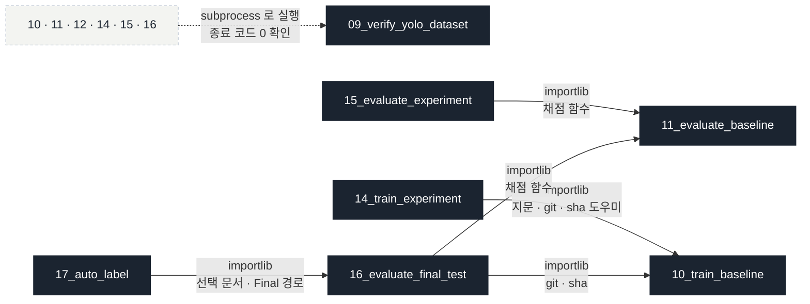

실선 = **importlib 로 파일을 모듈처럼 불러와 함수 · 상수를 그대로 씀** (같은 계산을 다시 쓰지 않기 위해) · 점선 = **import 하지 않고 별도 프로세스로 실행만** (09 가 FAIL 이면 학습 · 평가를 시작하지 않음).

### 3-3. 외부 라이브러리

| 라이브러리 | 쓰는 파일 | 메모 |
|---|---|---|
| `ultralytics` (YOLO) | `src/train_detector` · `src/evaluate_detector` · `13` | **함수 안에서** import → 검사를 통과한 뒤에만 불러옴 |
| `ultralytics` (버전 확인) | `01` · `10` · `11` · `12` · `15` · `16` | 팀 고정 8.4.175 인지 검사 |
| `torch` | `01` · `10` · `14` | CUDA · GPU 확인 (10 · 14 는 함수 안) |
| `pandas` · `numpy` | `04` · `05` · `src/capture_group` | 촬영 세션 · 분포 계산 |
| `Pillow` | `04` (EXIF 시각) · `13` (비교 그림 그리기) | |
| `PyYAML` | `07` · `10` · `11` · `12` · `14` · `15` · `16` · `17` | configs/*.yaml 읽기 |
| 표준 라이브러리 | 전부 | `pathlib` · `csv` · `shutil` · `hashlib` · `re` · `subprocess` · `importlib` 등 |

> `05_make_split.py`는 `src`를 import하지 않고 **결과 CSV 두 개만** 읽습니다. 그래서 앞 단계 코드가 바뀌어도 CSV가 같으면 배정 결과가 같습니다.

> `06` · `07` · `archive` · `08` · `09` · `10` · `11` · `12` · `13` · `14` · `15` · `16` · `17`은 `src/manifest.py`를 import해서 `read_manifest()`로 manifest(v1 · v2 · split CSV)를 같은 모양(모든 행에 `split` 키, Bridge 값은 `bridge_holdout`)으로 읽습니다. 06은 ①~⑤ 검사에서만 05의 v1 split CSV를 `role` 칸 그대로 직접 읽고, ⑥ 이후는 `read_manifest()`를 씁니다. 06 · archive가 manifest를 쓸 때는 `build_v2_rows()` · `write_manifest_set()`을 함께 씁니다. `10` · `14`는 `src/train_detector.py`를, `11` · `12` · `13` · `15` · `16` · `17` · `18`은 `src/evaluate_detector.py`를 import합니다. `16`은 `manifest.py`에서 `fingerprint()`도 가져와 Test 지문을 다시 계산합니다. `15`는 `train_detector.py`에서 `TRAIN_KEYS`만 가져와 14와 같은 규칙으로 "바꾼 것"을 계산합니다. `13`은 `evaluate_detector.py`에서 `match_boxes()`만 가져와 11과 같은 짝짓기로 TP · FP · FN을 셉니다.

> `09`는 `08`의 코드를 import하지 않습니다. 09가 가져오는 것은 manifest를 읽는 `read_manifest()`뿐입니다. 만든 쪽(B)과 검사하는 쪽(A)을 나눠서, 08에 실수가 있어도 09의 검사가 같이 틀리지 않게 하려는 설계입니다. 그래서 `fingerprint()`는 05 · 06 · 08 · 09에 **같은 계산으로 각각** 들어 있고, `src/manifest.py`에도 같은 계산이 있어 archive · 10이 그쪽을 가져다 씁니다. 14는 10을 통해 같은 계산을 씁니다.

> `10` · `11` · `12` · `14` · `15` · `16`은 `09`를 import하지 않고 **별도 프로세스로 실행**해서(`subprocess`) 종료 코드 0인지만 확인합니다. 09가 FAIL이면 학습 · 평가 · 분류 · Test 평가를 시작하지 않습니다. `13`은 09를 실행하지 않는 대신, 가중치 sha가 Baseline 학습 단계 기록과 같은지 확인하고 Val 사진만 그립니다.

> `14` · `15`는 스크립트 파일 이름이 숫자로 시작해 일반 `import`가 안 되므로 `importlib`로 **10 · 09 파일을 모듈로 불러옵니다**(`t10` · `e11`). 10 · 11의 `main()`은 `if __name__ == "__main__"` 안에 있어서 불러와도 학습 · 평가가 돌지 않고, 도우미 함수와 상수만 씁니다. 14는 10의 라벨 지문 · git · 환경 · results 확인 · sha를, 15는 11의 지표 기록 · 그림 복사 · 이미지별 / Class별 채점 · sha를 그대로 씁니다 → Baseline과 **계산이 다를 수 없는 구조**입니다. Final 선정 단계도 같은 방식으로, `16`은 11(채점 함수)과 10(git · sha)을, `17`은 16(선택 문서 읽기 · Final 경로)를 모듈로 불러옵니다. `16`은 불러온 11 모듈의 폴더 상수만 test로 바꿔 채점 규칙을 한 줄도 다시 쓰지 않습니다.

<details>
<summary><b>상세 그림 펼치기</b> — 예전 3장 그림 (라이브러리까지 모든 화살표)</summary>

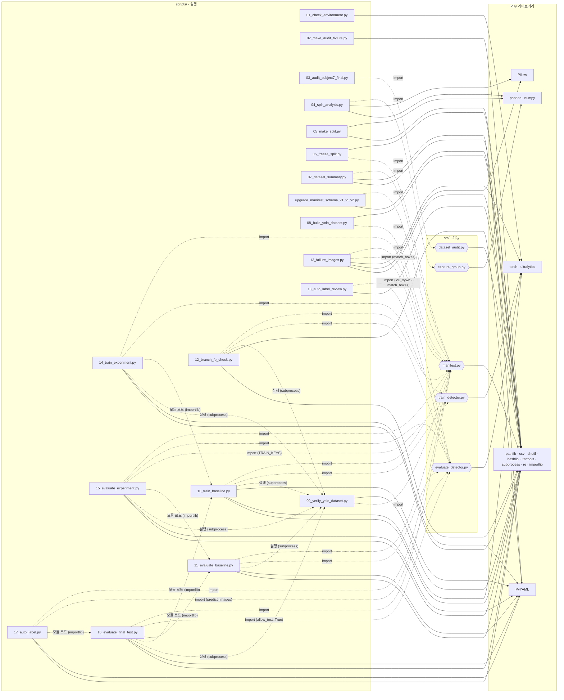

</details>


## 4. 글로 적은 전체 지도 · 파일별 입력 · 출력

1장 그림을 글로 옮긴 버전입니다. 그림이 안 보이는 환경이거나, 파일 이름으로 검색하고 싶을 때 씁니다. (README 8장에서 옮겨 옴)

### 4-1. 단계별 실행 순서

```
[환경 구성 단계]  01_check_environment.py ──→ 화면 출력 → 5장 팀원 환경 표

[데이터 감사 단계]  02_make_audit_fixture.py ──→ data/audit_test/ (8쌍 + 버그 9종)
              │
              ▼
         03_audit_subject7_final.py --fixture ──→ 9종 각 1건 검출 확인   (검사기부터 검사)
         03_audit_subject7_final.py           ──→ reports/audit_issue · audit_check · audit_label_stats.csv
              │  (import src.dataset_audit)            │
              │                                        ▼
         04_split_analysis.py ←──────────── audit_label_stats.csv
              │  (import src.capture_group)
              ▼
         reports/class_scene_distribution · capture_group_* · capture_groups · filename_time_check.csv
              │
              ▼
         [사람] 팀 회의 → docs/split_policy.md (숫자 근거 + 결정)

[Split 단계 선행]
         05_make_split.py ←── capture_groups.csv + audit_label_stats.csv + 정책 상수
              ▼
         splits/kimchi_v1_split.csv · reports/split_check.csv · split_summary.csv · Frozen Test 지문 4f9291849fe6

[Split 단계]
         06_freeze_split.py ←── splits/kimchi_v1_split.csv (검사 13항목 · 전부 PASS일 때만 Freeze)
              ▼
         manifests/split_manifest.csv · train · val · test · bridge_holdout.csv · reports/freeze_check.csv
              ▼
         07_dataset_summary.py ←── manifests/ + audit_label_stats.csv + configs/dataset.yaml (검사 8항목 · PASS일 때만 저장)
              ▼
         reports/dataset_summary.csv (산출물 1 · 네 역할 합 900)
              ▼
         08_build_yolo_dataset.py ←── manifests/ + data/subject7_final (복사만 · Bridge 제외)
              ▼
         data/yolo/{images,labels}/{train,val,test} · reports/yolo_build_summary.csv
              ▼
         09_verify_yolo_dataset.py ←── manifests/ + data/yolo + 원본 labels (읽기만)
              ▼
         reports/yolo_verify_check.csv (19항목 · 종료 코드 0 / 1)
              ▼
         [사람] 라벨 Preview 20장 (라벨 검수 도구 · 읽기 전용 작업 공간) ──→ reports/label_preview.md
              ▼
         Smoke Test: yolo detect train (1 epoch · Train 600 / Val 74) → predict (Val · conf 0.05 / 0.25)
              ▼
         runs/smoke_day3/weights/best.pt (Git 제외 · Baseline 아님) · reports/smoke_test.md

[Split 단계 보완]  upgrade_manifest_schema_v1_to_v2.py : manifests/ v1 → v2 (1회 · reports/manifest_schema_check.csv)
              (06 · 07 · archive · 08 · 09 · 10 · 11 · 12 · 13 · 14 · 15 · 16 · 17은 manifest 읽기 · 쓰기를 src/manifest.py 하나로 공유)

[Baseline 학습 단계]
         10_train_baseline.py ←── configs/baseline.yaml + configs/dataset.yaml + manifests/ + data/yolo
              │  (import src.manifest · src.train_detector · 학습 전 09 실행 → 종료 코드 0 확인)
              │  학습 전 검사 12항목 · 전부 PASS일 때만 학습 (--dry-run: 검사 + 조건 문서만)
              ▼
         runs/baseline_v1/ (results.csv · weights) · models/baseline/baseline_best.pt (Git 제외)
         reports/baseline_training_condition.md · reports/baseline_results.csv (Git)

[Baseline 평가 단계]
         11_evaluate_baseline.py ←── models/baseline/baseline_best.pt + baseline_training_condition.md (상태 · sha) + manifests/val.csv + data/yolo (val)
              │  (import src.manifest · src.evaluate_detector · 평가 전 09 실행 → 종료 코드 0 확인)
              │  평가 전 검사 10항목 · split = val 고정 (Frozen Test · Bridge 미사용)
              ▼
         reports/baseline_metrics.csv · reports/figures/baseline_*.png · reports/baseline_val_image_check.csv · reports/baseline_class_check.csv (Git)
         runs/baseline_v1_val/ · runs/predict/baseline_val_images/ (Git 제외 · NDA · 박스 그린 Val 이미지는 사람이 눈으로 확인)

[실패 분석 단계]
         12_branch_fp_check.py ←── models/baseline/baseline_best.pt + baseline_training_condition.md (sha) + manifests/val.csv + data/yolo (val) + reports/baseline_val_image_check.csv (비교용)
              │  (import src.manifest · src.evaluate_detector · 실행 전 09 실행 → 종료 코드 0 확인)
              │  실행 전 검사 6항목 · Val branch 예측을 정답과 대조해 5종으로 분류 (TP · 중복 · 다른 이물 위 · 위치 어긋남 · 정답 없는 자리)
              ▼
         reports/branch_pred_check.csv (Git · human_check · memo는 사람이 채움) · runs/predict/branch_check/ (Git 제외 · NDA)
              ▼
         [사람] branch 박스 확인 (라벨 누락 · 김치 줄기 착각 · 다른 이물) ──→ reports/failure_analysis.csv H3 행 · (라벨 누락이면) reports/issue_log.md
              ▼
         [사람] FN · FP 많은 Val 사진 14장 선정 ──→ reports/failure_analysis.csv · reports/failure_hypothesis.md (H1~H4 · L)
              ▼
         13_failure_images.py ←── reports/failure_analysis.csv + models/baseline/baseline_best.pt + baseline_training_condition.md (sha) + manifests/val.csv + data/yolo (val)
              │  (import src.manifest · src.evaluate_detector.match_boxes · Val만 · conf 0.25 · IoU 0.5 = 11과 같은 기준)
              ▼
         demo/failure_analysis/*_compare.jpg (Git 제외 · NDA · 정답 초록 · 놓침 노랑 · 예측 빨강) · reports/failure_image_list.csv (Git)
              ▼
         [사람] 10/15 회의 → H1 개선 대상 확정 ──→ configs/exp001.yaml · reports/improvement_experiment.md (변수 imgsz 하나 · 상태: 확정)

[개선 실험 단계]
         14_train_experiment.py --smoke ←── configs/exp001.yaml (1 epoch · runs/exp001_smoke · 기록 안 남김 · 최대 9.97GB < 11GB → imgsz 1280)
              ▼
         14_train_experiment.py ←── configs/exp001.yaml + configs/baseline.yaml (학습 설정 차이 = 정확히 1개) + improvement_experiment.md (확정) + manifests/ + data/yolo
              │  (import src.manifest · src.train_detector · 10을 모듈로 불러 지문 · git · 환경 도우미 재사용 · 학습 전 09 실행 → 종료 코드 0 확인)
              ▼
         runs/exp001/ · models/improved/exp001_best.pt (Git 제외) · reports/exp001_training_condition.md · reports/exp001_results.csv (Git)
              ▼
         15_evaluate_experiment.py ←── models/improved/exp001_best.pt + exp001_training_condition.md (상태 · sha) + reports/baseline_*.csv 3개 + reports/failure_analysis.csv
              │  (import src.manifest · src.evaluate_detector · src.train_detector.TRAIN_KEYS · 11을 모듈로 불러 채점 함수 그대로 · 평가 전 09 실행)
              │  평가 전 검사 10항목 · split = val 고정 (Frozen Test · Bridge 미사용)
              ▼
         reports/exp001_metrics · exp001_class_check · exp001_val_image_check.csv · reports/figures/exp001_*.png · reports/experiment_log.csv (Git)
         runs/exp001_val/ · runs/predict/exp001_val_images/ (Git 제외)
              ▼
         [사람] reports/baseline_vs_improved.md 해석 · experiment_log.csv decision 작성 ──→ Frozen Test 를 보지 않고 exp001 을 Final Model 후보로

[Final 선정 단계]
         [사람] reports/final_model_selection.md (상태: 확정) · models/improved/exp001_best.pt → models/final/final_best.pt ──→ 커밋 · 푸시 (Test 보다 먼저)
              ▼
         16_evaluate_final_test.py ←── models/final/final_best.pt + final_model_selection.md (확정 · 커밋 · sha) + configs/exp001.yaml (imgsz 1280) + data/yolo (test)
              │  (11 · 10 을 모듈로 불러 채점 함수 · git 도우미 재사용 · allow_test=True · Test 지문 확인 · 1회 잠금)
              ▼
         reports/final_metrics · final_class_check · final_test_image_check · final_test_runs.csv · reports/figures/final_test_*.png (Git)
         runs/final_test/ · runs/predict/final_test_images/ (Git 제외)
              ▼
         17_auto_label.py ←── models/final/final_best.pt + final_model_selection.md (sha) + reports/final_metrics.csv (16이 끝났다는 증거) + manifests/test.csv + data/yolo (test)
              │  (16 을 모듈로 불러 Final 경로 · sha 규칙 공유 · import src.manifest · src.evaluate_detector.predict_images)
              │  준비 검사 8항목 · Test 사진 8장 (Class · 세션 골고루 · 같은 입력이면 같은 목록) · Bridge · Train · Val 사진 거부
              ▼
         demo/prediction_images/ (Detection) · demo/auto_label/candidate_labels/ (후보 TXT) · review_workspace/ (검수 폴더) · gt_hidden/ (정답 · 비공개) (Git 제외)
         reports/auto_label_candidates.csv (Git)
              ▼
         [사람] 라벨 검수 도구 v4.1 (cd ../labeling-qa-tool && python main.py) → review_workspace 열기 → 승인 · 수정 · 삭제 · 추가 → work/ · final/ 저장
              ▼
         18_auto_label_review.py ←── candidate_labels/ + review_workspace/{final,work}/labels + 작업대장 dataset_manifest.csv + gt_hidden/ (참고 비교만)
              │  (import src.evaluate_detector.iou_xywh · match_boxes · 후보 ↔ 검수 1:1 짝짓기 · 승인 IoU ≥ 0.95)
              ▼
         demo/auto_label/reviewed_labels/ (Git 제외) · reports/auto_label_review.csv (Git · 승인 31 / 43)
```

### 4-2. 스크립트별 입력 · 출력 · 의존

| 파일 | 입력 | 출력 | 의존 |
|---|---|---|---|
| `01_check_environment.py` | 현재 Python 환경 | 화면 | torch · ultralytics |
| `02_make_audit_fixture.py` | `data/subject7_final` 앞 8쌍 | `data/audit_test/` | shutil |
| `03_audit_subject7_final.py` | images · labels · 라벨 검수 단계 Manifest · `EXPECTED` | `reports/audit_*.csv` | `src.dataset_audit` |
| `04_split_analysis.py` | `audit_label_stats.csv` · images(EXIF) | `reports/` CSV 5개 | `src.capture_group` · PIL |
| `05_make_split.py` | `capture_groups.csv` · `audit_label_stats.csv` | `splits/` · `reports/split_*.csv` | pandas만 (src 의존 없음) |
| `06_freeze_split.py` | `splits/kimchi_v1_split.csv` · `audit_label_stats.csv` · images · labels | `manifests/` (v2) · `reports/freeze_check.csv` | `src.manifest` |
| `07_dataset_summary.py` | `manifests/split_manifest.csv` · `audit_label_stats.csv` · `configs/dataset.yaml` | `reports/dataset_summary.csv` | `src.manifest` · PyYAML |
| `upgrade_manifest_schema_v1_to_v2.py` | `manifests/` (v1) · split CSV · `audit_label_stats.csv` | `manifests/` (v2) · `reports/manifest_schema_check.csv` | `src.manifest` |
| `08_build_yolo_dataset.py` | `manifests/split_manifest.csv` (`--from-split`이면 split CSV) · images · labels | `data/yolo/` · `reports/yolo_build_summary.csv` | `src.manifest` (읽기만) |
| `09_verify_yolo_dataset.py` | `manifests/split_manifest.csv` · `data/yolo` · 원본 labels | `reports/yolo_verify_check.csv` | `src.manifest` (읽기만 · 08 import 안 함) |
| Smoke Test (CLI) | `configs/dataset.yaml` → `data/yolo` train · val | `runs/smoke_day3/` · `reports/smoke_test.md` | ultralytics |
| `10_train_baseline.py` | `configs/baseline.yaml` · `configs/dataset.yaml` · `manifests/` · `data/yolo` (09 검증 PASS) · 원본 labels (지문) | `runs/baseline_v1/` · `models/baseline/baseline_best.pt` · `reports/baseline_training_condition.md` · `reports/baseline_results.csv` | `src.manifest` · `src.train_detector` · PyYAML · torch · ultralytics · git |
| `11_evaluate_baseline.py` | `models/baseline/baseline_best.pt` · `reports/baseline_training_condition.md` · `configs/baseline.yaml` · `manifests/val.csv` · `data/yolo` (val) | `reports/baseline_metrics.csv` · `reports/figures/` · `reports/baseline_val_image_check.csv` · `reports/baseline_class_check.csv` · `runs/baseline_v1_val/` · `runs/predict/baseline_val_images/` | `src.manifest` · `src.evaluate_detector` · PyYAML |
| `12_branch_fp_check.py` | `models/baseline/baseline_best.pt` · `reports/baseline_training_condition.md` (sha) · `configs/dataset.yaml` · `manifests/val.csv` · `data/yolo` (val) · `reports/baseline_val_image_check.csv` (비교용) | `reports/branch_pred_check.csv` · `runs/predict/branch_check/` | `src.manifest` · `src.evaluate_detector` · PyYAML |
| `13_failure_images.py` | `reports/failure_analysis.csv` · `models/baseline/baseline_best.pt` · `reports/baseline_training_condition.md` (sha) · `manifests/val.csv` · `data/yolo` (val) | `demo/failure_analysis/*_compare.jpg` · `reports/failure_image_list.csv` | `src.manifest` · `src.evaluate_detector` (`match_boxes`) · Pillow · ultralytics |
| `14_train_experiment.py` | `configs/exp001.yaml` · `configs/baseline.yaml` · `reports/improvement_experiment.md` · `configs/dataset.yaml` · `manifests/` · `data/yolo` (09 검증 PASS) · 원본 labels (지문) | `runs/exp001/` (`--smoke`: `runs/exp001_smoke/`) · `models/improved/exp001_best.pt` · `reports/exp001_training_condition.md` · `reports/exp001_results.csv` | `src.manifest` · `src.train_detector` · `10_train_baseline.py` (importlib) · PyYAML · torch · git |
| `15_evaluate_experiment.py` | `models/improved/exp001_best.pt` · `reports/exp001_training_condition.md` · `configs/exp001.yaml` · `configs/baseline.yaml` · `reports/baseline_*.csv` 3개 · `reports/failure_analysis.csv` · `data/yolo` (val) | `reports/exp001_metrics.csv` · `reports/exp001_class_check.csv` · `reports/exp001_val_image_check.csv` · `reports/figures/exp001_*.png` · `reports/experiment_log.csv` · `reports/baseline_vs_improved.md` (없을 때만) · `runs/exp001_val/` · `runs/predict/exp001_val_images/` | `src.manifest` · `src.evaluate_detector` · `src.train_detector` (`TRAIN_KEYS`) · `11_evaluate_baseline.py` (importlib) · PyYAML |
| `16_evaluate_final_test.py` | `models/final/final_best.pt` · `reports/final_model_selection.md` (확정 · 커밋 · sha) · `reports/exp001_training_condition.md` (sha) · `configs/exp001.yaml` · `configs/dataset.yaml` · `manifests/` · `data/yolo` (test) | `reports/final_metrics.csv` · `reports/final_class_check.csv` · `reports/final_test_image_check.csv` · `reports/final_test_runs.csv` · `reports/figures/final_test_*.png` · `runs/final_test/` · `runs/predict/final_test_images/` | `src.manifest` · `src.evaluate_detector` (`allow_test=True`) · `10` · `11` (importlib) · PyYAML · git |
| `17_auto_label.py` | `models/final/final_best.pt` · `reports/final_model_selection.md` (sha) · `reports/final_metrics.csv` (16 완료 증거) · `configs/exp001.yaml` (imgsz) · `manifests/` (4개 역할 확인) · `data/yolo` (test) | `demo/prediction_images/` · `demo/auto_label/candidate_labels/` · `demo/auto_label/review_workspace/` · `demo/auto_label/gt_hidden/` · `reports/auto_label_candidates.csv` | `src.manifest` · `src.evaluate_detector` (`predict_images`) · `16` (importlib) · PyYAML |
| `18_auto_label_review.py` | `demo/auto_label/candidate_labels/` · `demo/auto_label/review_workspace/{final,work}/labels/` · `review_workspace/manifests/dataset_manifest.csv` · `demo/auto_label/gt_hidden/` | `demo/auto_label/reviewed_labels/` · `reports/auto_label_review.csv` | `src.evaluate_detector` (`iou_xywh` · `match_boxes`) |
