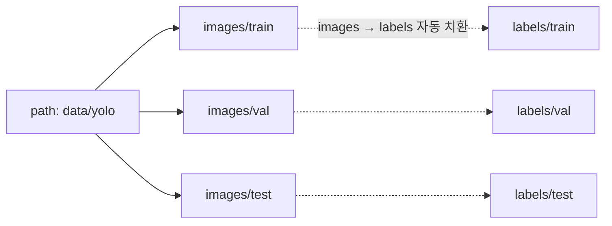

# `configs/dataset.yaml` 코드 리뷰

> 환경 구성 단계 · 산출물 1 · 11.4장

## 1. 한 줄 요약

YOLO에게 "학습 · 검증 · 시험 이미지가 어디 있고, Class 번호가 무슨 뜻인지" 알려 주는 **데이터 안내서**입니다.

## 2. 입력 · 출력 · 실행

| 구분 | 내용 |
|---|---|
| 누가 읽나 | Ultralytics YOLO (10 · 11 · 14 · 15 · 16) · 07 · 10 검사 (Bridge 없음 · Class 7개) |
| 기준 위치 | `path: data/yolo`는 `detection-model/`에서 실행할 때 기준 |
| 가리키는 폴더 | `data/yolo/` (08이 만듦) |
| 이름 기준 | README 4장 Class 표 · 라벨 검수 단계 `configs/classes.yaml` |

## 3. 내용

```yaml
path: data/yolo            # 기준 폴더 (detection-model/ 에서 실행 기준)

train: images/train        # → data/yolo/images/train
val: images/val            # → data/yolo/images/val
test: images/test          # → data/yolo/images/test

names:
  0: leaf_paper
  1: plastic_stone_metal
  2: branch
  3: insect
  4: rubber_glove_unused   # 0건이어도 번호 유지
  5: disease_browning
  6: green_onion_pepper
```

### 흐름 그림



## 4. 핵심 읽기

### 4.1 라벨 폴더는 적지 않는다

YOLO는 `images/train/a.jpg`를 보면 자동으로 `labels/train/a.txt`를 찾습니다. 그래서 images와 labels 폴더 구조가 **똑같아야** 합니다.

### 4.2 Class 번호는 라벨 검수 단계 그대로

Class 4(고무장갑)가 0건이어도 `5 → 4`처럼 당기지 않습니다. 번호를 바꾸면 라벨 검수 단계 라벨 900개의 의미가 전부 틀어집니다.

### 4.3 Bridge Holdout은 넣지 않는다

yaml에 적힌 경로는 YOLO가 언제든 읽을 수 있습니다. Bridge는 후속 프로젝트 전용이라 **목록에서 아예 빼서** 실수로도 쓰이지 않게 합니다. `test`도 적혀 있지만 실제로 여는 곳은 16 하나뿐입니다.
