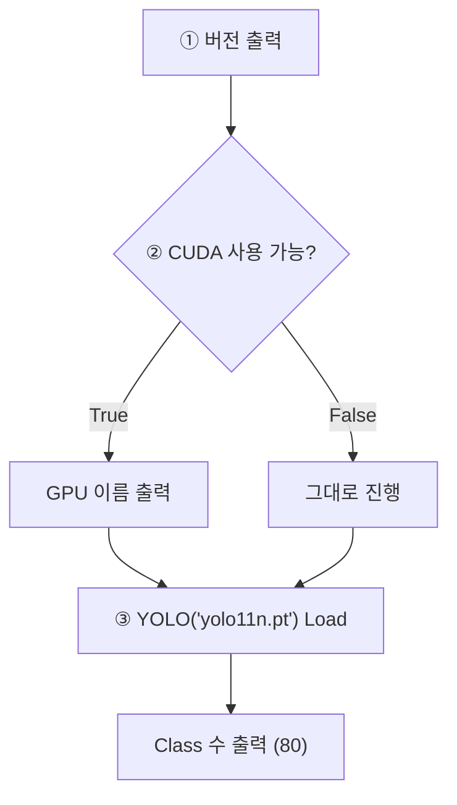

# `scripts/01_check_environment.py` 코드 리뷰

> 환경 구성 단계 · 36줄 · 14.4

## 1. 한 줄 요약

팀원 모두가 **같은 환경**(Python · PyTorch · Ultralytics · GPU)인지, YOLO11n 사전학습 모델이 **정상으로 Load되는지** 확인합니다.

## 2. 입력 · 출력 · 실행

| 구분 | 내용 |
|---|---|
| 입력 | 현재 가상환경 (`detection-model/.venv`) · 버전 기준 `requirements.txt` |
| 출력 | 화면 출력 (버전 · CUDA · GPU · Class 수) · 처음 실행 시 `yolo11n.pt` 자동 다운로드 (Git 제외) |
| 결과 기록 | README 5장 팀원 환경 표 (사람이 옮겨 적음) |

```bash
python scripts/01_check_environment.py   # detection-model 폴더에서
```

## 3. 구조

| 줄 | 내용 |
|--:|---|
| 1~14 | 설명 · `sys.path` 설정 · import |
| 17~33 | `main()`: ① 버전 ② GPU ③ YOLO Load |

### 흐름 그림



## 4. 핵심 코드 읽기

```python
print("CUDA 사용 가능:", torch.cuda.is_available())      # False면 CPU 학습 → 매우 느림
if torch.cuda.is_available():
    print("GPU         :", torch.cuda.get_device_name(0))

model = YOLO("yolo11n.pt")                                  # 없으면 자동 다운로드
print("YOLO Load 성공, Class 수:", len(model.names))        # 80 (COCO)
```

- **버전을 맞추는 이유**: 라이브러리 버전이 다르면 같은 설정이어도 학습 결과가 달라질 수 있어, 팀 공통 Baseline을 비교하려면 출발선이 같아야 합니다.
- **Class가 80개인 이유**: `yolo11n.pt`는 COCO 80종으로 미리 학습된 모델입니다. 우리 7개 Class는 Baseline 학습 단계 Fine-tuning 뒤에 적용되고, 환경 구성 단계는 "불러와지는가"만 봅니다.
