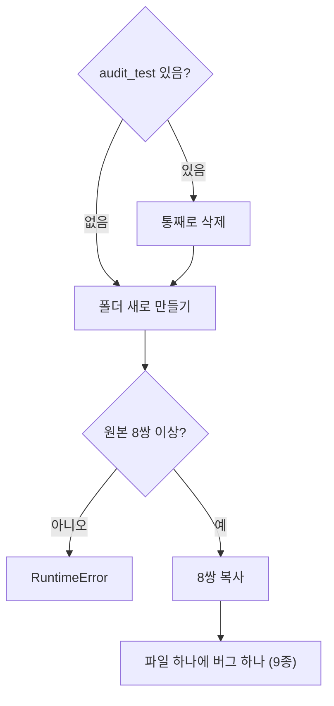

# `scripts/02_make_audit_fixture.py` 코드 리뷰

> 데이터 감사 단계 · 76줄 · 요구사항 예시 2-⑧ "작은 시험: 일부러 오류를 만든 TXT"

## 1. 한 줄 요약

검사기가 **정말 오류를 찾는지** 시험하려고, 원본 8쌍을 복사한 뒤 **버그 9종을 하나씩 심은 테스트 데이터(Fixture)**를 만듭니다. 연기 감지기에 연기를 뿌려 보는 것과 같습니다.

## 2. 입력 · 출력 · 실행

| 구분 | 내용 |
|---|---|
| 입력 | `data/subject7_final/{images,labels}` 앞 8쌍 (읽기만) |
| 출력 | `data/audit_test/{images,labels}` (Git 제외 · 언제든 다시 생성) + 화면에 심은 버그 목록 |
| 다음 실행 | `03_audit_subject7_final.py --fixture` → 9종 각 1건이면 검사기 OK |

```bash
python scripts/02_make_audit_fixture.py
```

## 3. 구조

| 줄 | 내용 |
|--:|---|
| 16~21 | 경로 · `append_line()` (TXT 끝에 한 줄 추가) |
| 29~42 | `main()`: 이전 폴더 삭제 → 앞 8쌍 복사 |
| 47~72 | 버그 9종 심기 → 목록 출력 |

### 흐름 그림



## 4. 핵심 코드 읽기

### 4.1 원본은 건드리지 않고, 매번 같은 8장

```python
stems = sorted(p.stem for p in (SRC / "labels").glob("*.txt"))[:8]
for s in stems:
    shutil.copyfile(SRC / "images" / f"{s}.jpg", DST / "images" / f"{s}.jpg")
    shutil.copyfile(SRC / "labels" / f"{s}.txt", DST / "labels" / f"{s}.txt")
```

- 시작 전에 `audit_test`를 통째로 지워서, 버그가 두 번 심어지지 않게 항상 같은 시작점에서 만듭니다.
- `copyfile`은 **내용만** 복사해서 원본의 읽기 전용 권한이 따라오지 않습니다. 그래서 복사본에는 버그를 쓸 수 있습니다.

### 4.2 파일 하나에 버그 하나

```python
append_line(lbl(0), "9 0.5 0.5 0.1 0.1")      # CLASS_RANGE      (Class 9)
append_line(lbl(1), "0 1.5 0.5 0.1 0.1")      # CENTER_RANGE     (x = 1.5)
append_line(lbl(2), "0 0.5 0.5 0.1")          # COLUMN_COUNT     (4칸)
lbl(3).write_text("", encoding="utf-8")       # EMPTY_LABEL      (내용 삭제)
lbl(4).unlink()                               # MISSING_LABEL    (TXT 삭제)
append_line(lbl(5), "4 0.5 0.5 0.1 0.1")      # CLASS4_REVIEW
append_line(lbl(6), "0 0.98 0.5 0.1 0.1")     # BBOX_OUT_OF_IMAGE (0.98 + 0.05 = 1.03)
append_line(lbl(7), "0 abc 0.5 0.1 0.1")      # PARSE_ERROR
(DST / "labels" / "orphan_000.txt").write_text(...)   # MISSING_IMAGE (짝 없는 TXT)
```

버그를 파일마다 하나씩만 넣어서, Audit 결과의 **어느 파일 · 어느 버그가 잡혔는지 1:1로** 대조할 수 있습니다.
