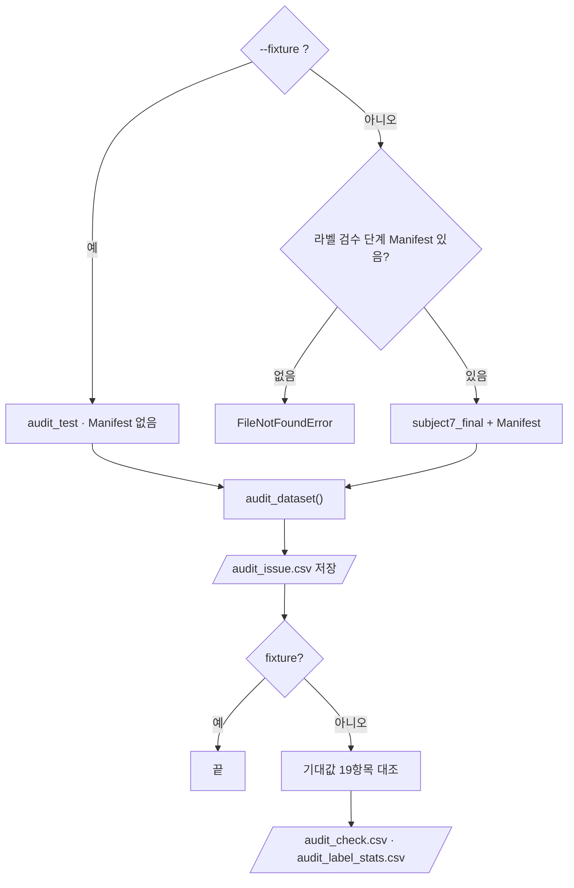

# `scripts/03_audit_subject7_final.py` 코드 리뷰

> 데이터 감사 단계 · 121줄 · 15.6 Daily Gate

## 1. 한 줄 요약

`src/dataset_audit.py`로 검수 완료 데이터셋 900장을 검사하고, **Audit 전에 고정한 기대값 19항목**과 대조해 PASS / FAIL을 남깁니다. `--fixture`면 테스트 데이터로 검사기 자체를 시험합니다.

## 2. 입력 · 출력 · 실행

| 모드 | 입력 | 출력 |
|---|---|---|
| `--fixture` | `data/audit_test/` | `data/audit_test/audit_issue.csv` (Git 제외) |
| 기본 | `data/subject7_final/` + `labeling-qa-tool/manifests/dataset_manifest.csv` + `EXPECTED` | `reports/audit_issue.csv` · `audit_check.csv` · `audit_label_stats.csv` (→ 04 · 05의 입력) |

| 구분 | 내용 |
|---|---|
| 가져다 쓰는 코드 | `src/dataset_audit.py` (`audit_dataset` · `write_csv` · `compare_with_expected`) |
| 기대값 출처 | `reports/audit_expected.md` (v2) |

```bash
python scripts/03_audit_subject7_final.py --fixture   # 검사기 시험 → 9종 각 1건
python scripts/03_audit_subject7_final.py             # 900장 → PASS 19 / FAIL 0
```

## 3. 구조

| 줄 | 내용 |
|--:|---|
| 27~30 | 경로: `FINAL_DIR` · `FIXTURE_DIR` · `MANIFEST` · `REPORT_DIR` |
| 35~57 | `EXPECTED` 기대값 19항목 · CSV 컬럼 |
| 60~117 | `main()`: 모드 선택 → 검사 → 저장 → 대조 |

### 흐름 그림



## 4. 핵심 코드 읽기

### 4.1 기대값 — 결과를 보고 고치지 않는다

```python
EXPECTED_DOC_VERSION = "v2"
EXPECTED = {
    "jpg_count": 900,
    ...
    "bbox_total": 4601,   # v1: 4602
    "class_0": 924,      # v1: 868 (10/08 Class 2→0 수정)
    "class_1": 1897,
    "class_2": 711,      # v1: 767
    ...
    "missing_in_dataset": 0,
}
```

- **v1 (10/12)**: 라벨 검수 단계 문서 숫자를 옮겼더니 **PASS 14 / FAIL 5**. FAIL을 숨기지 않고 추적해 "10/08 라벨 수정이 문서에 반영되지 않았다"는 원인을 찾았습니다.
- **v2 (10/13)**: 팀이 `kimchi_v1`(4,601 · 지문 `5c2b4fc2c3e6`)을 확정한 뒤 **근거 문서 개정 → 코드 반영** 순서로 바꿨습니다 (이유: `audit_expected.md` 9장). 이제 이 값은 "kimchi_v1이 그대로인지" 지키는 회귀 기준입니다.

### 4.2 한 스크립트, 두 모드

```python
if args.fixture:
    data_dir, manifest, out_dir = FIXTURE_DIR, None, FIXTURE_DIR      # Manifest · 기대값 대조 안 함
else:
    data_dir, manifest, out_dir = FINAL_DIR, MANIFEST, REPORT_DIR
```

Fixture 결과는 `data/audit_test/`에 저장해서 실제 결과(`reports/`)를 덮어쓰지 않고 Git에도 올라가지 않습니다.

### 4.3 라벨 검수 단계 Manifest를 복사하지 않고 읽기

```python
MANIFEST = PROJECT_ROOT.parent / "labeling-qa-tool" / "manifests" / "dataset_manifest.csv"
```

레포 루트에서 `labeling-qa-tool/`로 들어가 라벨 검수 단계 결과를 그대로 읽습니다.
