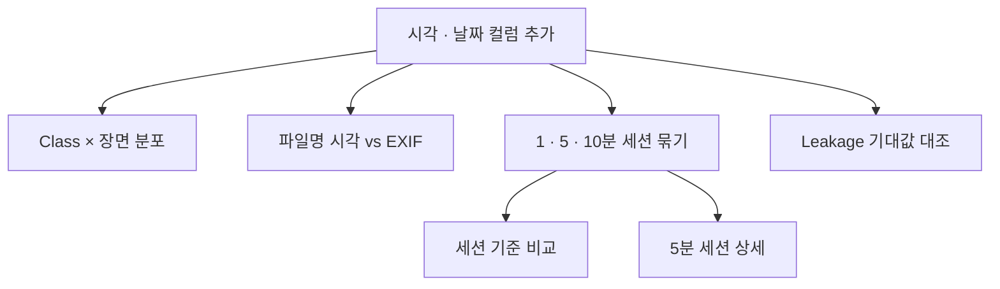

# `scripts/04_split_analysis.py` 코드 리뷰

> 데이터 감사 단계 · 202줄 · 요구사항 §15.2 (분포) · 15.3 (Leakage)

## 1. 한 줄 요약

Split 정책을 정하기 전에 **데이터 지도**를 숫자로 만듭니다. Class가 어디에 몰려 있는지, 파일명이 촬영 시각인지, 세션을 몇 분 기준으로 끊을지, 기존 validation이 train과 얼마나 가까운지 확인합니다.

## 2. 입력 · 출력 · 실행

| 구분 | 내용 |
|---|---|
| 입력 | `reports/audit_label_stats.csv` (03 결과) · `data/subject7_final/images` (EXIF용) |
| 출력 | `reports/` CSV 5개 (`capture_groups.csv`는 05의 입력) + 화면에 Leakage 기대값 대조 |
| 가져다 쓰는 코드 | `src/capture_group.py` |
| 정상 결과 | 세션 18개 · Leakage PASS 4 / FAIL 1 (136 vs 135 경계값) |

```bash
python scripts/04_split_analysis.py            # --gap 10 으로 상세 표 기준 변경 가능
```

## 3. 구조

| 줄 | 이름 | 결과 |
|--:|---|---|
| 54 | `class_scene_distribution()` | `class_scene_distribution.csv` |
| 68~84 | `read_exif_time()` · `filename_time_check()` | `filename_time_check.csv` |
| 103 | `compare_gaps()` | `capture_group_compare.csv` |
| 125 | `group_summary()` | `capture_group_summary.csv` |
| 146 | `main()` | 위 함수들 + `capture_groups.csv` + Leakage 대조 |

### 흐름 그림



## 4. 핵심 코드 읽기

### 4.1 분포 — 집계 여러 개를 한 번에

```python
keys = ["source_dataset", "original_split", "scene_type"]
table = df.groupby(keys).agg(images=("file_name", "count"),
                             bbox=("n_bbox", "sum"),
                             **{c: (c, "sum") for c in CLASS_COLS}).reset_index()
```

`**{...}`로 `class_0=("class_0","sum"), ...`을 반복 없이 씁니다. 이 표에서 "파·고추 · 병해는 김치 장면에만 있다"를 발견했습니다.

### 4.2 EXIF — 실패해도 멈추지 않기

```python
try:
    exif = Image.open(path).getexif()
except OSError:
    return None
raw = exif.get_ifd(0x8769).get(36867) or exif.get(306)   # DateTimeOriginal 또는 DateTime
```

EXIF가 없으면 `None`으로 기록하고 넘어갑니다. 결과는 모두 EXIF 없음 → 연속 사진을 직접 보고 "파일명 = 촬영 순서"로 판단했습니다.

### 4.3 세션 기준 비교 — 1 · 5 · 10분

```python
for gap in GAP_CANDIDATES:                                         # [1, 5, 10]
    df[f"group_{gap}m"] = assign_capture_groups(df["capture_time"], gap)
```

| 기준 | 세션 | 가장 큰 | 1장짜리 | 섞인 세션 |
|---|--:|--:|--:|--:|
| 1분 | 106 | 132 | 29 | 57 |
| **5분** | **18** | 150 | 1 | 17 |
| 10분 | 13 | 150 | 0 | 13 |

### 4.4 Leakage 재확인 — 경계값 1장

```python
gaps = nearest_gap_seconds(val["capture_time"], train["capture_time"])
actual = {"val_within_60s": int((gaps <= LEAK_SECONDS).sum()), ...}
```

라벨 검수 단계 문서는 136장, 이 코드는 135장입니다. 60.28초 떨어진 사진 1장 때문으로, 라벨 검수 단계은 초 단위로 잘랐고 이 코드는 마이크로초까지 계산합니다(**경계값 분석**).
