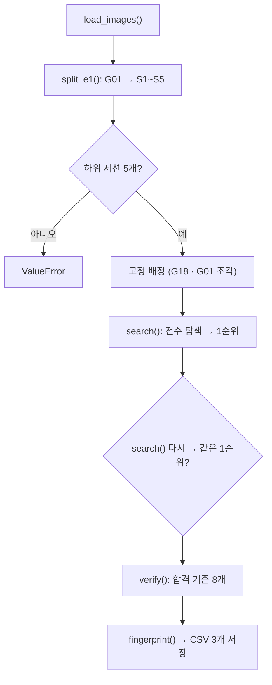

# `scripts/05_make_split.py` 코드 리뷰

> Split 단계 선행 · 266줄 · 요구사항 예시 3 (`split_builder`) · 16.1 · `docs/split_policy.md`

## 1. 한 줄 요약

`docs/split_policy.md`의 규칙대로 900장을 **Train / Val / Frozen Test / Bridge**에 배정합니다. 세션이 18개뿐이라 **가능한 조합을 전부 검사(전수 탐색)**하고, 고른 결과를 **다른 계산 경로로 다시 검증**합니다.

## 2. 입력 · 출력 · 실행

| 구분 | 내용 |
|---|---|
| 입력 | `reports/capture_groups.csv` (04) · `reports/audit_label_stats.csv` (03) · 정책 상수 |
| 출력 | `splits/kimchi_v1_split.csv` · `reports/split_check.csv` · `reports/split_summary.csv` · 화면에 Frozen Test 지문 |
| 가져다 쓰는 코드 | 없음 (pandas · 표준 라이브러리만) → 입력 CSV가 같으면 결과도 같음 |
| 정상 결과 | 600 / 74 / 80 / 146 · 합격 기준 8 / 8 PASS · 지문 `4f9291849fe6` |

```bash
python scripts/05_make_split.py   # 약 10~20초
```

## 3. 구조

| 줄 | 이름 | 역할 |
|--:|---|---|
| 32~46 | 정책 상수 | `TARGET` · `TOL` · `MIN_*` · `E1_*` |
| 52 | `load_images()` | 두 CSV 합치기 · 900행 확인 |
| 65 | `split_e1()` | G01 → 2분 하위 세션 S1~S5 |
| 81 | `subsets_in_range()` | 장수 합이 범위 안인 세션 조합 |
| 92 | `search()` | Test → Val → Bridge → Train 전수 탐색 · 정렬 |
| 148 | `verify()` | 파일 단위 합격 기준 검증 |
| 199 | `fingerprint()` | 파일명 목록 sha256 앞 12자리 |
| 205 | `main()` | 전체 순서 · 저장 · 출력 |

### 흐름 그림



## 4. 핵심 코드 읽기

### 4.1 정책 상수 — 문서와 1:1

```python
TARGET = {"train": 600, "val": 75, "test": 75, "bridge": 150}    # 5장
TOL = 10                                                          # ±10장
MIN_EVAL = 20       # Frozen Test · Bridge  Class별 최소 (7장 4번)
MIN_TRAIN = 100     # Train                 Class별 최소 (7장 7번)
E1_ASSIGN = {1: "test", 2: "test", 3: "bridge", 4: "val", 5: "train"}   # S1~S5 배정
```

규칙을 바꾸려면 **문서부터 고치고 → 이 상수를 고칩니다.** 숫자를 코드 여기저기에 흩어 두지 않았습니다. `split_e1()`은 하위 세션 수가 이 표(5개)와 다르면 조용히 배정하지 않고 멈춥니다.

### 4.2 `search` — 엄격한 것부터 고르는 전수 탐색

```python
for test in subsets_in_range(free, size, *window("test")):          # Test 후보부터
    n_t, c_t, d_t = role_stats("test", test)
    if c_t.min() < MIN_EVAL or len(d_t) < MIN_DATES:                # Class ≥ 20 · 날짜 ≥ 2
        continue
    for val in subsets_in_range(rest1, size, *window("val")):
        ...
        for bridge in subsets_in_range(rest2, size, *window("bridge")):
            ...
            train = [n for n in rest2 if n not in bridge]            # 나머지 = Train
found.sort(key=lambda x: (x["dev"], -x["eval_min"], x["test"], x["val"], x["bridge"]))
```

- **가지치기**: 조건이 가장 엄격한 Test부터 고르고, 실패하면 `continue`로 그 아래를 보지 않습니다.
- **정렬** (정책 8장): 목표와의 차이 → 평가 Class 최소 개수(큰 것) → 이름 순. 무작위가 없어서 항상 같은 결과이고, 5,606개 조합 중 1순위를 씁니다. `search()`를 두 번 돌려 같은 1순위인지 **실제로 확인**합니다.

### 4.3 `verify` — 탐색과 다른 길로 다시 센다

```python
dup = df["file_name"].duplicated().sum()                          # 누락 · 중복
span = df.groupby("group")["role"].nunique()                      # 한 세션이 몇 역할에 걸치나
by_role = df.groupby("role")[CLASS_COLS].sum()                    # Class 최소
```

`search`는 **세션 단위**, `verify`는 **파일 900개 단위**로 셉니다. 탐색 코드에 버그가 있어도 검증에서 잡히도록 계산 경로를 일부러 다르게 했습니다.

### 4.4 `fingerprint` — Frozen Test 봉인 도장

```python
text = "\n".join(sorted(names)).encode("utf-8")
return hashlib.sha256(text).hexdigest()[:12]
```

정렬 후 해시라 순서와 상관없이 **같은 80장이면 같은 지문**입니다.
