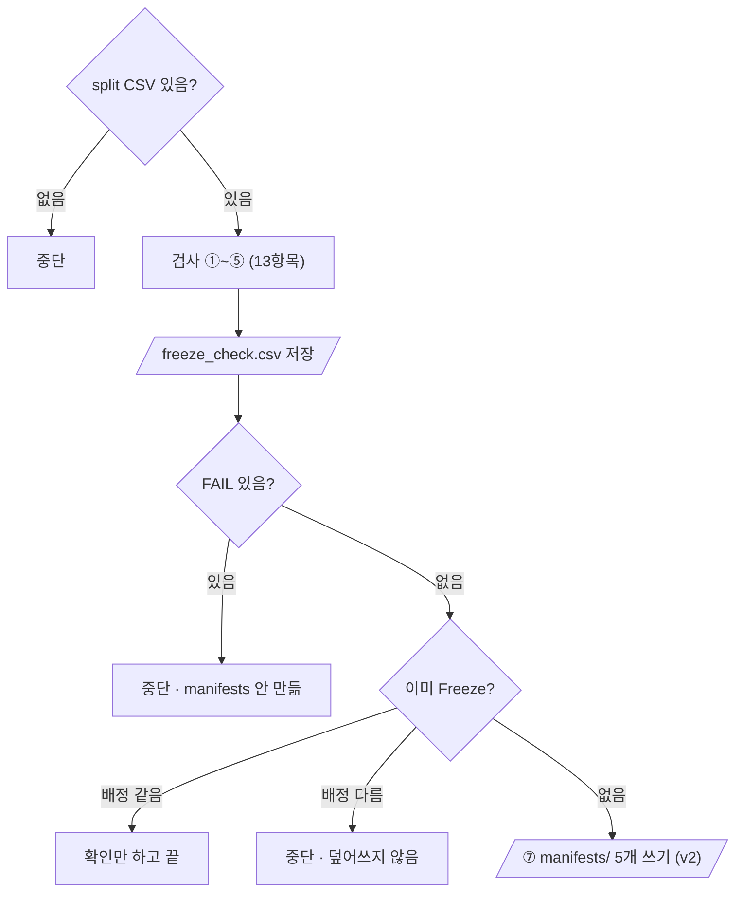

# `scripts/06_freeze_split.py` 코드 리뷰

> Split 단계 · 149줄 · split_policy.md 1 · 8장 · README 9장

## 1. 한 줄 요약

`splits/kimchi_v1_split.csv`(900행)를 **13항목으로 검사**하고, 전부 PASS일 때만 `manifests/`에 확정본(스키마 v2)을 만들어 **얼립니다(Freeze)**. 이미 얼려 둔 것은 다시 쓰지 않습니다.

## 2. 입력 · 출력 · 실행

| 구분 | 내용 |
|---|---|
| 입력 | `splits/kimchi_v1_split.csv` · `data/subject7_final/images` · `labels` · `reports/audit_label_stats.csv` (Freeze 때만) |
| 출력 (항상) | `reports/freeze_check.csv` |
| 출력 (전부 PASS일 때만) | `manifests/split_manifest.csv` (900행 · v2) · `train` · `val` · `test` · `bridge_holdout.csv` |
| 가져다 쓰는 코드 | `src/manifest.py` (`read_manifest` · `assignment` · `build_v2_rows` · `write_manifest_set`) |
| 기준값 출처 | `split_policy.md` 1 · 8장 · README 6.1 |

```bash
python scripts/06_freeze_split.py   # 옵션 없음
```

## 3. 구조

| 줄 | 내용 |
|--:|---|
| 41~45 | 기준값: `LABEL_FP` · `FROZEN_TEST_FP` · `EXPECTED_COUNTS` |
| 49~66 | `fingerprint()` · `label_fingerprint()` · `read_split()` |
| 69~145 | `main()`: 검사 ①~⑤ → 저장 → ⑥ 이미 Freeze? → ⑦ Freeze |

### 흐름 그림



## 4. 핵심 코드 읽기

### 4.1 기준값과 라벨 지문

```python
LABEL_FP = "5c2b4fc2c3e6"           # kimchi_v1 라벨 지문 (README 6.1 명령과 같은 계산)
FROZEN_TEST_FP = "4f9291849fe6"     # Frozen Test 지문 (split_policy.md 8장)
EXPECTED_COUNTS = {"train": 600, "val": 74, "test": 80, "bridge": 146}

def label_fingerprint(label_dir: Path) -> str:
    h = hashlib.sha256()
    for p in sorted(label_dir.glob("*.txt"), key=lambda p: p.name.encode("utf-8")):
        h.update(p.read_bytes())                     # cat 처럼 내용을 순서대로 이어 붙임
    return h.hexdigest()[:12]
```

- 기준값은 실행 결과가 아니라 **문서에서 옮겨 적은 값**입니다.
- `label_fingerprint()`는 `LC_ALL=C cat labels/*.txt | sha256sum`과 같은 값이 나오도록, 이름을 **바이트 순서**로 정렬합니다.

### 4.2 검사 13항목 — 전부 통과해야 Freeze

| 번호 | 내용 |
|:--:|---|
| ① | 칸 이름 · 900행 · 중복 0 · 모르는 역할 0 |
| ② | 역할별 장수 600 / 74 / 80 / 146 |
| ③ | Frozen Test 지문 |
| ④ | 한 세션이 두 역할에 걸친 개수 0 (Leakage 방지) |
| ⑤ | split ↔ 실제 이미지 900장 · 라벨 지문 |

```python
if n_fail:
    sys.exit("\n[중단] FAIL 이 있어 Freeze 하지 않았습니다. manifests/ 는 만들지 않았습니다.")
```

검사 결과는 실패해도 **먼저 저장**하고, `manifests/`는 그 뒤에 만들어서 반쯤 만들어진 확정본이 남지 않습니다.

### 4.3 한 번 얼린 것은 다시 쓰지 않는다

```python
split_rows, _ = read_manifest(SPLIT_CSV)                          # role/bridge → split/bridge_holdout
if full_path.exists():
    frozen, schema = read_manifest(full_path)
    if assignment(frozen) == assignment(split_rows):
        ...                                                        # 확인만 (v1이면 업그레이드 안내)
        return
    sys.exit("\n[중단] 이미 Freeze 된 manifests/ 가 split 과 다릅니다. 팀 확인 전에는 덮어쓰지 않습니다.")
```

- `assignment()`는 `(file_name, capture_group, split)`만 비교해서, manifest가 v1이든 v2든 **배정이 같으면 같은 Freeze**로 봅니다. 그래서 여러 번 실행해도 안전합니다.
- 배정이 다르면 덮어쓰지 않고 멈춥니다. 확정본을 바꾸는 일은 코드가 아니라 팀이 결정합니다.

### 4.4 Freeze — v2 9칸으로 쓰기

```python
write_manifest_set(MANIFEST_DIR, build_v2_rows(split_rows, stats))   # 900행 · split 순서 그대로
```

배정은 그대로 두고 `audit_label_stats.csv`에서 출처 · 장면 정보를 채워 v2 9칸을 만듭니다. 처음 Freeze(10/13)한 `manifests/`는 v1이었고, archive 스크립트로 v2로 올렸습니다(배정 변경 0).
