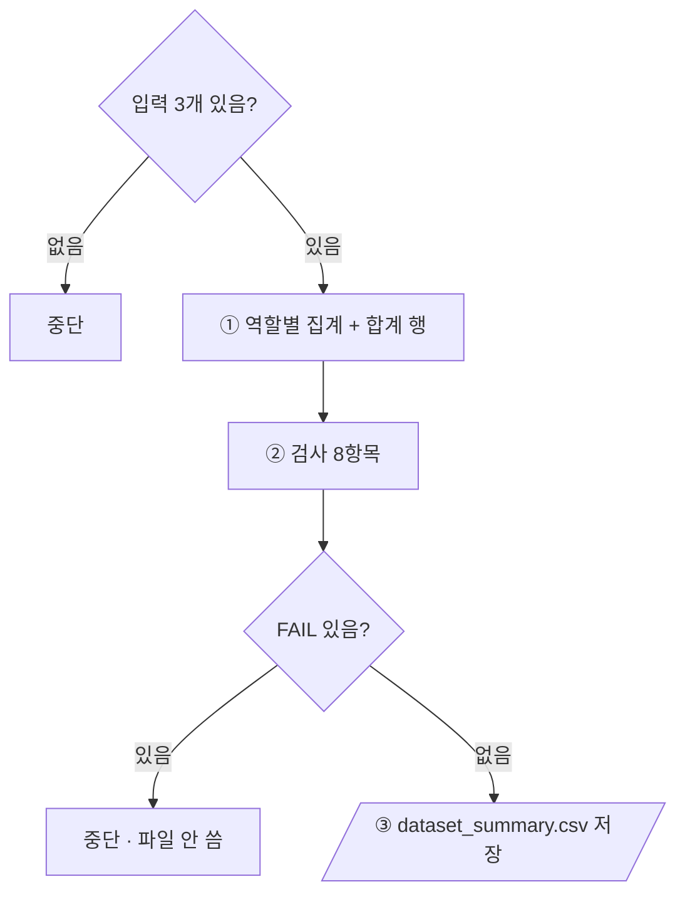

# `scripts/07_dataset_summary.py` 코드 리뷰

> Split 단계 · 128줄 · 16.1 · Daily Gate 산출물 1

## 1. 한 줄 요약

Freeze 된 manifest와 데이터 감사 단계 Audit 결과를 합쳐 **역할 4개 + 합계 1행짜리 Dataset Version 요약표**를 만듭니다. 산출물 1 검사 **8항목이 모두 PASS일 때만** 파일을 씁니다.

## 2. 입력 · 출력 · 실행

| 구분 | 내용 |
|---|---|
| 입력 | `manifests/split_manifest.csv` · `reports/audit_label_stats.csv` · `configs/dataset.yaml` |
| 출력 (전부 PASS일 때만) | `reports/dataset_summary.csv` (역할 4행 + `total`) |
| 가져다 쓰는 코드 | `src/manifest.py` (`read_manifest` · `SPLITS` · `DATASET_VERSION`) |
| 기준값 출처 | `audit_expected.md` v2 (900장 · BBox 4601) |

```bash
python scripts/07_dataset_summary.py   # 옵션 없음
```

## 3. 구조

| 줄 | 내용 |
|--:|---|
| 39~42 | 기준값: `ROLES` · `EXPECTED_TOTAL_IMAGES` · `EXPECTED_TOTAL_BBOX` |
| 45~47 | `read_csv()` |
| 50~124 | `main()`: 입력 확인 → ① 역할별 집계 → ② 검사 8항목 → ③ 저장 |

### 흐름 그림



## 4. 핵심 코드 읽기

### 4.1 역할별 집계

```python
for role in ROLES:
    files = [r for r in manifest if r["split"] == role]
    st = [stats[r["file_name"]] for r in files if r["file_name"] in stats]
    row = {
        "split": role,
        "images": len(files),
        "bbox": sum(int(s["n_bbox"]) for s in st),
        **{c: sum(int(s[c]) for s in st) for c in CLASSES},
        "dates": " ".join(sorted({r["file_name"][:6] for r in files})),   # 파일명 앞 6자리 = 촬영일
        ...
        "in_dataset_yaml": "yes" if role in yaml_roles else "no",
    }
```

`**{...}`로 Class 0~6 합계 7칸을 한 줄에 만듭니다. `in_dataset_yaml`은 Bridge Holdout이 `no`여야 정상입니다.

### 4.2 산출물 1 검사 8항목

| 번호 | 항목 | 기대 |
|:--:|---|---|
| 1 · 2 | 네 역할 합계 · manifest 행 수 | 900 |
| 3 | 통계와 짝이 안 맞는 파일 | 0 |
| 4 | BBox 합계 | 4601 |
| 5 | 두 역할에 걸친 세션 | 0 |
| 6 | Bridge가 dataset.yaml에 포함 | no |
| 7 | manifest 스키마 | v2 |
| 8 | Dataset Version | `kimchi_v1` |

```python
for name, exp, act in checks:
    ok = str(exp) == str(act)
    n_fail += not ok                     # True 는 1 로 더해짐
if n_fail:
    sys.exit(f"\n[중단] FAIL {n_fail}건 → dataset_summary.csv 를 쓰지 않았습니다.")
```

- 06 · 09와 달리 `add()` 대신 (항목, 기대, 실제) 튜플 목록을 돌고, 결과는 화면에만 출력합니다.
- 6번은 실제로 **경로 문자열**에 `bridge`가 있는지로 걸러냅니다 (`yaml_roles`는 train · val · test 키만 모아서 항상 bridge가 없음).
- 7 · 8번 덕분에 v1 manifest로는 요약표가 만들어지지 않습니다.
