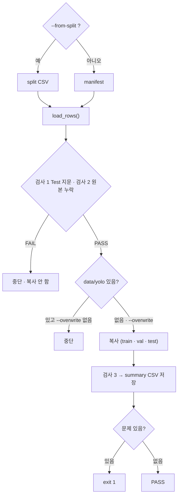

# `scripts/08_build_yolo_dataset.py` 코드 리뷰

> Split 단계 · 182줄 · split_policy.md 8장 · README 9장

## 1. 한 줄 요약

Split 목록대로 원본 이미지 · 라벨을 **`data/yolo/{images,labels}/{train,val,test}/`로 복사**해 YOLO 학습 폴더를 만듭니다. **Bridge Holdout은 넣지 않고**, 지문 · 누락 검사를 통과한 뒤에만 복사합니다.

## 2. 입력 · 출력 · 실행

| 모드 | 입력 | 출력 |
|---|---|---|
| `--from-split` (리허설 · Freeze 전) | `splits/kimchi_v1_split.csv` | `data/yolo/` (Git 제외) · `reports/yolo_build_summary.csv` |
| `--overwrite` (본 실행 · Freeze 후) | `manifests/split_manifest.csv` | 같음 (기존 `data/yolo/`는 지우고 다시 만듦) |

| 구분 | 내용 |
|---|---|
| 공통 입력 | `data/subject7_final/images` · `labels` (읽기만) |
| 가져다 쓰는 코드 | `src/manifest.py` (`read_manifest` · `SPLITS`) |
| 결과 검증 | 같은 폴더를 `09_verify_yolo_dataset.py`가 따로 검사 |

```bash
python scripts/08_build_yolo_dataset.py --from-split    # 리허설
python scripts/08_build_yolo_dataset.py --overwrite     # 본 실행
```

## 3. 구조

| 줄 | 내용 |
|--:|---|
| 43~45 | 기준값: `YOLO_ROLES` · `ALL_ROLES` · `FROZEN_TEST_FP` |
| 48~74 | `fingerprint()` · `load_rows()` · `count_bbox()` |
| 77~178 | `main()`: 입력 → 검사 1 · 2 → 폴더 준비 → 복사 → 검사 3 → 저장 |

### 흐름 그림



## 4. 핵심 코드 읽기

### 4.1 복사 전에 검사 — 하나라도 FAIL이면 복사하지 않는다

```python
test_fp = fingerprint(by_role["test"])
if test_fp != FROZEN_TEST_FP:
    sys.exit(f"[중단] Frozen Test 지문 불일치: {test_fp} (기대 {FROZEN_TEST_FP})")
...
if missing:
    sys.exit(f"[중단] 원본 누락 {len(missing)}건 (예: {missing[:3]})")
```

원본에 파일이 다 있는지 **미리** 확인해서, 복사하다 중간에 멈춘 폴더가 남지 않게 합니다.

### 4.2 Bridge는 아예 넣지 않는다

```python
YOLO_ROLES = ["train", "val", "test"]       # data/yolo 에 넣는 역할 (bridge_holdout 제외)
ALL_ROLES = set(SPLITS)                     # train · val · test · bridge_holdout
```

복사 반복문은 `YOLO_ROLES`만 돕니다. 검출 모델 단계에서 쓰면 안 되는 데이터를 **폴더에 두지 않아서 실수할 길을 막는** 설계이고, 검사 3에서 섞여 들어갔는지 한 번 더 확인합니다.

### 4.3 지우기 전 안전장치

```python
if OUT_DIR.exists() and any(OUT_DIR.iterdir()):
    if not args.overwrite:
        sys.exit(f"[중단] {OUT_DIR.relative_to(PROJECT_ROOT)} 가 이미 있습니다. 다시 만들려면 --overwrite")
    assert OUT_DIR.resolve() == (PROJECT_ROOT / "data" / "yolo").resolve()
    shutil.rmtree(OUT_DIR)
```

`--overwrite` 없이는 덮어쓰지 않고, `rmtree` 직전 `assert`로 지우는 대상이 정확히 `detection-model/data/yolo`인지 확인합니다.

### 4.4 복사 — 원본은 그대로

```python
shutil.copy2(SRC_IMG / name, img_dir / name)                 # copy2: 수정 시각도 보존
shutil.copy2(SRC_LBL / f"{stem}.txt", lbl_dir / f"{stem}.txt")
```

폴더 이름이 `images/<role>` · `labels/<role>`인 이유는 Ultralytics가 경로의 `images`를 `labels`로 바꿔 라벨을 찾기 때문입니다. 복사 후 검사 3(개수 · Bridge 미포함 · Test 지문)은 결과를 **먼저 저장**하고 문제가 있으면 종료 코드 `1`로 알립니다.
