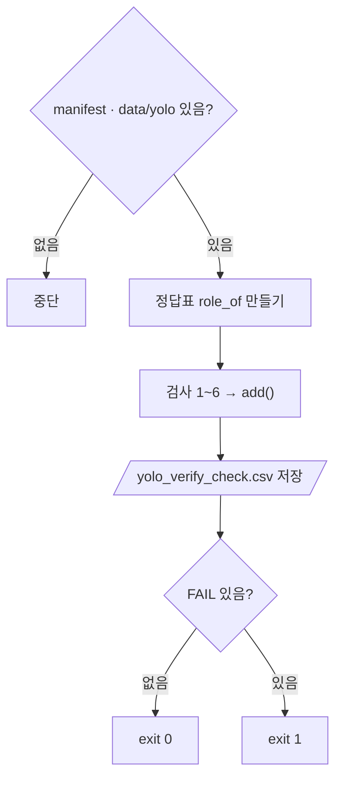

# `scripts/09_verify_yolo_dataset.py` 코드 리뷰

> Split 단계 · 134줄 · manifests/ · split_policy.md 8장 · reports/split_summary.csv

## 1. 한 줄 요약

08이 만든 `data/yolo`가 Freeze 된 `manifests/`와 **정확히 같은지** 19항목으로 확인하고 `reports/yolo_verify_check.csv`에 남깁니다. `data/yolo`는 읽기만 합니다.

## 2. 입력 · 출력 · 실행

| 구분 | 내용 |
|---|---|
| 입력 | `manifests/split_manifest.csv` (정답표) · `data/yolo/` (검사 대상) · `data/subject7_final/labels` (원본 라벨) |
| 출력 | `reports/yolo_verify_check.csv` (no · item · expected · actual · result) |
| 종료 코드 | 모두 PASS → `0` / FAIL 있음 → `1` |
| 가져다 쓰는 코드 | `src/manifest.py`의 `read_manifest()`만 (08 코드는 import 안 함) |

```bash
python scripts/09_verify_yolo_dataset.py   # detection-model 폴더에서 · 옵션 없음
```

## 3. 구조

| 줄 | 내용 |
|--:|---|
| 29~40 | 경로 · 기준값 (`EXPECTED_IMAGES` · `EXPECTED_BBOX` · `FROZEN_TEST_FP`) |
| 43~55 | `fingerprint()` · `file_hash()` · `count_bbox()` |
| 58~130 | `main()`: 전제 조건 → 검사 1~6 → 저장 → 종료 코드 |

### 흐름 그림



## 4. 핵심 코드 읽기

### 4.1 만든 사람과 검사하는 사람을 나눈다

```python
def fingerprint(names) -> str:
    """파일명 목록의 sha256 앞 12자리 (05 · 06 · 08 과 같은 계산)."""
    text = "\n".join(sorted(names)).encode("utf-8")
    return hashlib.sha256(text).hexdigest()[:12]
```

09는 08을 import 하지 않고, 같은 계산도 **다시 적어 둡니다.** 08에 실수가 있어도 검사가 같이 틀리지 않게 하기 위해서입니다.

### 4.2 기준값은 결과를 보고 고치지 않는다

```python
YOLO_ROLES = ["train", "val", "test"]                        # bridge 는 data/yolo 에 없어야 함
EXPECTED_IMAGES = {"train": 600, "val": 74, "test": 80}      # split_policy.md 8장
EXPECTED_BBOX = {"train": 2957, "val": 389, "test": 477}     # reports/split_summary.csv (데이터 감사 단계)
FROZEN_TEST_FP = "4f9291849fe6"                              # split_policy.md 8장
```

`YOLO_ROLES`에 `bridge`가 없는 것 자체가 기준입니다. Bridge는 학습 폴더에 들어가면 안 됩니다.

### 4.3 검사 19항목

```python
def add(no, item, expected, actual):
    checks.append({"no": no, "item": item, "expected": expected, "actual": actual,
                   "result": "PASS" if str(expected) == str(actual) else "FAIL"})
```

| 번호 | 내용 | 개수 |
|:--:|---|:--:|
| 1 | 역할별 이미지 수 · 라벨 수 · 짝 안 맞는 이름 0 | 9 |
| 2 | test 폴더의 Frozen Test 지문 | 1 |
| 3 | Bridge 미포함 · manifest에 없는 이미지 · 엉뚱한 폴더 · 추가 폴더 | 4 |
| 4 | 원본 라벨과 바이트 단위 비교 (`sha256`) | 1 |
| 5 | 역할별 BBox 합계 | 3 |
| 6 | 두 역할에 걸친 촬영 세션 0 | 1 |

### 4.4 짝 맞추기와 폴더 위치

```python
unpaired = {Path(n).stem for n in images[role]} ^ {Path(n).stem for n in labels[role]}
add(3, "wrong_role_folder", 0, sum(p.parent.name != role_of.get(p.name, p.parent.name) for p in all_jpg))
```

- `^`(대칭 차집합) = 이미지에만 · 라벨에만 있는 이름
- `role_of.get(..., p.parent.name)`: manifest에 없는 이미지는 여기서 세지 않음 (`not_in_manifest`가 따로 셈)

### 4.5 항상 저장하고, 결과는 종료 코드로

```python
n_fail = sum(c["result"] == "FAIL" for c in checks)
sys.exit(1 if n_fail else 0)
```

PASS든 FAIL이든 CSV는 항상 저장합니다. 종료 코드 덕분에 학습 · 평가 전에 09를 실행하는 스크립트(10 · 11 · 12 · 14)가 **성공 여부를 바로 판단**할 수 있습니다.
