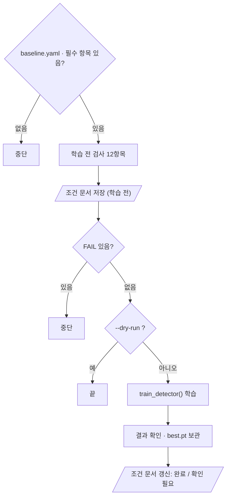

# `scripts/10_train_baseline.py` 코드 리뷰

> Baseline 학습 단계 · 300줄 · 17.6 Daily Gate · 산출물 2

## 1. 한 줄 요약

팀 공통 **Baseline(YOLO11n) 학습**을 실행합니다. 학습 전 검사 12항목을 **모두 통과해야만 시작**하고, 끝나면 결과를 확인해 `best.pt`를 따로 보관하고 실제 학습 조건을 문서로 자동 기록합니다. Frozen Test 평가 코드는 이 파일에 없습니다.

## 2. 입력 · 출력 · 실행

| 구분 | 내용 |
|---|---|
| 입력 | `configs/baseline.yaml` (학습 조건) · `configs/dataset.yaml` · `manifests/` · `data/yolo` · 원본 labels (지문용) |
| 출력 (항상) | `reports/baseline_training_condition.md` |
| 출력 (학습 후) | `runs/baseline_v1/` · `models/baseline/baseline_best.pt` (둘 다 Git 제외) · `reports/baseline_results.csv` |
| 가져다 쓰는 코드 | `src/train_detector.py` (`train_detector` · `TRAIN_KEYS`) · `src/manifest.py` · `09` (별도 프로세스로 실행) |
| 결과를 읽는 곳 | 11이 조건 문서의 **상태 · 가중치 sha**를 읽음 → 문서 문구를 바꾸면 11도 같이 고쳐야 함 |

```bash
python scripts/10_train_baseline.py --dry-run   # 학습 전 검사만 (몇 초)
python scripts/10_train_baseline.py             # 검사 → 학습 → 기록 (약 40분)
```

## 3. 구조

| 줄 | 내용 |
|--:|---|
| 47~59 | 경로 · 기준값 (`REQUIRED_KEYS` · `FROZEN_TEST_FP`) |
| 62~101 | 보조 함수 · `environment()` (버전 · GPU 기록) |
| 104~152 | `pre_checks()`: 학습 전 검사 ①~⑤ |
| 155~168 | `check_results()`: results.csv 확인 |
| 171~225 | `write_condition_md()`: 조건 문서 작성 |
| 228~296 | `main()` |

### 흐름 그림



## 4. 핵심 코드 읽기

### 4.1 학습 숫자는 `baseline.yaml`에서만

```python
REQUIRED_KEYS = ["name", "dataset_version", "label_fingerprint", "ultralytics_version", "model", *TRAIN_KEYS]
cfg = yaml.safe_load(BASELINE_YAML.read_text(encoding="utf-8"))
missing = [k for k in REQUIRED_KEYS if k not in cfg]
if missing:
    sys.exit(f"[중단] configs/baseline.yaml 에 없는 항목: {missing}")
```

- epochs · batch · imgsz 같은 숫자를 코드에 적지 않고 **팀이 확정한 yaml만** 따릅니다.
- optimizer · lr0 · momentum을 `auto`에 맡기지 않고 값으로 고정한 이유: Smoke Test에서 `auto`가 `lr0`를 무시하고 AdamW를 자동으로 골랐고, epoch 수가 바뀌면 선택도 바뀌기 때문입니다 (`smoke_test.md` 4장).

### 4.2 학습 전 검사 12항목

| 번호 | 내용 | 개수 |
|:--:|---|:--:|
| ① | Ultralytics 버전 = 팀 고정 · CUDA 사용 가능 | 2 |
| ② | Class 7개 · Bridge 없음 · manifest v2 · `kimchi_v1` · 라벨 지문 | 5 |
| ③ | 09 실행 → 종료 코드 0 | 1 |
| ④ | 시작 가중치 있음 · 이전 결과 덮어쓰지 않음 | 3 |
| ⑤ | `configs` · `src` · `scripts` · `manifests` 커밋됨 | 1 |

```python
r = subprocess.run([sys.executable, str(VERIFY_SCRIPT)], cwd=PROJECT_ROOT, capture_output=True, text=True)
add("09 data/yolo 검증", "종료 코드 0", f"종료 코드 {r.returncode} · {last}", ok=(r.returncode == 0))
```

- ③은 같은 검사를 다시 짜지 않고 **09를 그대로 실행해 종료 코드만** 봅니다.
- `add()`의 `ok=`는 "같은가"로 판단할 수 없는 항목(종료 코드 등)을 직접 PASS/FAIL로 넣는 용도입니다.
- ⑤는 조건 문서의 커밋 번호로 같은 코드를 다시 찾을 수 있게 하는 **재현성** 검사입니다. `--dry-run`에서는 경고(WARN)만 냅니다.

### 4.3 학습과 결과 확인

```python
save_dir = train_detector(str(PROJECT_ROOT / cfg["model"]), str(DATASET_YAML), cfg, RUNS_DIR, cfg["name"])
res = check_results(results_csv, cfg["epochs"])
if res["nan_or_inf"]:
    problems.append(f"loss 에 NaN/inf {res['nan_or_inf']}개")
```

- 결과 폴더 이름이 설정과 다르면(Ultralytics가 `baseline_v12`처럼 번호를 붙인 경우) 문제로 칩니다.
- loss 칸의 NaN · inf와 완료 epoch 수를 확인합니다. 성능 해석은 Baseline 평가 단계(11)의 일입니다.

### 4.4 문제가 있으면 "완료"라고 쓰지 않는다

```python
shutil.copy2(best, MODEL_OUT)                                   # 산출물 2: best.pt 별도 보관
write_condition_md(cfg, env, checks, info, "완료" if not problems else "확인 필요", run)
```

조건 문서 상태가 `완료`여야 11이 평가를 시작합니다. 학습이 끝났어도 문제가 있으면 `확인 필요`로 쓰고 종료 코드 `1`로 끝납니다.
