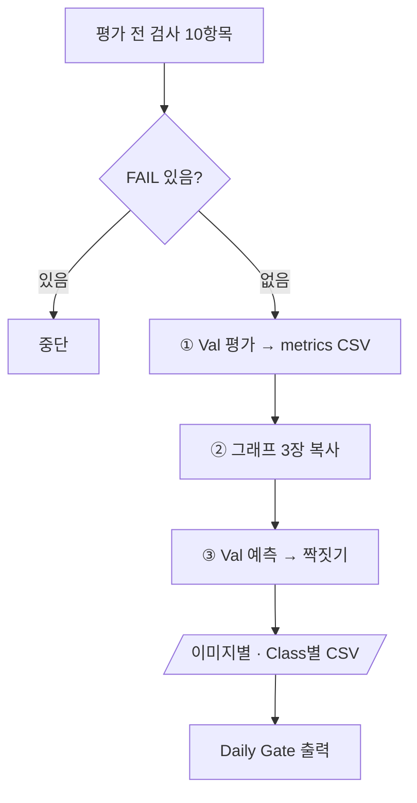

# `scripts/11_evaluate_baseline.py` 코드 리뷰

> Baseline 평가 단계 · 328줄 · 18.5 Daily Gate · 산출물 2 · 5

## 1. 한 줄 요약

Baseline을 **Validation에서만 평가**해 전체 · Class별 지표를 남기고, Val 이미지를 예측해 **이미지별 · Class별 TP · FP · FN**을 만듭니다. 이 결과가 Failure Analysis와 개선 실험 단계 비교의 기준이 됩니다.

## 2. 입력 · 출력 · 실행

| 구분 | 내용 |
|---|---|
| 입력 | `models/baseline/baseline_best.pt` · `reports/baseline_training_condition.md` (상태 · sha) · `configs/` · `manifests/val.csv` · `data/yolo/*/val` |
| 출력 (Git) | `reports/baseline_metrics.csv` · `reports/figures/baseline_*.png` 3장 · `baseline_val_image_check.csv` · `baseline_class_check.csv` |
| 출력 (Git 제외) | `runs/baseline_v1_val/` · `runs/predict/baseline_val_images/` |
| 가져다 쓰는 코드 | `src/evaluate_detector.py` (`evaluate_detector` · `predict_images` · `match_boxes`) · `src/manifest.py` · `09` (별도 프로세스) |

```bash
python scripts/11_evaluate_baseline.py              # --conf 0.25 (기본값) · 예측 · FP/FN 집계용
```

요구사항 문서의 `07_evaluate_baseline.py` + `08_predict_images.py`를 하나로 묶었습니다.

## 3. 구조

| 줄 | 내용 |
|--:|---|
| 62~67 | 기준값: `SPLIT = "val"` · `IOU_MATCH` · `SMALL_PX` · `UNUSED_CLASSES` |
| 70~120 | `condition_info()` · `pre_checks()`: 평가 전 검사 10항목 |
| 123~166 | `write_metrics()` · `copy_figures()` |
| 169~242 | `read_gt()` · `is_small()` · `image_check()` · `write_class_check()` |
| 245~319 | `main()` |

### 흐름 그림



## 4. 핵심 코드 읽기

### 4.1 Baseline 학습 단계가 "완료"되어야 평가한다

```python
state = re.search(r"\*\*상태\*\*: ([^·\n]+)", text)
sha = re.search(r"baseline_best\.pt` · sha `([0-9a-f]{12})`", text)
...
add("학습 상태 (condition md)", "완료", info["state"])
add("Weight sha = Baseline 학습 단계 기록", info["sha"], sha12(BEST_PT) if BEST_PT.exists() else "-")
```

10이 쓴 조건 문서에서 **상태와 가중치 sha**를 읽어, 학습 직후 기록과 지금 파일이 같은지 확인합니다. 나머지 검사는 버전 · 학습곡선 · Bridge 없음 · split=val · manifest v2 · `kimchi_v1` · 09 종료 코드 0입니다.

### 4.2 Val만 평가한다 — 막는 곳이 두 겹

```python
SPLIT = "val"                     # 이 스크립트는 val 만 평가한다
metrics, val_dir = evaluate_detector(str(BEST_PT), str(DATASET_YAML), SPLIT, imgsz, batch, RUNS_DIR, VAL_RUN_NAME)
```

`evaluate_detector()`도 `val` 밖의 split을 거부하고, `test`는 `allow_test=True`를 명시해야만 열립니다. 11은 이 값을 넘기지 않으므로 Frozen Test를 평가할 수 없습니다. 개선 실험 단계도 같은 함수를 써서 두 모델의 차이는 가중치 하나뿐입니다.

### 4.3 Val에 없는 Class는 비우고 이유를 적는다

```python
if cid in index:
    cp, cr, c50, c = metrics.class_result(index[cid])
    row.update(precision=cp, recall=cr, map50=c50, map50_95=c, note="")
else:
    row.update(precision="", recall="", map50="", map50_95="",
               note=UNUSED_CLASSES.get(cid, "Val 에 Instance 0 → 해석 불가"))
```

"쓰지 않는 Class(4)"와 "Val에 없는 Class"가 빈 칸이어도 `note`로 구분됩니다.

### 4.4 이미지별 TP · FP · FN — 지표와 다른 문턱

```python
for name, size, preds in predict_images(str(best_pt), VAL_IMAGES, conf, imgsz, RUNS_DIR / "predict", run_name):
    gts = read_gt(Path(name).stem)
    m = match_boxes(gts, preds, IOU_MATCH)
```

- `image_check()`는 가중치 · 결과 이름을 인자로 받아서 15 · 16이 같은 함수를 다른 모델에 그대로 씁니다.
- `match_boxes()`: 점수 높은 예측부터 같은 Class 정답과 IoU ≥ 0.5로 짝짓기 → 짝 = TP, 남은 예측 = FP, 남은 정답 = FN
- 이 표는 현장 문턱 **conf 0.25**, 4.3의 지표는 Ultralytics 기본 **conf 0.001**입니다. 그래서 두 파일의 P · R이 다른 것이 정상입니다 (예: Recall 0.591 vs 0.595).
- 결과는 FP+FN이 많은 이미지부터 정렬해 실패 분석에 넘깁니다.

### 4.5 작은 객체 — 모델이 보는 크기로 판단

```python
def is_small(box, size) -> bool:
    w_img, h_img = size
    scale = 640 / max(w_img, h_img)
    return (box[3] * w_img * scale) * (box[4] * h_img * scale) < SMALL_PX * SMALL_PX
```

4K 원본을 긴 변 640으로 줄였을 때 32×32px 미만이면 작은 객체입니다(COCO small 기준). 실패 분석 단계 가설 H1의 근거가 된 숫자입니다.

### 4.6 그래프만 복사, 사람이 볼 칸은 남긴다

`reports/figures/`에는 그래프 3장만 복사하고, 회사 이미지가 들어간 예측 그림은 `runs/`에만 둡니다(NDA). Daily Gate의 "실제 Val Prediction 이미지 확인"은 사람이 직접 보고 체크해야 해서 항상 ☐로 출력합니다.
