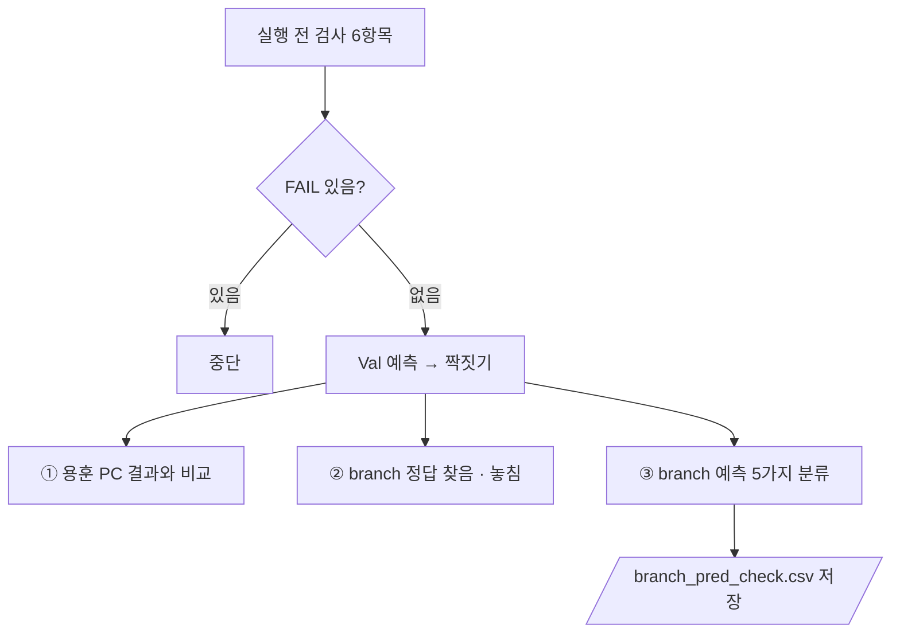

# `scripts/12_branch_fp_check.py` 코드 리뷰

> 실패 분석 단계 준비 · 275줄 · 요구사항 §19 (Failure Analysis) · 가설 H3 (branch 오검출)

## 1. 한 줄 요약

Baseline이 Val에서 **branch(Class 2)라고 친 박스를 하나씩 정답과 대조**해 5가지로 나누고, 사람이 확인할 칸을 붙여 저장합니다. Baseline 평가 단계 11과 같은 조건으로 예측해서, 내 PC 결과가 용훈 PC 결과와 같은지도 확인합니다.

## 2. 입력 · 출력 · 실행

| 구분 | 내용 |
|---|---|
| 입력 | `models/baseline/baseline_best.pt` · 조건 문서 (sha) · `manifests/val.csv` · `data/yolo/*/val` · `reports/baseline_val_image_check.csv` (11 결과 · 비교용) |
| 출력 | `reports/branch_pred_check.csv` (branch 예측 1개 = 1행) · `runs/predict/branch_check/` (Git 제외 · NDA) |
| 가져다 쓰는 코드 | `src/evaluate_detector.py` (`predict_images` · `match_boxes` · `iou_xywh`) · `09` (별도 프로세스) |

```bash
python scripts/12_branch_fp_check.py   # --conf 0.25 (11과 같아야 비교가 맞음)
```

> **다시 돌리면 덮어씁니다.** 사람 확인(`human_check` · `memo`)을 채운 뒤에는 실행하지 않습니다.

## 3. 구조

| 줄 | 내용 |
|--:|---|
| 59~64 | 기준값: `BRANCH` · `IOU_MATCH`(0.5) · `IOU_NEAR`(0.1) · `N_VAL` |
| 83~110 | `pre_checks()`: 실행 전 검사 6항목 |
| 123~138 | `match_detail()`: 예측마다 짝지어진 정답 번호 |
| 141~158 | `classify()`: branch 예측 → 5가지 분류 |
| 161~271 | `main()` |

### 흐름 그림



## 4. 핵심 코드 읽기

### 4.1 분류 5가지

| 분류 | branch 박스를 친 곳 | 사람 확인 |
|---|---|:--:|
| `TP` | branch 정답과 IoU ≥ 0.5로 짝 | 불필요 |
| `중복` | 이미 다른 예측이 잡은 branch 정답 위 | 불필요 |
| `다른 이물 위` | 다른 Class 정답과 IoU ≥ 0.5 → Class 혼동 | 선택 |
| `위치 어긋남` | 어떤 정답과 0.1 ≤ IoU < 0.5 | 필요 |
| `정답 없는 자리` | 모든 정답과 IoU < 0.1 → 라벨 누락? 김치 착각? | 필요 (핵심) |

```python
def classify(j, preds, gts, matched) -> tuple[str, float, str, str]:
    if matched[j] is not None:
        return "TP", 1.0, "branch", "-"                 # TP 의 best_iou 는 고정값 1.0
    ious = [iou_xywh(g[1:], p[2:]) for g in gts]        # Class 상관없이 모든 정답과 비교
    i = max(range(len(gts)), key=lambda k: ious[k])
    if ious[i] >= IOU_MATCH:
        kind = "중복" if g_cls == BRANCH else "다른 이물 위"
    elif ious[i] >= IOU_NEAR:
        kind = "위치 어긋남"
    else:
        return "정답 없는 자리", ious[i], "-", "-"
```

### 4.2 짝짓기 — `match_boxes`와 같은 규칙, 결과가 같은지 매번 확인

```python
matched = match_detail(gts, preds, IOU_MATCH)
assert sum(x is not None for x in matched) == m["tp"]
```

`match_boxes()`는 개수만 돌려줘서, "이 예측은 몇 번째 정답과 짝인가"를 알려고 같은 규칙(점수 높은 순 · 같은 Class · 정답 한 번만)을 `match_detail()`로 따로 구현했습니다. 두 구현이 어긋나지 않도록 TP 개수를 `assert`로 비교합니다.

### 4.3 용훈 PC 결과와 같은가

```python
mine = (len(preds), m["tp"], m["fp"], m["fn"])
if r0 is None or mine != (int(r0["pred"]), int(r0["tp"]), int(r0["fp"]), int(r0["fn"])):
    diff.append(...)
```

이미지마다 Baseline 평가 단계 기록과 비교합니다. `다름 0`이어야 이 PC의 분류 결과를 믿고 사람 확인을 시작합니다. 검사 3번(가중치 sha = Baseline 학습 단계 기록)도 같은 목적입니다.

### 4.4 저장 — 사람이 볼 것부터 위로

```python
order = {"정답 없는 자리": 0, "위치 어긋남": 1, "다른 이물 위": 2, "중복": 3, "TP": 4}
rows.sort(key=lambda r: (order[r["kind"]], -float(r["conf"])))
```

- 좌표는 원본 사진 픽셀(`x1 · y1 · x2 · y2`)로 바꿔서 라벨링 프로그램에서 그 위치를 바로 찾을 수 있게 합니다.
- `human_check` · `memo`는 빈 칸으로 저장하고, 사람이 채웁니다.
- 결과 확인: branch 예측 38개 = TP 8 + 나머지 30으로, 11의 `baseline_class_check.csv` branch 행(`tp 8 · fp 30`)과 같습니다.
