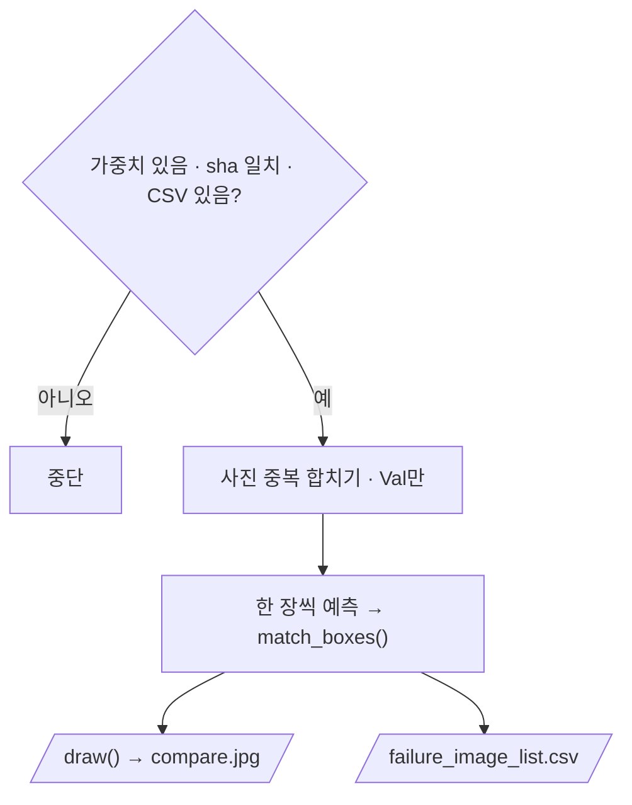

# `scripts/13_failure_images.py` 코드 리뷰

> 실패 분석 단계 · 184줄 · 요구사항 §19.A · §19.6 (대표 실패 사례 GT vs Prediction 비교 이미지)

## 1. 한 줄 요약

`reports/failure_analysis.csv`에 적힌 Val 사진마다 **정답(초록 · 놓친 정답은 노랑)과 예측(빨강)을 한 장에 겹쳐** 그리고, 그린 사진 목록을 숫자로 남깁니다.

## 2. 입력 · 출력 · 실행

| 구분 | 내용 |
|---|---|
| 입력 | `reports/failure_analysis.csv` · `models/baseline/baseline_best.pt` · 조건 문서 (sha) · `manifests/val.csv` · `data/yolo/*/val` |
| 출력 | `reports/failure_image_list.csv` (Git · 숫자만) · `demo/failure_analysis/*_compare.jpg` (Git 제외 · NDA) |
| 가져다 쓰는 코드 | `src/evaluate_detector.py` (`match_boxes`) · `src/manifest.py` |
| 기준 | 11과 같은 conf 0.25 · imgsz 640 · IoU 0.5 → 그림의 TP / FP / FN이 11 결과와 같아야 정상 |

```bash
python scripts/13_failure_images.py            # 전부 (중복 제거)
python scripts/13_failure_images.py --max 10   # 앞에서부터 10장만
```

| 색 | 의미 |
|---|---|
| 초록 굵은 선 · 박스 위 `GT` | 맞힌 정답 |
| 노랑 굵은 선 · 박스 위 `MISSED` | 놓친 정답 (FN) |
| 빨강 선 · 박스 아래 확신도 | 모델 예측 |

## 3. 구조

| 줄 | 내용 |
|--:|---|
| 42~55 | 경로 · `CONF` · `IMGSZ` · `IOU` · 색 · `SAVE_LONG_SIDE` |
| 79~91 | `read_gt()` · `to_px()` (0~1 좌표 → 픽셀) |
| 94~118 | `draw()`: 박스 + 맨 위 띠 + 긴 변 1920으로 축소 |
| 121~180 | `main()`: 검사 → 사진 목록 정리 → 예측 · 짝짓기 · 그림 → CSV |

### 흐름 그림



## 4. 핵심 코드 읽기

### 4.1 가중치가 "그 Baseline"인지 sha로 확인

```python
m = re.search(r"baseline_best\.pt` · sha `([0-9a-f]{12})`", text)
if not m or sha12(BEST_PT) != m.group(1):
    sys.exit("[중단] baseline_best.pt sha 가 Baseline 학습 단계 기록과 다릅니다 (다른 가중치)")
```

파일 이름이 같아도 내용이 바뀌었으면 멈춥니다. 평가와 **같은 모델로 그린다**는 보장입니다.

### 4.2 같은 사진은 한 장으로, Val만

```python
if name not in types:
    order.append(name)
    types[name] = []
if r["failure_type"] not in types[name]:
    types[name].append(r["failure_type"])
...
order = [n for n in order if n in val_names]
```

한 사진에 실패 유형이 여러 개면 합쳐서 한 장만 그립니다(예: `FN + Class`). Val에 없는 사진은 건너뜁니다.

### 4.3 겹쳐도 둘 다 보이게

```python
pad = lw * 2                 # 정답 박스를 바깥으로 조금 키움
d.rectangle([x1 - pad, y1 - pad, x2 + pad, y2 + pad], outline=color, width=lw + 2)
```

정답은 조금 크고 굵게, 예측은 원래 크기로 그려서 딱 맞힌 경우에도 초록 안에 빨강이 보입니다. 글자도 정답은 위, 예측은 아래라 겹치지 않습니다.

> **개선 여지**: 그릴 사진이 0장이면 CSV 저장에서 `IndexError`가 납니다. `if not out_rows: sys.exit(...)` 한 줄이면 안내로 끝낼 수 있습니다.
