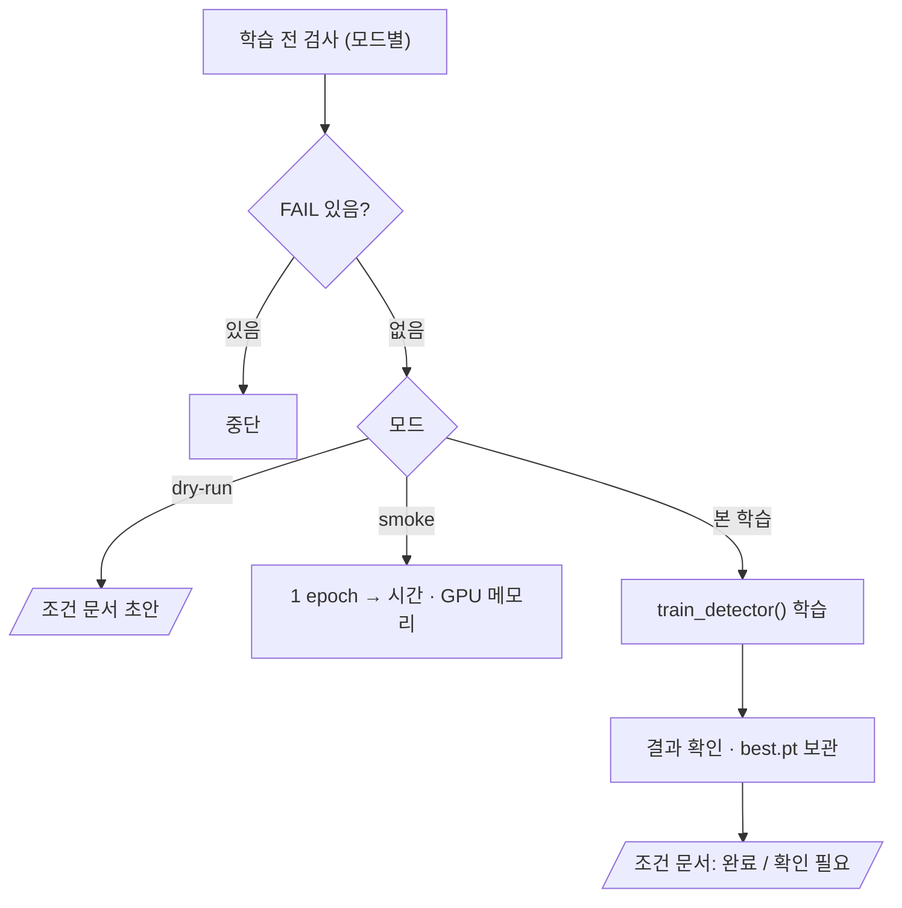

# `scripts/14_train_experiment.py` 코드 리뷰

> 개선 실험 단계 · 245줄 · 요구사항 §20 (§20.3 계획 확정 · 한 변수 원칙) · 산출물 4 (Improved Weight)

## 1. 한 줄 요약

실험 설정이 Baseline과 **학습 설정 정확히 하나만 다른지**, 계획 문서가 **학습 전에 확정**됐는지 검사한 뒤 10과 같은 함수로 학습합니다. `--smoke`(1 epoch 시험) · `--dry-run`(검사만) · 본 학습 세 모드가 있습니다.

## 2. 입력 · 출력 · 실행

| 구분 | 내용 |
|---|---|
| 입력 | `configs/exp001.yaml` · `configs/baseline.yaml` · `reports/improvement_experiment.md` (본 학습만) · `data/yolo` 등 10과 같음 |
| 출력 (Git) | `reports/exp001_training_condition.md` · `reports/exp001_results.csv` |
| 출력 (Git 제외) | `runs/exp001/` · `models/improved/exp001_best.pt` (산출물 4) · `runs/exp001_smoke/` |
| 가져다 쓰는 코드 | `10_train_baseline.py`를 모듈로 (지문 · git · 환경 · 결과 확인 · sha) · `src/train_detector.py` · `09` |
| 결과를 읽는 곳 | 15 · 16이 조건 문서의 `best_sha`로 같은 가중치인지 확인 |

| 모드 | 검사 | 학습 | 남는 것 |
|---|---|---|---|
| `--smoke` | 계획 문서 · 덮어쓰기 제외 · 미커밋 WARN | 1 epoch | 화면 출력만 |
| `--dry-run` | 전부 · 미커밋 WARN | 안 함 | 조건 문서 초안 |
| 본 학습 | 전부 · 미커밋 FAIL | 전부 | best.pt · results.csv · 조건 문서 |

```bash
python scripts/14_train_experiment.py --config configs/exp001.yaml --smoke
python scripts/14_train_experiment.py --config configs/exp001.yaml --dry-run
python scripts/14_train_experiment.py --config configs/exp001.yaml
```

## 3. 구조

| 줄 | 내용 |
|--:|---|
| 43~46 | 10을 모듈 `t10`로 불러옴 |
| 58~61 | `changed_keys()`: Baseline과 다른 학습 설정 |
| 64~106 | `pre_checks()`: 환경 · 데이터 · 한 변수 · 계획 문서 · 덮어쓰기 · 커밋 |
| 109~144 | `write_condition_md()` · `gpu_peak_gb()` |
| 147~241 | `main()`: 모드 분기 → smoke / 본 학습 → 보관 · 기록 |

### 흐름 그림



## 4. 핵심 코드 읽기

### 4.1 10의 도우미를 그대로 가져오기

```python
_spec = importlib.util.spec_from_file_location("train10", PROJECT_ROOT / "scripts" / "10_train_baseline.py")
t10 = importlib.util.module_from_spec(_spec)
_spec.loader.exec_module(t10)
```

파일 이름이 숫자로 시작해 `import`가 안 되므로 `importlib`로 불러옵니다. Baseline과 **같은 계산**을 쓰고 코드 중복이 없습니다. 10의 `main()`은 `__main__` 안에 있어서 불러와도 학습이 돌지 않습니다.

### 4.2 한 변수 원칙 — 다른 설정이 정확히 1개

```python
def changed_keys(base: dict, exp: dict) -> list[tuple]:
    keys = [*TRAIN_KEYS, "model"]
    return [(k, base.get(k), exp.get(k)) for k in keys if base.get(k) != exp.get(k)]
```

Ultralytics에 실제로 넘기는 키만 비교합니다(`name` · `reason`은 달라도 됨). 0개도 2개 이상도 FAIL이라, 결과 차이를 **그 변수 하나 때문**이라고 말할 수 있습니다.

### 4.3 계획 문서가 학습 전에 확정됐는지

```python
ok = ("**상태: 확정**" in plan) and (f"`{key}`" in plan) and (str(new) in plan)
```

문서에 `상태: 확정` + 바꿀 변수 이름 + 새 값이 모두 있어야 본 학습이 시작됩니다. Smoke는 확정 전에 메모리를 보는 단계라 이 검사를 건너뜁니다.

### 4.4 Smoke — 본 학습 기록은 건드리지 않는다

```python
s_cfg = {**cfg, "epochs": 1, "patience": 1}
try:
    train_detector(str(PROJECT_ROOT / cfg["model"]), str(DATASET_YAML), s_cfg, RUNS_DIR, name)
except RuntimeError as e:
    if "out of memory" in str(e).lower():
        sys.exit(f"\n[OOM] GPU 메모리 부족 ...")
```

`runs/exp001_smoke`에만 학습해서 최대 GPU 메모리를 봅니다. 결과 9.97GB < 11GB → imgsz 1280을 확정했습니다.

> **개선 여지**: 이전 smoke 폴더를 지우기 전 안전장치가 `assert`인데, `python -O`로 실행하면 꺼집니다. `if ...: sys.exit(...)`가 더 확실합니다.
