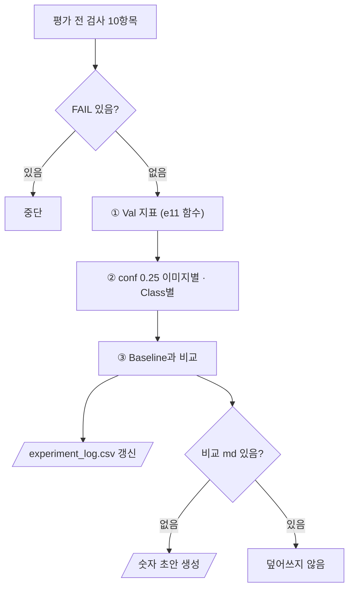

# `scripts/15_evaluate_experiment.py` 코드 리뷰

> 개선 실험 단계 · 252줄 · 20.6 · 20.7 Daily Gate · 산출물 5 (실험 기록 · Baseline vs Improved)

## 1. 한 줄 요약

14에서 학습한 개선 모델을 **Baseline을 채점한 11의 함수 그대로** 같은 Val 74장에서 평가하고, Baseline과 나란히 비교해 실험 로그를 갱신합니다. 바뀌는 것은 가중치와 그 모델의 `imgsz`뿐이고, Test는 쓰지 않습니다.

## 2. 입력 · 출력 · 실행

| 구분 | 내용 |
|---|---|
| 입력 | `configs/exp001.yaml` · `configs/baseline.yaml` · `models/improved/exp001_best.pt` · `reports/exp001_training_condition.md` |
| 비교 기준 | `reports/baseline_*.csv` 3개 (11) · `reports/failure_analysis.csv` (실패 분석 단계 대표 사진) |
| 출력 (Git) | `reports/exp001_metrics.csv` · `exp001_class_check.csv` · `exp001_val_image_check.csv` · `figures/exp001_*.png` · `experiment_log.csv` · `baseline_vs_improved.md` (없을 때만 초안) |
| 가져다 쓰는 코드 | `11_evaluate_baseline.py`를 모듈로 (채점 함수) · `src/evaluate_detector.py` · `src/train_detector.py` (`TRAIN_KEYS`) · `09` |

```bash
python scripts/15_evaluate_experiment.py --config configs/exp001.yaml     # 14 학습 "완료" 뒤
```

결과 (Val 74장): mAP50 0.622 → **0.756** · Recall(conf 0.25) 0.591 → **0.846** · FN 159 → 60 · FP 92 → 41

## 3. 구조

| 줄 | 내용 |
|--:|---|
| 36~39 | 11을 모듈 `e11`로 불러옴 |
| 53~96 | `md_info()` · `pre_checks()`: 평가 전 검사 10항목 |
| 99~131 | `update_log()` · `fmt_delta()` |
| 134~248 | `main()`: 검사 → ① Val 지표 → ② conf 0.25 집계 → ③ 비교 · 로그 · 초안 |

### 흐름 그림



## 4. 핵심 코드 읽기

### 4.1 11의 채점 코드를 그대로

```python
_spec = importlib.util.spec_from_file_location("eval11", PROJECT_ROOT / "scripts" / "11_evaluate_baseline.py")
e11 = importlib.util.module_from_spec(_spec)
_spec.loader.exec_module(e11)
```

`e11.write_metrics` · `e11.image_check` · `e11.write_class_check` 등을 재사용해서 채점 방법(conf 0.25 · IoU 0.5 · 작은 객체 기준)이 두 모델에서 **완전히 같습니다.** 그래서 숫자 차이는 채점이 아니라 모델 차이입니다.

### 4.2 "확인 필요"로 끝난 학습은 평가하지 않는다

```python
st = re.search(r"\*\*상태\*\*: ([^·\n]+)", text)
sha = re.search(re.escape(weight_name) + r"` · sha `([0-9a-f]{12})`", text)
```

14가 쓴 조건 문서의 상태가 `완료`이고, 지금 가중치 sha가 기록과 같아야 평가합니다. "바꾼 것"도 14의 `changed_keys()`와 같은 규칙(`TRAIN_KEYS + model`)으로 계산합니다.

### 4.3 실험 로그 — 사람이 쓴 decision은 지우지 않는다

```python
old = {r["experiment_id"]: r for r in read_csv(LOG_CSV)} if LOG_CSV.exists() else {}
"decision": old.get(eid, {}).get("decision") or default_decision
```

다시 실행해도 숫자만 바뀌고 회의 결정은 남습니다. 비교 문서(`baseline_vs_improved.md`)도 **없을 때만** 숫자 초안을 만들고, 해석 칸은 사람이 씁니다.

### 4.4 변화량 표시

```python
def fmt_delta(a, b, digits=3, lower_better=False):
    d = float(b) - float(a)
    good = (d < 0) if lower_better else (d > 0)
    mark = "▲" if d > 0 else ("▼" if d < 0 else "=")
    return f"{mark}{abs(d):.{digits}f}" + (" ✓" if good and d != 0 else "")
```

화살표는 방향, ✓는 좋아졌는지를 따로 보여 줍니다. FN · FP는 `lower_better=True`라 내려가야 ✓입니다.

> **개선 여지**: `--config` 파일이 없으면 안내 없이 `FileNotFoundError`가 납니다. 또 비교 문서가 이미 있으면 exp002를 돌려도 갱신되지 않으니, 실험이 늘면 파일 이름을 실험별로 나누는 게 좋습니다.
