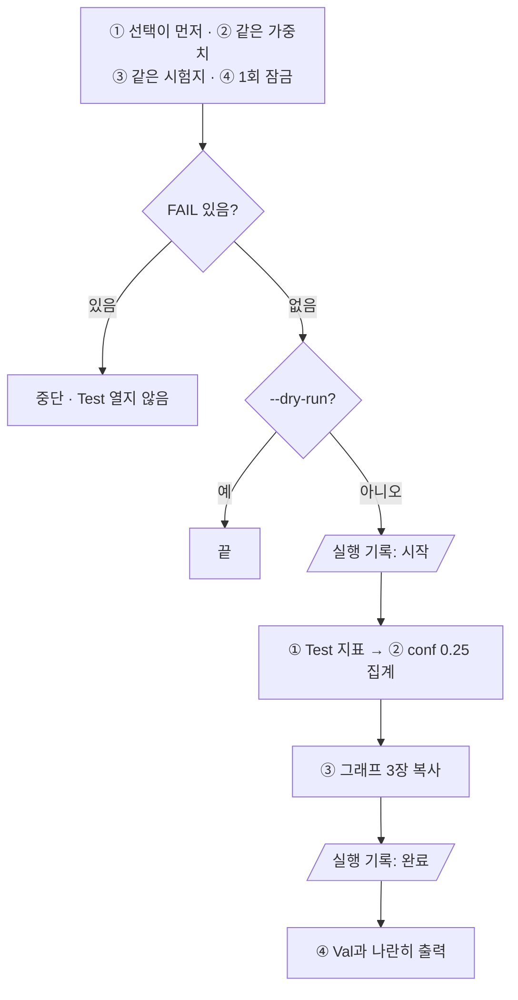

# `scripts/16_evaluate_final_test.py` 코드 리뷰

> Final 선정 단계 · 285줄 · 21.2 · 21.A (Frozen Test 최종평가 1회) · 21.6 Daily Gate · 산출물 5

## 1. 한 줄 요약

Validation으로 고른 Final Model을 **봉인해 둔 Frozen Test 80장에서 딱 한 번** 평가합니다. 평가 전에 "선택이 먼저 커밋됐는지 · 고른 그 가중치인지 · 봉인한 그 시험지인지 · 처음 여는지"를 15항목으로 확인하고, 채점은 11의 함수를 그대로 씁니다.

## 2. 입력 · 출력 · 실행

| 구분 | 내용 |
|---|---|
| 입력 | `reports/final_model_selection.md` (상태: 확정 · 커밋됨) · `models/final/final_best.pt` · `reports/exp001_training_condition.md` (sha) · `configs/exp001.yaml` (imgsz) · `manifests/` · `data/yolo/*/test` |
| 출력 (Git) | `reports/final_metrics.csv` · `final_class_check.csv` · `final_test_image_check.csv` · `final_test_runs.csv` (1회 증거) · `figures/final_test_*.png` 3장 |
| 출력 (Git 제외) | `runs/final_test/` · `runs/predict/final_test_images/` |
| 가져다 쓰는 코드 | `11`(채점) · `10`(git · sha)을 모듈로 · `src/evaluate_detector.py` (`allow_test=True`) · `src/manifest.py` (`fingerprint`) · `09` |
| 결과를 읽는 곳 | 17은 `final_metrics.csv`가 있어야 Test 사진을 씀 |

```bash
python scripts/16_evaluate_final_test.py --dry-run     # 검사만 (Test를 열지 않음)
python scripts/16_evaluate_final_test.py               # Frozen Test 1회 평가
```

결과: Frozen Test **mAP50 0.606 · mAP50-95 0.478** (Val 0.756 · 0.641)

## 3. 구조

| 줄 | 내용 |
|--:|---|
| 56~81 | 11 · 10을 모듈로 불러옴 · 경로 · `FROZEN_TEST_FP` · `CONF` |
| 84~150 | `selection_info()` · `pre_checks()`: 평가 전 검사 15항목 |
| 153~171 | `log_run()` (실행 기록 추가) · `rewrite()` · `read_csv()` |
| 174~281 | `main()`: 검사 → ① 지표 → ② conf 0.25 집계 → ③ 그래프 → ④ Val과 나란히 |

### 흐름 그림



## 4. 핵심 코드 읽기

### 4.1 선택이 Test보다 먼저였다는 것을 Git으로 증명

```python
committed = bool(t10.git("log", "-1", "--format=%h", "--", rel)) and not t10.git("status", "--porcelain", "--", rel)
add("선택 문서가 커밋됨 (Test 전에 결정한 기록)", "커밋됨", "커밋됨" if committed else "미커밋 또는 수정됨", ok=committed)
```

선택 문서가 한 번 커밋됐고 그 뒤 고치지 않았어야 PASS입니다. "Validation으로 선택 → 그다음 Test" 순서를 **말이 아니라 기록**으로 남깁니다.

### 4.2 같은 가중치 · 같은 시험지

```python
add("Final sha = 선택 문서", info["final_sha"], sha)
add(f"Final sha = {info['source']} 학습 기록", m.group(1) if m else "기록 없음", sha)
add("Frozen Test 지문 (Split 단계 봉인)", FROZEN_TEST_FP, fingerprint(test_names))
```

- Final 파일 = 선택 문서의 sha = 14 학습 기록의 sha, 세 곳이 모두 `029c0e92e594`여야 합니다.
- `imgsz`도 원본 설정(1280)에서 읽습니다. 640으로 평가하면 작은 이물이 다시 작아져 점수가 왜곡됩니다.
- Test 파일 목록 지문이 05에서 봉인한 `4f9291849fe6`와 같아야 합니다.

### 4.3 1회 잠금과 실행 기록

```python
add("Frozen Test 1회 잠금 (final_metrics.csv 없음)", "없음", ..., ok=(not done) or bool(rerun_reason))
log_run({..., "event": "시작", "reason": args.rerun_reason or "최초 1회"})
```

결과 파일이 있으면 FAIL이라, 같은 Test를 보며 반복 튜닝하는 것을 **코드로 막습니다.** 예외는 기술적 오류 때 `--rerun-reason`뿐이고, 그 이유와 "시작 · 완료"가 `final_test_runs.csv`에 계속 추가됩니다.

### 4.4 11의 채점 함수를 test에 그대로

```python
e11.SPLIT, e11.VAL_IMAGES, e11.VAL_LABELS = "test", TEST_IMAGES, TEST_LABELS
metrics, test_dir = evaluate_detector(str(FINAL_PT), str(DATASET_YAML), "test", imgsz, batch,
                                      RUNS_DIR, RUN_NAME, allow_test=True)
```

- 불러온 11 모듈의 폴더 상수만 test로 바꿔서 채점 코드를 한 줄도 다시 쓰지 않습니다. 이 변경은 이 프로세스 안에서만 효과가 있고 11 파일은 그대로입니다.
- `allow_test=True`를 넘기는 곳은 프로젝트에서 **이 파일 하나뿐**입니다.
- Test가 Val보다 낮게 나와도 Final Model을 바꾸지 않고 **한계로 기록**하는 것이 규칙입니다.
