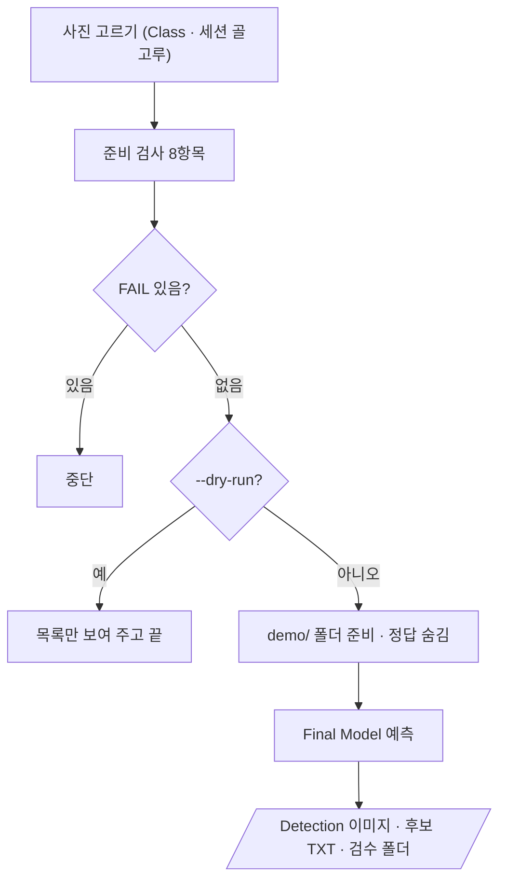

# `scripts/17_auto_label.py` 코드 리뷰

> Final 선정 단계 · 215줄 · 21.4 (Detection · Auto Label 후보) · 산출물 6

## 1. 한 줄 요약

Frozen Test 평가(16)가 **끝난 뒤에만** Test 사진 8장을 골라, Final Model로 Detection 이미지와 **후보 라벨 TXT**를 만들고 라벨 검수 도구이 바로 열 수 있는 검수 폴더를 준비합니다. 정답은 검수자에게 보이지 않게 따로 둡니다.

## 2. 입력 · 출력 · 실행

| 구분 | 내용 |
|---|---|
| 입력 | `reports/final_model_selection.md` · `models/final/final_best.pt` · `reports/final_metrics.csv` (16이 끝났다는 증거) · `manifests/*.csv` 4개 · `data/yolo/*/test` |
| 출력 (Git 제외) | `demo/prediction_images/` · `demo/auto_label/candidate_labels/` · `review_workspace/` · `gt_hidden/` (정답 · 비공개) |
| 출력 (Git) | `reports/auto_label_candidates.csv` |
| 가져다 쓰는 코드 | `16`을 모듈로 (선택 문서 · Final 경로 · sha) · `src/evaluate_detector.py` (`predict_images`) |
| 다음 단계 | 사람이 `labeling-qa-tool/main.py`로 검수 → 18이 집계 |

```bash
python scripts/17_auto_label.py --dry-run     # 검사 + 고른 사진 목록만
python scripts/17_auto_label.py               # Test 8장 (--n 으로 1~10)
```

## 3. 구조

| 줄 | 내용 |
|--:|---|
| 43~65 | 16을 모듈 `f16`로 불러옴 · `demo/` 경로 · `CONF` · `N_DEFAULT` |
| 68~92 | `read_yolo()` · `choose_images()` (Class · 세션 골고루) |
| 95~124 | `pre_checks()`: 준비 검사 8항목 |
| 127~211 | `main()`: 사진 고르기 → 검사 → 폴더 준비 · 정답 숨김 → 예측 → 저장 |

### 흐름 그림



## 4. 핵심 코드 읽기

### 4.1 Test 사진은 최종평가 "뒤에만"

```python
add("Frozen Test 평가 끝남 (Test 사진은 그 뒤에만)", "final_metrics.csv 있음", ..., ok=f16.METRICS_CSV.exists())
bad = [c for c in chosen if split_of.get(c) != "test"]
```

- 새 사진이 없을 때 요구사항 §21.3이 허용하는 방법(평가를 **모두 끝낸 뒤** Test 사진으로 시연)을 코드 조건으로 옮겼습니다. 고른 사진이 하나라도 `test`가 아니면 FAIL이라 Bridge는 여기서 막힙니다.
- Final Model을 16과 **같은 코드**(`f16.selection_info()`)로 읽어서, 16이 평가한 가중치와 다른 가중치를 쓸 수 없습니다.

### 4.2 사진 고르기 — 누가 돌려도 같은 8장

```python
best = min((k for k in info if k not in chosen),
           key=lambda k: (-len(info[k][0] - covered), info[k][2] in groups, -len(info[k][0]), info[k][1], k))
```

아직 안 나온 Class가 많은 사진 → 안 쓴 촬영 세션 → Class 종류 많은 사진 → 박스 적은 사진(검수 시간 짧게) → 파일명 순입니다. 무작위가 없습니다.

### 4.3 사람 검수 기록은 덮어쓰지 않는다

```python
started = any((WS / s / "labels").glob("*.txt") for s in ("work", "final")) if WS.exists() else False
add("사람 검수 아직 시작 전 (덮어쓰기 방지)", "시작 전", ..., ok=(not started) or force_new)
```

라벨 검수 도구에 저장된 라벨이 하나라도 있으면 FAIL입니다. 정말 새로 만들 때만 `--force-new`를 씁니다.

### 4.4 후보 TXT는 정답과 같은 형식, 정답은 숨긴다

```python
lines = [f"{p[0]} {p[2]:.6f} {p[3]:.6f} {p[4]:.6f} {p[5]:.6f}" for p in preds]   # 확신도는 저장하지 않음
(CAND_DIR / f"{stem}.txt").write_text(text, encoding="utf-8")
(WS_LABELS / f"{stem}.txt").write_text(text, encoding="utf-8")   # 라벨 검수 도구이 '원본 라벨'로 불러올 파일
```

- 확신도를 빼고 `class x y w h`만 써서 라벨 검수 도구이 정답 라벨처럼 읽습니다.
- `candidate_labels/`는 AI가 낸 그대로의 보존본이라, 사람이 고친 뒤에도 18이 비교할 수 있습니다.
- 정답은 `gt_hidden/`에 따로 둡니다. 검수자가 정답을 보면 "AI 후보 → 사람 검수" 효과를 잴 수 없기 때문입니다.
