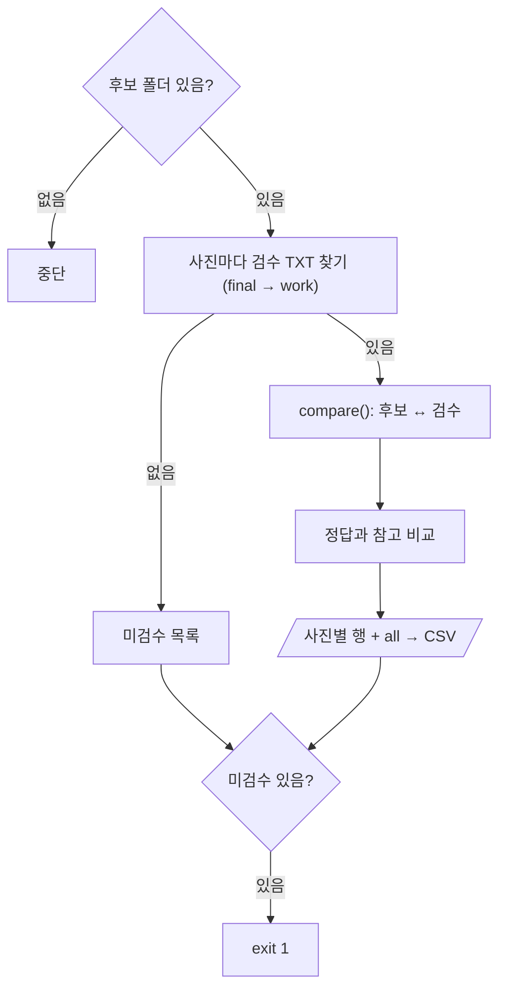

# `scripts/18_auto_label_review.py` 코드 리뷰

> Final 선정 단계 · 172줄 · 요구사항 §21.5 (Human Review 결과 집계) · 산출물 6

## 1. 한 줄 요약

17이 만든 **AI 후보 라벨**과 **사람이 검수해 저장한 라벨**을 박스 1:1로 짝지어 승인 · Class 수정 · BBox 수정 · 삭제 · 누락 추가를 셉니다. 숨겨 둔 정답과도 비교해 "AI만" vs "사람 검수 후"를 참고로 보여 줍니다.

## 2. 입력 · 출력 · 실행

| 구분 | 내용 |
|---|---|
| 입력 (Git 제외) | `candidate_labels/` (AI 후보) · `review_workspace/{final,work}/labels/` (사람 검수 · final 우선) · 라벨 검수 단계 작업대장 · `gt_hidden/` (정답 · 참고만) |
| 출력 | `demo/auto_label/reviewed_labels/` (Git 제외) · `reports/auto_label_review.csv` (사진별 + `all` 합계) |
| 가져다 쓰는 코드 | `src/evaluate_detector.py` (`iou_xywh` · `match_boxes`) |

```bash
python scripts/18_auto_label_review.py      # 라벨 검수 도구으로 검수를 끝낸 뒤
```

결과 (8장 · 후보 43개): 승인 31 (72%) · Class 수정 2 · BBox 수정 3 · 삭제 7 · 누락 추가 7

## 3. 구조

| 줄 | 내용 |
|--:|---|
| 36~44 | 경로 · `APPROVE_IOU = 0.95` · `MATCH_IOU = 0.5` · `VALID_CLASSES` |
| 47~62 | `read_yolo()`: TXT 읽기 + 형식 · Class · 좌표 검사 |
| 65~86 | `compare()`: 후보 ↔ 검수 1:1 짝짓기 → 5가지로 세기 |
| 96~168 | `main()`: 사진마다 검수 파일 찾기 → 비교 → 합계 · 저장 |

### 흐름 그림



## 4. 핵심 코드 읽기

### 4.1 후보 ↔ 검수 짝짓기 — Class와 상관없이

```python
pairs = sorted(((iou_xywh(c[1:], r[1:]), i, j) for i, c in enumerate(cands) for j, r in enumerate(reviewed)),
               reverse=True)
for v, i, j in pairs:
    if v < MATCH_IOU:
        break
    ...
    if cands[i][0] != reviewed[j][0]:
        out["class_changed"] += 1
    elif v >= APPROVE_IOU:
        out["approved"] += 1
    else:
        out["bbox_changed"] += 1
out["deleted"] = len(cands) - len(used_c)
out["added"] = len(reviewed) - len(used_r)
```

| 분류 | 조건 |
|---|---|
| 승인 | 같은 Class · IoU ≥ 0.95 |
| Class 수정 | IoU ≥ 0.5 · Class가 바뀜 |
| BBox 수정 | 같은 Class · 0.5 ≤ IoU < 0.95 |
| 삭제 · 누락 추가 | 짝 없는 후보 · 짝 없는 검수 박스 |

- `match_boxes()`와 달리 **Class를 보지 않고** 짝짓습니다. 같은 자리에서 Class만 바뀐 박스를 "삭제 1 + 추가 1"이 아니라 "Class 수정 1"로 세기 위해서입니다.
- 승인 기준이 1.0이 아니라 0.95인 이유: 라벨 검수 도구이 다시 저장하면서 좌표 소수점이 아주 조금 달라질 수 있기 때문입니다.

### 4.2 사람이 저장한 TXT도 검사

```python
if len(p) != 5 or c not in VALID_CLASSES or not all(0 <= v <= 1 for v in xywh):
    errors.append(f"{path.name}:{i} 형식 · Class · 좌표 범위")
```

사람 손을 거친 파일이라 데이터 감사 단계 Audit과 같은 기준(칸 5개 · Class 4 제외 · 좌표 0~1)으로 다시 봅니다. 문제 줄은 집계에서 빼고 화면에 경고합니다.

### 4.3 정답과 참고 비교

```python
m_ai = match_boxes(gt, [(c[0], 1.0, *c[1:]) for c in cands], MATCH_IOU)
m_hu = match_boxes(gt, [(c[0], 1.0, *c[1:]) for c in reviewed], MATCH_IOU)
```

라벨에 없는 확신도 자리에 `1.0`을 넣어 예측 형식에 맞춥니다. 정답 46개 중 AI 후보만 33개 → 사람 검수 후 36개 일치했지만, 검수 중에는 정답을 보지 않았으므로 **참고값**입니다.
