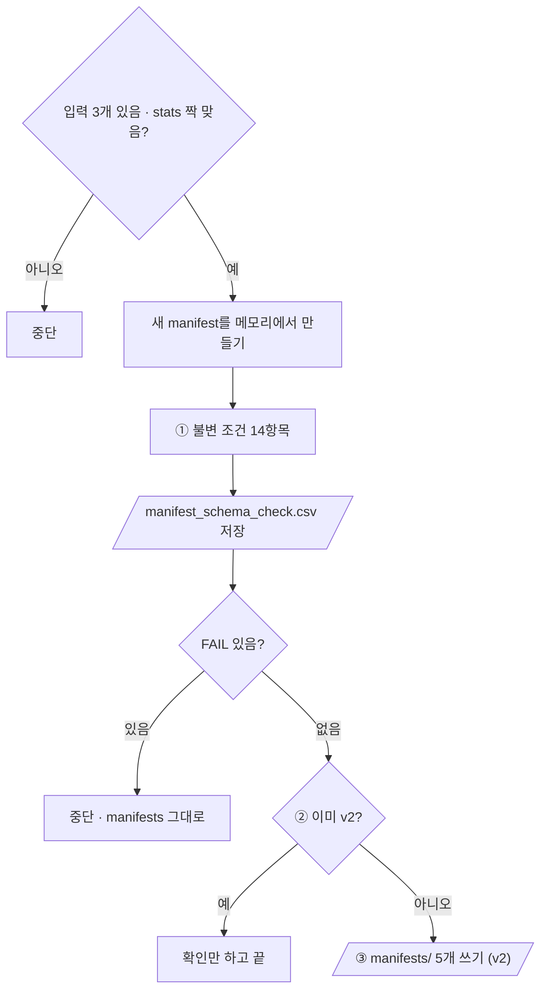

# `scripts/archive/upgrade_manifest_schema_v1_to_v2.py` 코드 리뷰

> Split 단계 · 117줄 · split_policy.md 8장 · audit_expected.md v2

## 1. 한 줄 요약

10/13에 v1(3칸)으로 얼려 둔 `manifests/`를 요구사항 §16.1의 **v2 스키마(9칸)로 올립니다.** 칸만 채우고 **역할 배정은 한 장도 바꾸지 않으며**, 불변 조건 14개가 모두 PASS일 때만 씁니다. 1회성 스크립트로 이미 실행을 마쳤습니다.

## 2. 입력 · 출력 · 실행

| 구분 | 내용 |
|---|---|
| 입력 | `manifests/split_manifest.csv` (지금 manifest) · `splits/kimchi_v1_split.csv` (비교용) · `reports/audit_label_stats.csv` (새 칸을 채울 값) |
| 출력 (항상) | `reports/manifest_schema_check.csv` |
| 출력 (v1이고 전부 PASS일 때만) | `manifests/` 5개 파일 (v2) |
| 가져다 쓰는 코드 | `src/manifest.py` (`read_manifest` · `assignment` · `build_v2_rows` · `write_manifest_set` · `fingerprint`) — 06과 같은 함수 |

```bash
python scripts/archive/upgrade_manifest_schema_v1_to_v2.py   # 지금은 "이미 v2" 확인만 하고 끝남
```

## 3. 구조

| 줄 | 내용 |
|--:|---|
| 38~41 | 기준값: `EXPECTED_COUNTS` · `FROZEN_TEST_FP` · `SCENE_TOTALS` |
| 44~113 | `main()`: 입력 읽기 → 새 manifest 만들기 → ① 불변 조건 → ② 이미 v2? → ③ 쓰기 |

### 흐름 그림



## 4. 핵심 코드 읽기

### 4.1 새 manifest는 메모리에서 먼저

```python
new_rows = build_v2_rows(old_rows, stats)            # 행 순서 · 배정 그대로, 칸만 채움
```

파일을 쓰기 전에 완성해서 검사하므로, 검사에 실패해도 디스크의 `manifests/`는 그대로입니다. 06이 처음 Freeze 할 때와 같은 함수라 새로 얼리든 업그레이드하든 같은 v2가 나옵니다.

### 4.2 불변 조건 — 배정이 그대로인지 두 기준으로

```python
add("assignment_same_as_old_manifest", "yes", "yes" if assignment(new_rows) == assignment(old_rows) else "no")
add("assignment_same_as_split_csv", "yes", "yes" if assignment(new_rows) == assignment(split_rows) else "no")
```

| 항목 | 기대 |
|---|---|
| 행 수 · 모르는 split 값 | 900 · 0 |
| 배정 = 지금 manifest · = 05 결과 | 둘 다 yes |
| 역할별 장수 | 600 / 74 / 80 / 146 |
| Frozen Test 지문 | `4f9291849fe6` |
| 두 역할에 걸친 세션 | 0 |
| 장면별 장수 | 750 / 150 |
| Dataset Version | `kimchi_v1` |
| 경로 ↔ 파일 이름 불일치 | 0 |

핵심은 배정 검사 두 줄입니다. 칸을 늘리면서 "누가 어느 역할인가"가 바뀌지 않았음을 확인합니다.

### 4.3 이미 v2이면 어떤 경우에도 쓰지 않는다

```python
if schema == "v2":
    same = [{k: r[k] for k in MANIFEST_FIELDS} for r in old_rows] == new_rows
    print("\n이미 v2 입니다. " + ("내용도 같아서 아무것도 다시 쓰지 않았습니다." if same
                                else "[주의] 내용이 다릅니다 → 팀 확인 전에는 덮어쓰지 않습니다."))
    return
```

그래서 여러 번 돌려도 안전합니다. 06은 배정만 비교하지만, 여기는 **칸 내용까지** 비교합니다.
