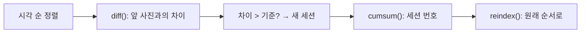

# `src/capture_group.py` 코드 리뷰

> 데이터 감사 단계 · 54줄 · 요구사항 §15.3 (Data Leakage) · 11.1 (capture_group)

## 1. 한 줄 요약

파일명에서 **촬영 시각**을 꺼내고, 시각이 가까운 사진끼리 **촬영 세션**으로 묶고, 두 사진 묶음 사이의 **가장 가까운 시간 차**를 재는 기능 모음입니다. 같은 장면이 Train과 Test에 나뉘는 Leakage를 막는 기반입니다.

## 2. 입력 · 출력 · 실행

| 함수 | 입력 | 출력 |
|---|---|---|
| `parse_capture_time` | 파일명 | `datetime` |
| `assign_capture_groups` | 촬영 시각 Series · 기준(분) | 세션 번호 Series (1부터) |
| `nearest_gap_seconds` | 시각 Series 2개 | target별 최소 시간 차(초) |

직접 실행하지 않고 `04_split_analysis.py`가 import 합니다. 같은 원리가 `05`의 `split_e1()`에도 쓰입니다.

## 3. 구조

| 줄 | 이름 |
|--:|---|
| 20 | `parse_capture_time()` |
| 30 | `assign_capture_groups()` |
| 46 | `nearest_gap_seconds()` |

### 흐름 그림



## 4. 핵심 코드 읽기

### 4.1 파일명 → 시각

```python
stem = Path(file_name).stem                     # 250410_180800068444
date_part, _, time_part = stem.partition("_")   # '250410', '_', '180800068444'
if len(date_part) != 6 or len(time_part) != 12 or not time_part.isdigit():
    raise ValueError(f"예상과 다른 파일명 형식: {file_name}")
base = datetime.strptime(date_part + time_part[:6], "%y%m%d%H%M%S")
return base + timedelta(microseconds=int(time_part[6:]))
```

형식이 다르면 **조용히 틀린 시각을 만들지 않고 멈춥니다.** "파일명 = 촬영 시각"은 EXIF가 없어 연속 사진을 직접 보고 확인한 **가정**입니다 (`split_policy.md` 3장).

### 4.2 diff + cumsum — 반복문 없이 세션 번호 매기기

```python
order = times.sort_values()                                       # ① 시각 순 정렬
gap = order.diff()                                                # ② 바로 앞 사진과의 시간 차
is_new = gap.isna() | (gap > pd.Timedelta(minutes=gap_minutes))  # ③ 첫 장 또는 기준 초과 → True
group_no = is_new.cumsum()                                        # ④ True 누적합 = 세션 번호
return group_no.reindex(times.index)                              # ⑤ 원래 행 순서로 되돌림
```

| 사진 | 앞 사진과 차이 | is_new | 세션 |
|:-:|---|:-:|:-:|
| 1 | (없음) | True | 1 |
| 2 | 45초 | False | 1 |
| 3 | 12분 | True | 2 |
| 4 | 30초 | False | 2 |

`gap > 5분`이라 **정확히 5분이면 같은 세션**입니다(정책: "5분 초과면 새 세션"). ⑤가 없으면 결과가 시각 순서로 나와 원래 표와 행이 엇갈립니다.

### 4.3 가장 가까운 사진까지의 시간

```python
ref_ns = np.asarray(reference.to_numpy(dtype="datetime64[ns]").astype("int64"))
for t in target:
    out.append(np.abs(ref_ns - t.value).min() / 1e9)
```

시각을 정수로 바꿔 numpy가 수백 장과의 뺄셈을 한 번에 합니다. 이 함수로 "기존 validation 180장 중 135장이 60초 안에 train 사진이 있다"를 계산했습니다.
