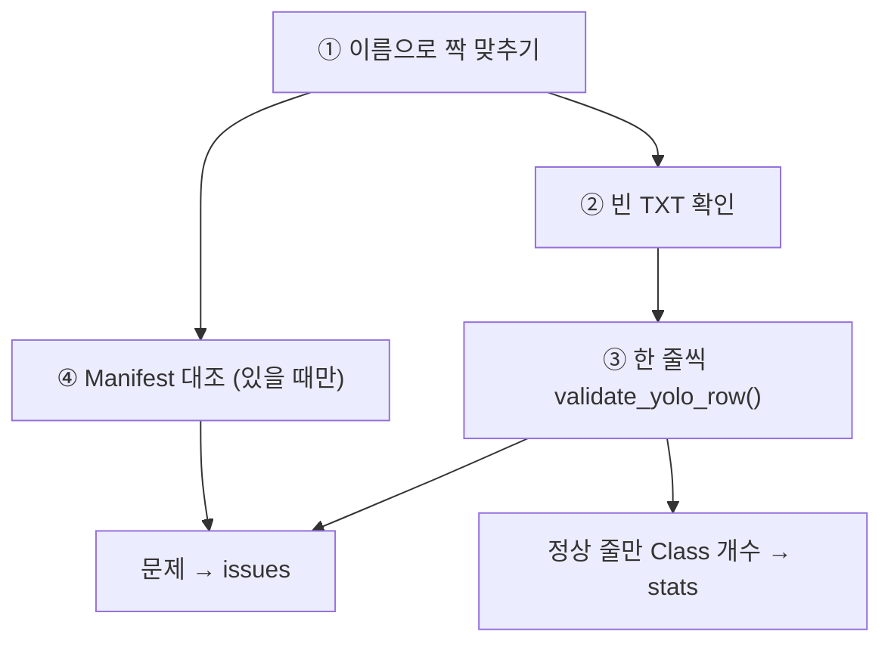

# `src/dataset_audit.py` 코드 리뷰

> 데이터 감사 단계 · 216줄 · 예시 2 ("데이터를 학습하기 전에 건강검진하는 프로그램")

## 1. 한 줄 요약

이미지 · YOLO 라벨 · 라벨 검수 단계 Manifest를 **읽기만 해서** 짝 · 형식 · Class · 좌표 문제를 목록으로 만들고, Class별 BBox 수를 세는 **기능 모음**입니다.

## 2. 입력 · 출력 · 실행

| 구분 | 내용 |
|---|---|
| 입력 | `images_dir` · `labels_dir` · (선택) `manifest_path` |
| 출력 | `issues` (문제 목록) · `stats` (전체 통계) · `image_rows` (이미지별 통계 → `audit_label_stats.csv`) |
| 부르는 곳 | `03_audit_subject7_final.py` (직접 실행 안 함 · 데이터 수정 없음) |

## 3. 구조

| 줄 | 이름 | 역할 |
|--:|---|---|
| 17~38 | 상수 · `SEVERITY` | 라벨 검수 단계 기준 · 문제 12종 → ERROR / WARN |
| 41 | `validate_yolo_row()` | TXT **한 줄** 검사 |
| 92 | `read_manifest()` | Manifest → `{파일명: 행}` |
| 98 | `audit_dataset()` | **폴더 전체** 검사 |
| 199 | `compare_with_expected()` | 기대값 대조 → PASS / FAIL |
| 209 | `write_csv()` | utf-8-sig로 저장 |

### 흐름 그림



## 4. 핵심 코드 읽기

### 4.1 한 줄 검사 — 순서가 중요하다

```python
parts = row.strip().split()
if len(parts) != 5:
    return ["COLUMN_COUNT"]          # ① 칸 수부터. 틀리면 바로 반환
try:
    cls = int(parts[0])
    x, y, w, h = map(float, parts[1:])
except ValueError:
    return ["PARSE_ERROR"]           # ② 숫자로 못 읽으면 바로 반환
...
if "CENTER_RANGE" not in issues and "SIZE_RANGE" not in issues:   # ⑤ 박스 경계
    if left < -EPS or top < -EPS or right > 1 + EPS or bottom > 1 + EPS:
        issues.append("BBOX_OUT_OF_IMAGE")
```

- ①②에서 실패하면 숫자가 없으니 일찍 반환합니다. ⑤는 중심 · 크기가 이미 틀렸으면 건너뛰어 **같은 원인으로 문제가 두 번** 기록되지 않게 합니다.
- `EPS = 1e-6`: `0.95 + 0.05`가 `1.0000000000000002`처럼 아주 조금 넘는 소수 계산 오차를 정상으로 봐 줍니다.
- 문자열만 받아 결과만 돌려주는 순수 함수라 따로 테스트하기 쉽습니다.

### 4.2 집합 연산으로 짝 맞추기

```python
images = {p.stem: p for p in images_dir.iterdir() if p.suffix.lower() in IMAGE_EXTS}
labels = {p.stem: p for p in labels_dir.iterdir() if p.suffix.lower() == ".txt"}
images.keys() - labels.keys()     # 이미지만 있음 → MISSING_LABEL
labels.keys() - images.keys()     # TXT만 있음 → MISSING_IMAGE
pairs = sorted(images.keys() & labels.keys())
```

확장자를 뺀 이름(`stem`)으로 한 번에 짝을 찾고, `sorted()`로 실행할 때마다 같은 순서를 남깁니다.

### 4.3 형식이 정상인 줄만 센다

```python
if not ({"COLUMN_COUNT", "PARSE_ERROR", "CLASS_RANGE"} & set(problems)):
    class_counts[cls] += 1
```

그래서 `bbox_total = class_0 + … + class_6`이 항상 성립합니다. 처음 버전에서는 Class 9 줄이 합계에만 들어가는 버그가 있었고, **Fixture 테스트(02)로 찾아 고쳤습니다.**

### 4.4 같은 함수로 두 모드

`manifest_path=None`이 기본값이라 Fixture 모드(Manifest 없음)와 실제 모드를 같은 함수로 처리합니다. Manifest가 있으면 이미지별 통계에 출처 · split · scene_type을 붙여, 이 결과가 04 · 05의 입력이 됩니다.
