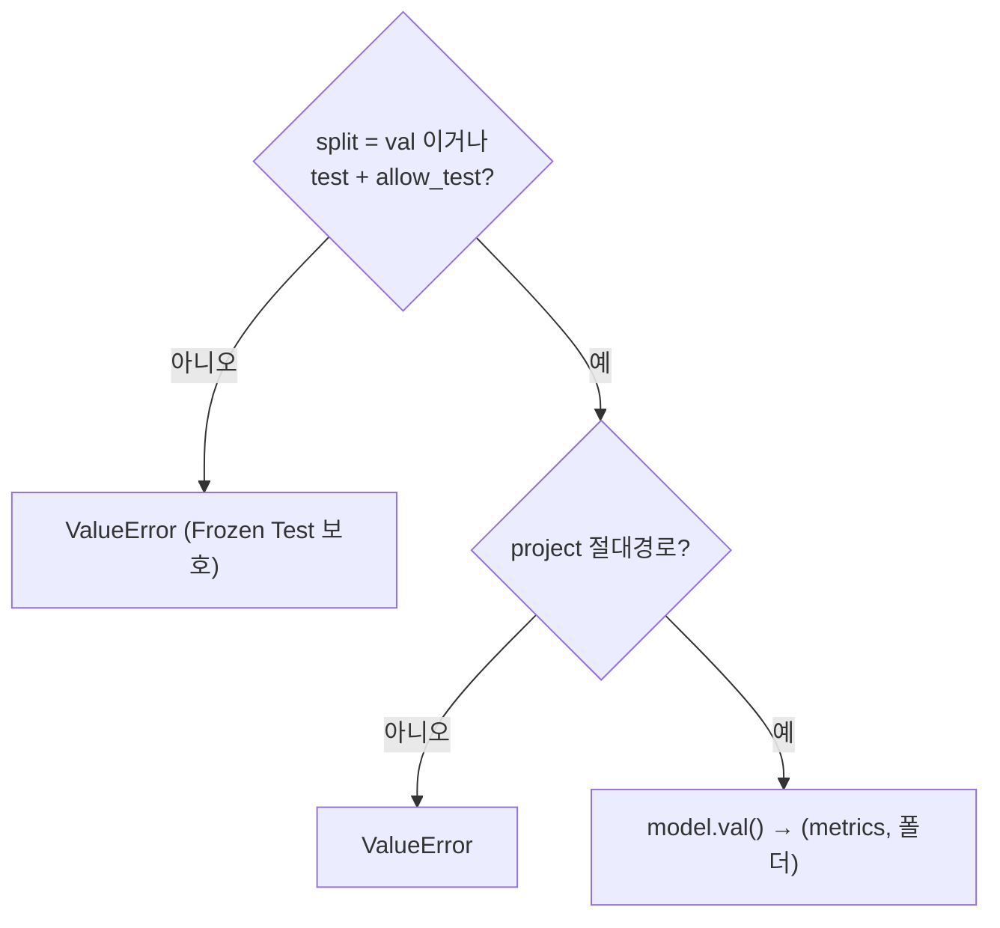
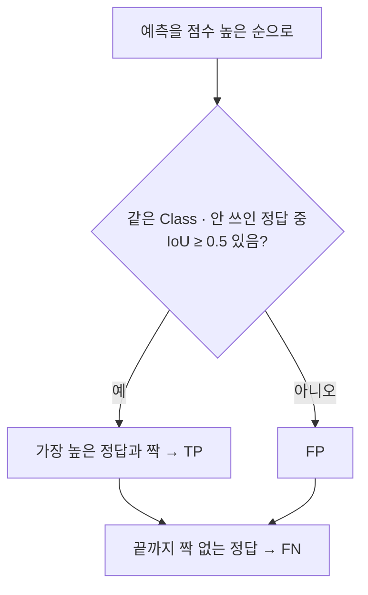

# `src/evaluate_detector.py` 코드 리뷰

> Baseline 평가 단계 · 94줄 · 21.2

## 1. 한 줄 요약

YOLO **평가 · 예측 공통 기능** 모음입니다. Val 지표를 만들고(`evaluate_detector`), 이미지를 한 장씩 예측하고(`predict_images`), 정답과 예측을 짝지어 TP · FP · FN을 셉니다(`match_boxes`). Baseline과 개선 모델이 **같은 함수**를 써서 차이는 가중치 하나뿐이 됩니다. **Frozen Test는 기본으로 막혀 있습니다.**

## 2. 입력 · 출력 · 실행

| 함수 | 돌려주는 값 | 부르는 곳 |
|---|---|---|
| `evaluate_detector()` | `(metrics, 결과 폴더)` | 11 · 15 · 16 (`allow_test=True`는 16만) |
| `predict_images()` | 한 장씩 `(파일명, (너비, 높이), [예측 박스])` | 11 · 12 · 17 |
| `iou_xywh()` | 두 박스의 IoU | 12 · 18 |
| `match_boxes()` | `tp` · `fp` · `fn` · `class_err` · `fn_idx` · `fp_cls` | 11 · 12 · 13 · 18 |

## 3. 구조

| 줄 | 내용 |
|--:|---|
| 15 | `ALLOWED_SPLITS = ("val",)` |
| 18~33 | `evaluate_detector()` |
| 36~51 | `predict_images()` |
| 54~61 | `iou_xywh()` |
| 64~94 | `match_boxes()` |

### 흐름 그림





위는 `evaluate_detector()`, 아래는 `match_boxes()`의 흐름입니다.

## 4. 핵심 코드 읽기

### 4.1 Frozen Test 보호 — 허용 목록 + 명시적 열쇠

```python
ALLOWED_SPLITS = ("val",)
if split not in ALLOWED_SPLITS and not (split == "test" and allow_test):
    raise ValueError(f"평가 split 은 val 만 허용합니다 (Frozen Test 보호): {split}")
```

- `test`는 `allow_test=True`를 **직접 적어 넘겨야만** 열립니다. 이 열쇠를 줘도 `bridge_holdout` 같은 다른 split은 여전히 막힙니다.
- `ultralytics`는 이 검사를 **통과한 뒤에** import 합니다.
- 평가는 `exist_ok=True`(같은 결과라 덮어써도 됨), 학습은 `exist_ok=False`로 반대입니다.

### 4.2 `predict_images()` — 한 장씩 돌려주는 제너레이터

```python
for r in model.predict(source=str(source), conf=conf, imgsz=imgsz, save=True, stream=True, verbose=False,
                       project=str(project), name=name, exist_ok=True):
    h, w = r.orig_shape
    boxes = [(int(c), float(s), *map(float, b))
             for c, s, b in zip(r.boxes.cls.tolist(), r.boxes.conf.tolist(), r.boxes.xywhn.tolist())]
    yield Path(r.path).name, (w, h), boxes
```

- `yield` 덕분에 4K 이미지를 전부 메모리에 올리지 않고 한 장씩 처리합니다.
- 좌표는 `xywhn`(0~1 비율)이라 정답 라벨과 바로 비교할 수 있습니다.

### 4.3 `iou_xywh()` — 0~1 좌표로 계산해도 IoU는 같다

```python
iw, ih = max(0.0, min(ax2, bx2) - max(ax1, bx1)), max(0.0, min(ay2, by2) - max(ay1, by1))
inter = iw * ih
union = a[2] * a[3] + b[2] * b[3] - inter
return inter / union if union > 0 else 0.0
```

가로 · 세로를 따로 늘려도 IoU 비율은 그대로라 픽셀로 바꿀 필요가 없습니다. `max(0.0, ...)`는 겹치지 않는 박스의 넓이를 0으로 만듭니다.

### 4.4 `match_boxes()` — 점수 높은 예측부터 짝짓기

```python
for p in sorted(preds, key=lambda p: -p[1]):
    best_i, best_iou = None, iou_thr
    for i, g in enumerate(gts):
        if i in used or g[0] != p[0]:
            continue
        v = iou_xywh(g[1:], p[2:])
        if v >= best_iou:
            best_i, best_iou = i, v
    if best_i is not None:
        used.add(best_i)
        tp += 1
        continue
    fp_cls.append(p[0])
```

- 한 정답은 한 번만 쓰여서(`used`), 같은 정답을 두 번 맞힌 중복 예측은 FP가 됩니다.
- `class_err`는 FP 중 **위치는 맞는데 Class만 틀린** 개수로, FP에 이미 포함된 숫자입니다.
- 이 짝짓기(conf 0.25)는 Ultralytics `val` 지표(conf 0.001)와 **별개 계산**이라 P · R 값이 서로 다른 것이 정상입니다. GPU 없이 테스트할 수 있는 순수 계산이기도 합니다.
