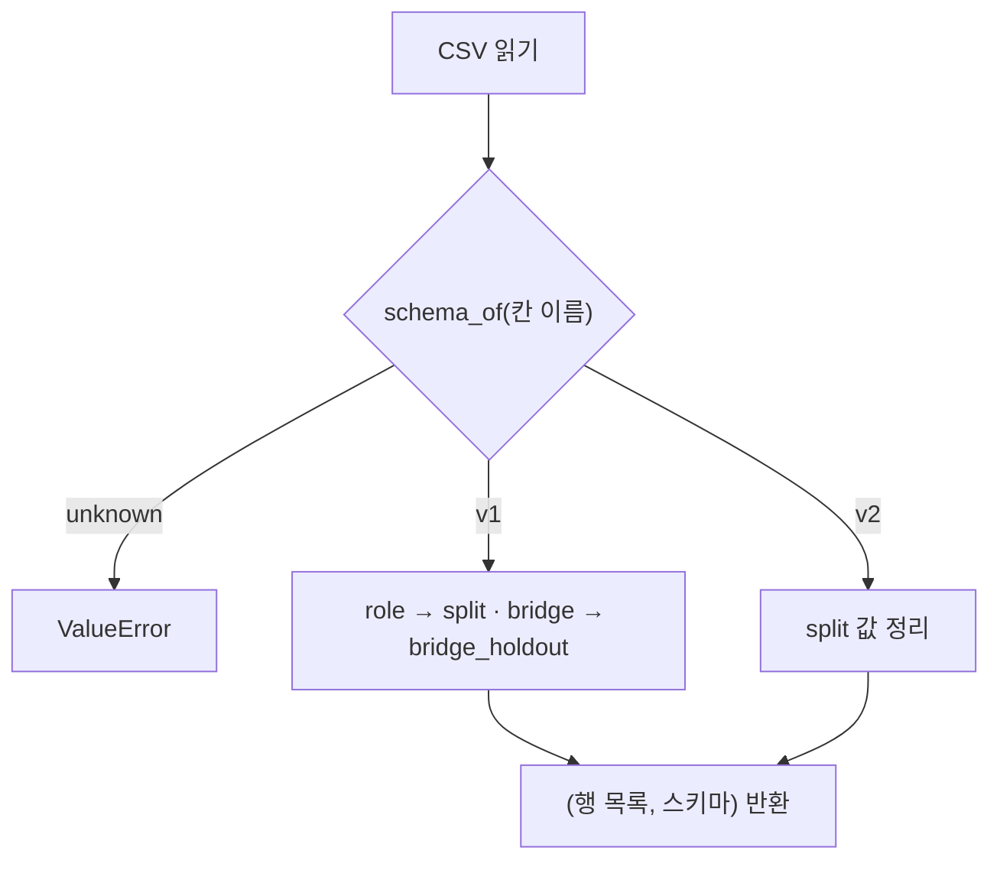

# `src/manifest.py` 코드 리뷰

> Split 단계 · 103줄 · 11.3

## 1. 한 줄 요약

Split Manifest를 **읽고 · 비교하고 · v2로 채우고 · 쓰는** 공통 기능입니다. v1(3칸) · v2(9칸) · split CSV를 모두 **같은 모양(`split` 키 · `bridge_holdout` 값)으로** 돌려줘서, scripts가 스키마를 신경 쓰지 않고 같은 코드로 manifest를 다룹니다.

## 2. 입력 · 출력 · 실행

직접 실행하지 않고 scripts가 가져다 씁니다.

| 함수 · 상수 | 하는 일 | 쓰는 곳 |
|---|---|---|
| `read_manifest(path)` | CSV → `(행 목록, 스키마)` | 06 ~ 17 · archive |
| `assignment(rows)` | 배정만 뽑은 비교용 목록 | 06 · archive |
| `build_v2_rows(rows, stats)` | 배정 그대로 v2 9칸 채우기 | 06 · archive |
| `write_manifest_set(dir, rows)` | `split_manifest.csv` + 역할별 4개 쓰기 | 06 · archive |
| `fingerprint(names)` | 파일명 목록 sha256 앞 12자리 | 10 · 16 · archive |
| `SPLITS` · `DATASET_VERSION` · `MANIFEST_FIELDS` | 역할 이름 · `kimchi_v1` · v2 칸 순서 | 06 · 07 · 08 · archive |

## 3. 구조

| 줄 | 내용 |
|--:|---|
| 17~28 | 상수: `SPLITS` · `LEGACY_VALUES` · `MANIFEST_FIELDS` · `SPLIT_FILES` · 경로 규칙 |
| 31~43 | `normalize_split()` · `schema_of()` |
| 46~57 | `read_manifest()` |
| 60~103 | `assignment()` · `build_v2_rows()` · `write_manifest_set()` · `fingerprint()` |

### 흐름 그림



## 4. 핵심 코드 읽기

### 4.1 스키마는 칸 이름만 보고 판단

```python
def schema_of(columns) -> str:
    cols = list(columns)
    if cols == MANIFEST_FIELDS:
        return "v2"
    if cols[:3] == ["file_name", "capture_group", "role"]:
        return "v1"
    return "unknown"
```

v2는 칸 이름 · 순서가 **정확히** 같아야 하고, v1은 앞 3칸만 봅니다(05의 split CSV도 v1로 읽힘). 둘 다 아니면 `read_manifest()`가 `ValueError`를 냅니다.

### 4.2 모든 행에 `split` 키를 단다

```python
for r in rows:
    r["split"] = normalize_split(r["split"] if schema == "v2" else r["role"])
```

```python
def normalize_split(value: str) -> str:
    return LEGACY_VALUES.get(value, value)       # 'bridge' → 'bridge_holdout' · 모르는 값은 그대로
```

모르는 값을 고치거나 버리지 않고 **그대로 두는 이유**는, 뒤에서 검사(06 `unknown_role` · 08 "알 수 없는 split 값")에 걸리게 하기 위해서입니다. v2 칸(`dataset_version` 등)은 v2일 때만 있어서 07 · 10은 `r.get(..., "-")`로 읽습니다.

### 4.3 `assignment()` — 스키마가 달라도 배정을 비교

```python
return sorted((r["file_name"], r["capture_group"], r["split"]) for r in rows)
```

세 값만 정렬해서, 행 순서나 다른 칸과 상관없이 "어느 사진이 어느 세션 · 어느 역할인가"만 비교합니다. v1과 v2를 견줄 수 있는 것이 이 함수의 쓸모입니다.

### 4.4 쓰기는 같은 규칙으로 5개 파일

```python
writer = csv.DictWriter(f, fieldnames=MANIFEST_FIELDS, lineterminator="\n")
writer.writerows({k: r[k] for k in MANIFEST_FIELDS} for r in part)
```

- `MANIFEST_FIELDS` 순서로 9칸만 씁니다 (v1의 `role` 같은 남은 칸은 안 들어감).
- 경로 칸은 `data/subject7_final/images/<이름>` 규칙으로 만들고, 출처 · 장면은 `audit_label_stats.csv`에서 채웁니다.
- **이 함수는 덮어쓰기를 막지 않습니다.** "얼린 것은 다시 쓰지 않는다"는 부르는 쪽(06 · archive)이 지킵니다.

### 4.5 `fingerprint()` — 한곳에서 가져다 쓰는 게 안전

```python
text = "\n".join(sorted(names)).encode("utf-8")
return hashlib.sha256(text).hexdigest()[:12]
```

Frozen Test 지문 `4f9291849fe6`이 이 계산입니다. 05 · 06 · 08 · 09는 같은 코드를 각자 갖고 있고 10 · 16 · archive는 여기서 가져옵니다. 계산이 한 글자라도 다르면 지문 비교가 무의미해지므로, 한곳에서 가져오는 쪽이 안전합니다.
