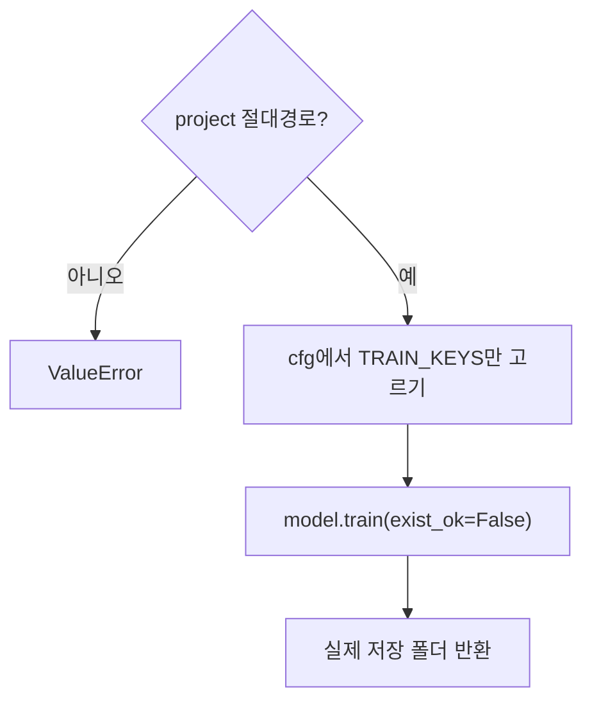

# `src/train_detector.py` 코드 리뷰

> Baseline 학습 단계 · 43줄 · 17.2

## 1. 한 줄 요약

Ultralytics `model.train()`을 감싼 **얇은 학습 함수 하나**입니다. 10(Baseline)과 14(개선 실험)가 **같은 함수**를 써서, 두 실험의 차이는 넘겨 준 설정값 하나뿐이 됩니다. 학습만 하고, 검사 · 기록은 scripts가 맡습니다.

## 2. 입력 · 출력 · 실행

| 구분 | 내용 |
|---|---|
| 입력 | `model_path` (시작 가중치) · `data_yaml` · `cfg` (설정 dict) · `project` (**절대경로**) · `name` |
| 출력 | 실제 결과 폴더 `Path` (`weights/best.pt` · `results.csv`가 있는 곳) |
| 상수 | `TRAIN_KEYS` (학습에 넘길 설정 키 12개) |
| 부르는 곳 | `10_train_baseline.py` · `14_train_experiment.py` (15는 `TRAIN_KEYS`만) |

## 3. 구조

| 줄 | 내용 |
|--:|---|
| 10~12 | `TRAIN_KEYS` |
| 15~43 | `train_detector()`: 경로 검사 → 설정 고르기 → `model.train()` → 저장 위치 반환 |

### 흐름 그림



## 4. 핵심 코드 읽기

### 4.1 학습 설정은 이 12개만 넘긴다

```python
TRAIN_KEYS = ["epochs", "patience", "imgsz", "batch", "workers", "optimizer", "lr0",
              "momentum", "seed", "deterministic", "amp", "pretrained"]
args = {k: cfg[k] for k in TRAIN_KEYS if k in cfg}
```

- 키 이름이 `baseline.yaml`과 Ultralytics 인자 이름과 같아서 그대로 `**args`로 넘깁니다. `name` · `dataset_version` 같은 기록용 항목은 넘어가지 않습니다.
- 없는 키는 **조용히 건너뛰고** Ultralytics 기본값으로 학습됩니다. 빠진 항목을 막는 일은 10의 `REQUIRED_KEYS` 검사가 합니다.

### 4.2 `project`는 반드시 절대경로

```python
if not Path(project).is_absolute():
    raise ValueError(f"project 는 절대경로여야 합니다: {project}")
```

상대경로를 주면 Ultralytics가 자기 기본 폴더 밑에 결과를 만들어 `detection-model/runs/`가 아닌 엉뚱한 곳에 생길 수 있기 때문입니다.

### 4.3 덮어쓰지 않고, 실제 저장 위치를 돌려준다

```python
model.train(
    data=data_yaml,
    project=str(project),
    name=name,
    exist_ok=False,          # 같은 이름 폴더가 있으면 Ultralytics 는 baseline_v12 처럼 번호를 붙임
    **args,
)
return Path(model.trainer.save_dir)              # Ultralytics 가 실제로 저장한 위치
```

- `exist_ok=False`라 같은 이름 폴더가 있으면 `baseline_v12`처럼 번호가 붙은 새 폴더가 생깁니다. 그래서 계산한 경로가 아니라 **실제 저장 위치**를 돌려주고, 10 · 14가 이름이 같은지 다시 확인합니다.
- `ultralytics`는 함수 **안에서** import 해서, `--dry-run`처럼 학습 없이 검사만 할 때는 무거운 라이브러리를 불러오지 않습니다.
