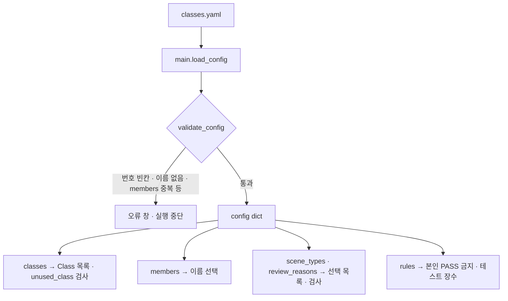

# `configs/classes.yaml` 코드 리뷰

> v4.1 · 75줄 · 문서가 아니라 **프로그램이 실제로 읽는 설정 파일**

## 1. 한 줄 요약

Class 7개, 팀원 5명, scene_type 4종, review_reason 6종, 팀 규칙 3개를 한 곳에 모아 둔 파일이에요. **코드를 고치지 않고 이 파일만 바꿔서** 팀 기준을 바꿀 수 있어요.

## 2. 입력 · 출력 · 실행

| 구분 | 내용 |
|---|---|
| 읽는 곳 | `main.py`의 `load_config()` → `validate_config()` 검사 → `config` dict |
| 쓰는 곳 | main_window (화면 목록 · 저장 규칙) · validator (Class · scene_type 검사) · self_test · reports · make_reports |
| 바꾸면 | 프로그램을 다시 켜야 적용 (실행 중에는 다시 읽지 않음) |

| 블록 | 내용 | 코드에서 쓰는 곳 |
|---|---|---|
| `classes` | 0~6 · `name` · `enabled` (4 고무장갑만 `false`) | Class 선택 목록 · `unused_class` 검사 |
| `members` | 작업자 / 검수자 이름 5명 | 이름 선택 목록 · manifest `worker` |
| `scene_types` | 이미지 전체 유형 4종 | scene_type 선택 · `empty_txt` · `scene` 검사 |
| `review_reasons` | REVIEW 사유 6종 | 사유 선택 · QA Summary 사유별 집계 |
| `rules` | `allow_self_review: false` · `golden_test_size: 20` · `pilot_test_size: 50` | 교차검수 · 자동 테스트 장수 |

## 3. 구조

| 줄 | 내용 |
|--:|---|
| 1~8 | 설명: 번호 = YOLO class_id · `name` · `enabled` · `color` |
| 10~37 | `classes:` 0~6 |
| 43~51 | `members:` 5명 |
| 53~60 | `scene_types:` 4종 (YOLO Class 아님 · TXT에 안 들어감) |
| 62~69 | `review_reasons:` 6종 |
| 71~75 | `rules:` 팀 작업 규칙 |

### 흐름 그림



## 4. 핵심 코드 읽기

### 4.1 Class 4는 지우지 않고 `enabled: false`

```yaml
  4:
    name: "고무장갑"
    enabled: false
```

- 데이터 원본의 Class 번호(0~6)를 그대로 지키려고 4번을 **목록에서 빼지 않고 사용 안 함으로만** 표시했어요. 4번을 지우고 번호를 당기면 5 병해·갈변이 4로 바뀌어서, 원본 TXT 전체와 번호가 어긋나요.
- `false`면 화면에서 고를 수 없고, 라벨에 남아 있으면 validator가 `unused_class` 오류를 내요. 그래서 FINAL로 갈 수 없어요. main_window는 저장할 때 "REVIEW(`unused_class_found`)로 저장할까요?"라고 물어봐요.
- 900장 전체에서 Class 4는 0건이었어요(`docs/subject08_handoff.md` 8장).

### 4.2 scene_type은 YOLO Class가 아니다

```yaml
# scene_type : YOLO Class 가 아닙니다!  (라벨 검수 단계 7번 Dataset Manifest 기준)
#   BBox 하나하나가 아니라 '이미지 전체가 어떤 형태인지' 기록하는 보조 정보입니다.
#   TXT 에는 들어가지 않고 manifests/dataset_manifest.csv 에만 기록됩니다.
```

- Class는 **박스 하나**에 붙고 TXT에 저장돼요. scene_type은 **사진 한 장 전체**에 붙고 manifest에만 저장돼요.
- 그래서 YOLO 학습에는 쓰이지 않지만, "빈 TXT가 정상인가?"(normal_kimchi)를 판단하거나 "김치 배경이 없는 사진(object_only)을 따로 평가하자"는 인수인계 근거가 돼요.

### 4.3 팀 규칙도 설정으로

```yaml
rules:
  allow_self_review: false     # false = 본인이 1차 검수한 이미지는 본인이 QA PASS 못 함 (교차검수)
  golden_test_size: 20         # Golden Test 에 쓸 이미지 수
  pilot_test_size: 50          # Pilot Test 에 쓸 이미지 수
```

- 교차검수 규칙을 코드에 박아 두지 않고 설정으로 뺐어요. 그래서 "왜 본인 PASS가 안 되나요?"라는 질문에 이 한 줄로 답할 수 있어요.
- 코드(`main_window.save_labels`)는 `self.rules.get("allow_self_review", False)`처럼 **값이 없으면 막는 쪽(False)** 을 기본으로 써요. 누가 이 줄을 실수로 지워도 규칙이 풀리지 않아요.

### 4.4 같은 Class 이름이 다른 파일에도 있다

`tools/label_stats.py`는 이 파일을 읽지 않고 Class 이름을 코드 안에 따로 적어 두었어요(`CLASS_NAMES`). 지금은 이름이 같고(4번만 "고무장갑 (미사용)"으로 표시) 문제가 없지만, 이 파일에서 이름을 바꾸면 통계 표의 이름은 바뀌지 않아요. 이름을 고칠 때는 두 곳을 함께 고쳐야 해요.
