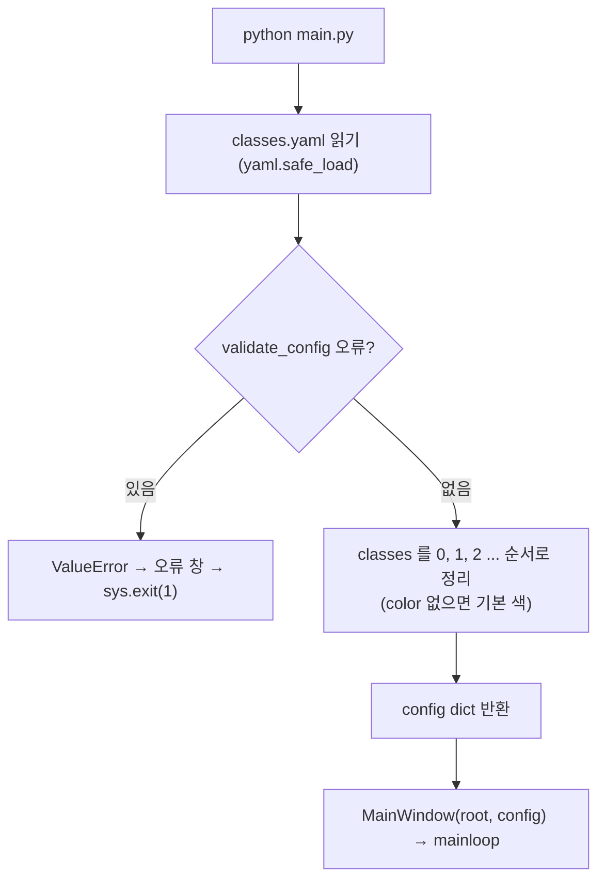

# `main.py` 코드 리뷰

> v4.1 · 94줄 · 프로그램 시작점

## 1. 한 줄 요약

`configs/classes.yaml`을 읽어 **프로그램이 쓰기 좋은 모양(`config`)** 으로 정리하고, 설정이 올바른지 검사한 뒤 메인 화면을 띄워요. 설정이 틀리면 화면을 띄우지 않고 **이유만 알려 주고 끝나요.**

## 2. 입력 · 출력 · 실행

| 구분 | 내용 |
|---|---|
| 입력 | `configs/classes.yaml` (main.py 위치 기준이라 어느 폴더에서 실행해도 같은 파일을 읽음) |
| 출력 | 메인 화면 (`MainWindow`) · 설정 오류면 오류 창 후 종료 코드 1 |
| 함께 쓰는 곳 | `tools/make_reports.py`가 `load_config` · `CONFIG_PATH`를 가져다 씀 (화면 없이 같은 설정 사용) |

```bash
python main.py   # labeling-qa-tool 폴더에서 (venv 켠 상태)
```

## 3. 구조

| 줄 | 내용 |
|--:|---|
| 1~20 | 설명: 실행 방법 · 하는 일 3단계 · 데이터 흐름 요약 |
| 22~37 | import · `BASE_DIR` · `CONFIG_PATH` · `DEFAULT_COLORS`(색이 없을 때 기본 색 10개) |
| 40~74 | `load_config()`: YAML 읽기 → `validate_config` → Class 목록 · 이름 · 규칙 정리 |
| 77~90 | `main()`: 설정 오류면 오류 창 후 종료 · 정상이면 `MainWindow` 실행 |

### 흐름 그림



## 4. 핵심 코드 읽기

### 4.1 어디서 실행해도 같은 설정 파일

```python
BASE_DIR = Path(__file__).resolve().parent          # main.py 가 있는 폴더 (어디서 실행해도 OK)
CONFIG_PATH = BASE_DIR / "configs" / "classes.yaml"
```

- `Path("configs/classes.yaml")`처럼 쓰면 **지금 터미널이 있는 폴더**를 기준으로 찾아요. 그래서 다른 폴더에서 실행하면 파일을 못 찾아요.
- `__file__`(이 파이썬 파일 자신)의 위치를 기준으로 잡으면, 어디서 실행해도 같은 파일을 읽어요. 산출물을 쓰는 `project_dir`도 이 `BASE_DIR`이에요.

### 4.2 Class 번호 = YOLO class_id 순서

```python
for cid in sorted(data["classes"]):                 # 0, 1, 2 ... 순서 = YOLO class_id
    info = data["classes"][cid]
    classes.append({
        "id": cid,
        "name": str(info["name"]).strip(),
        "enabled": info.get("enabled", True),
        "color": info.get("color") or DEFAULT_COLORS[cid % len(DEFAULT_COLORS)],
    })
```

- YAML의 순서와 상관없이 **번호순으로 정렬**해서 리스트에 넣어요. 그래서 `classes[4]`가 곧 Class 4예요. validator와 main_window가 `self.classes[cls]`처럼 번호로 바로 꺼내 쓸 수 있는 이유예요.
- 번호가 0부터 빈칸 없이 이어지는지는 정렬 **전에** `validate_config()`가 먼저 확인해요. 번호가 중간에 비면 `classes[5]`가 Class 6을 가리키게 되는 사고가 나기 때문이에요.
- `enabled`를 안 적으면 `True`(사용)로 봐요.

### 4.3 설정이 틀리면 화면을 띄우지 않는다

```python
try:
    config = load_config(CONFIG_PATH)
except (OSError, ValueError, yaml.YAMLError) as e:
    # 설정이 잘못되면 화면을 띄우지 않고 이유만 알려주고 끝냅니다.
    root = tk.Tk()
    root.withdraw()
    messagebox.showerror("설정 파일 오류", f"{CONFIG_PATH}\n\n{e}")
    root.destroy()
    sys.exit(1)
```

- 잡는 오류는 세 가지예요. 파일이 없음(`OSError`), 내용 규칙 위반(`ValueError`), YAML 문법 오류(`yaml.YAMLError`).
- 잘못된 Class 설정으로 라벨링을 시작하면 900장 라벨이 엉뚱한 번호로 저장될 수 있어요. 그래서 **작업을 시작하기 전에 막는 쪽**을 택했어요.
- `root.withdraw()`는 빈 메인 창을 숨기고 오류 창만 보이게 하는 tkinter 요령이에요.
