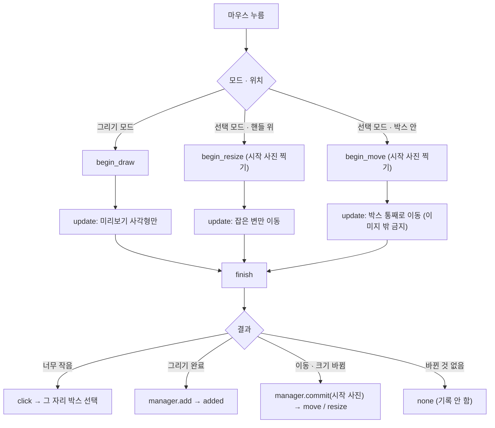

# `src/bbox/bbox_editor.py` 코드 리뷰

> v4.1 · 163줄 · 마우스로 BBox 그리기 · 이동 · 크기 조절

## 1. 한 줄 요약

`canvas.py`가 "어디를 눌렀나"를 알려 주면, 이 파일이 **"그래서 박스를 어떻게 바꾸나"** 를 정해서 `BBoxManager`의 데이터를 바꿔요. 드래그 한 번을 **시작 → 움직이는 중 → 끝** 세 단계로 나눠 관리해요.

```
canvas.py     : 어디를 눌렀나? (화면 좌표, 그리기)
bbox_editor   : 그래서 BBox 를 어떻게 바꾸나? (드래그 상태 관리)
bbox_manager  : BBox 목록 자체 (저장 대상 데이터)
```

## 2. 입력 · 출력 · 실행

| 함수 · 메서드 | 하는 일 | 쓰는 곳 |
|---|---|---|
| `handle_positions(box, to_canvas)` | 선택 박스의 핸들 8개 위치 (화면 좌표) | canvas (핸들 그리기) |
| `hit_handle(box, x, y, to_canvas)` | 클릭이 핸들 위인지 (7px 안) | canvas |
| `hit_box(boxes, x, y, to_canvas)` | 클릭 위치를 포함하는 박스 중 **가장 작은 것** | canvas |
| `BBoxEditor.begin_draw / begin_move / begin_resize` | 드래그 시작 · 시작 상태 기억 | canvas (`on_left_down`) |
| `update(ix, iy, img_w, img_h)` | 드래그 중 좌표 반영 (그리기는 미리보기만) | canvas (`on_left_drag`) |
| `finish(...)` | 드래그 마무리 → `click` · `added` · `move` · `resize` · `none` | canvas (`on_left_up`) |
| `cancel()` | Esc: 그리기 취소 · 이동/크기 조절은 원래대로 | canvas (`cancel_drag`) |

모든 좌표는 **원본 이미지 좌표**로 받아요. 화면 좌표 → 원본 좌표 변환은 canvas가 해요.

## 3. 구조

| 줄 | 내용 |
|--:|---|
| 1~14 | 설명 · `HANDLE_HIT = 7` · `HIT_MARGIN = 3` |
| 21~50 | ① 클릭 판정: `handle_positions()` · `hit_handle()` · `hit_box()` |
| 57~88 | ② `BBoxEditor`: `active` · `drag_type` · `begin_*()` |
| 91~118 | `update()`: draw 미리보기 · move · resize |
| 121~154 | `finish()`: 방향 정리 · 최소 1px · 바뀐 경우만 기록 |
| 156~163 | `cancel()` |

### 흐름 그림 (드래그 한 번)



## 4. 핵심 코드 읽기

### 4.1 겹친 박스 중 "가장 작은 것"을 고른다

```python
def hit_box(boxes, x, y, to_canvas):
    """클릭 위치를 포함하는 BBox 중 '가장 작은 것'의 번호 (큰 박스 안의 작은 박스 선택용)"""
    best, best_area = None, None
    for i, b in enumerate(boxes):
        x1, y1 = to_canvas(b["x1"], b["y1"])
        x2, y2 = to_canvas(b["x2"], b["y2"])
        if x1 - HIT_MARGIN <= x <= x2 + HIT_MARGIN and y1 - HIT_MARGIN <= y <= y2 + HIT_MARGIN:
            area = (x2 - x1) * (y2 - y1)
            if best is None or area < best_area:
                best, best_area = i, area
    return best
```

- 김치 사진에서는 큰 나뭇잎 박스 안에 작은 플라스틱 박스가 들어 있는 경우가 흔해요. 처음 찾은 박스를 고르면 큰 박스만 계속 잡혀서 작은 박스를 고를 수가 없어요.
- 그래서 클릭 위치를 포함하는 박스를 **모두** 보고, 그중 **넓이가 가장 작은 것**을 골라요.
- `HIT_MARGIN = 3`은 테두리 바깥 3px까지 클릭으로 인정해요. 아주 작은 박스도 고르기 쉬워요.

### 4.2 이동할 때 이미지 밖으로 못 나가게

```python
w, h = o["x2"] - o["x1"], o["y2"] - o["y1"]
nx1 = min(max(o["x1"] + (ix - d["ix"]), 0.0), img_w - w)
ny1 = min(max(o["y1"] + (iy - d["iy"]), 0.0), img_h - h)
b.update(x1=nx1, y1=ny1, x2=nx1 + w, y2=ny1 + h)
```

- 드래그 **시작 위치(`d["ix"]`)** 와 지금 위치의 차이만큼, **시작할 때의 박스(`o`)** 를 옮겨요. 매번 "지금 박스"에 더하지 않기 때문에 오차가 쌓이지 않아요.
- 왼쪽 위 점을 `0 ~ (이미지 너비 − 박스 너비)` 사이로 붙잡아서, 박스 크기는 그대로 두고 이미지 안에만 있게 해요.
- 크기 조절(resize)은 여기서 붙잡지 않아요. 대신 canvas가 마우스 좌표를 이미지 안으로 붙잡아서(`clamp`) 넘겨줘요. 이동만 예외로 붙잡지 않은 좌표를 넘기는 이유는, 박스를 가장자리에 붙이려면 마우스가 이미지 밖까지 나가야 하기 때문이에요.

### 4.3 끝낼 때 정리: 뒤집힌 박스 · 0px 박스 · 바뀌지 않은 드래그

```python
b["x1"], b["x2"] = sorted((b["x1"], b["x2"]))     # 핸들을 반대편으로 넘긴 경우 정리
b["y1"], b["y2"] = sorted((b["y1"], b["y2"]))
if b["x2"] - b["x1"] < 1:
    b["x2"] = min(float(img_w), b["x1"] + 1)
...
if b != d["orig"]:                                  # 실제로 바뀐 경우만 기록
    self.manager.commit(d["snapshot"])
    return {"type": d["type"]}
return {"type": "none"}
```

- 왼쪽 핸들을 오른쪽 끝 너머로 끌면 `x1 > x2`가 돼요. 정렬해서 항상 `x1 < x2`로 맞춰요. YOLO로 바꿀 때 너비가 음수가 되는 걸 막아요.
- 너비 · 높이가 1px보다 작으면 1px로 맞춰요. 0px 박스는 validator의 `bbox_bounds` 오류가 되기 때문이에요.
- 박스를 눌렀다가 그대로 놓으면 "이동"이 아니에요. 시작 상태와 같으면 **기록도, 저장 안 됨 표시도 남기지 않아요.**
