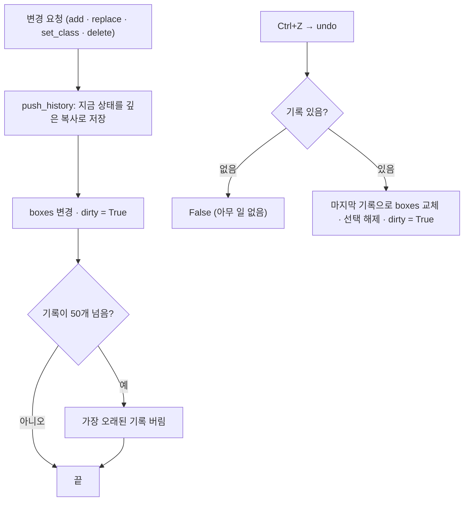

# `src/bbox/bbox_manager.py` 코드 리뷰

> v4.1 · 110줄 · 화면을 모르는 "순수 데이터" 클래스

## 1. 한 줄 요약

지금 열린 이미지의 **BBox 목록**을 들고 있으면서 추가 · 수정 · Class 변경 · 삭제 · **되돌리기(Ctrl+Z)** 를 처리해요. tkinter를 전혀 import하지 않기 때문에 **화면 없이도 테스트할 수 있어요**. 실제로 `self_test.py`가 이 클래스를 그대로 불러 Golden · Pilot 테스트를 해요.

## 2. 입력 · 출력 · 실행

| 메서드 · 속성 | 하는 일 | 쓰는 곳 |
|---|---|---|
| `boxes` · `selected` · `dirty` | 박스 목록 · 선택 번호 · 저장 안 한 변경 여부 | canvas · main_window |
| `load(boxes)` | 새 이미지로 교체 (되돌리기 기록 초기화) | main_window (`load_image`) |
| `mark_saved(boxes)` | 저장 후 다시 읽은 박스로 맞추고 `dirty = False` | main_window (`save_labels`) |
| `add` · `replace` · `set_class` · `delete_selected` · `replace_all` | 바꾸기 **직전** 상태를 기록하고 변경 | canvas · main_window · bbox_editor |
| `commit(snapshot)` | 드래그처럼 **이미 바꾼 뒤** 기록 | bbox_editor |
| `undo()` | 마지막 기록으로 되돌리기 (최대 50번) | main_window (Ctrl+Z) |

BBox 하나는 `{"cls": 1, "x1": .., "y1": .., "x2": .., "y2": ..}` 모양이고, 좌표는 **원본 이미지 픽셀**이에요.

## 3. 구조

| 줄 | 내용 |
|--:|---|
| 1~13 | 설명 · `HISTORY_LIMIT = 50` |
| 16~22 | `__init__()`: `boxes` · `selected` · `history` · `dirty` |
| 25~38 | `load()` · `mark_saved()` |
| 41~48 | `selected_box` · `select()` |
| 51~70 | 되돌리기: `snapshot()` · `push_history()` · `commit()` · `undo()` |
| 73~110 | `add()` · `replace()` · `set_class()` · `delete_selected()` · `replace_all()` |

### 흐름 그림 (되돌리기)



## 4. 핵심 코드 읽기

### 4.1 되돌리기는 "바꾸기 직전 사진"을 찍어 두는 것

```python
def snapshot(self):
    return copy.deepcopy(self.boxes)

def push_history(self, snapshot=None):
    """변경 '직전' 상태를 저장 → Ctrl+Z 로 돌아갈 수 있게"""
    self.history.append(self.snapshot() if snapshot is None else snapshot)
    del self.history[:-self.history_limit]          # 오래된 것은 버림
```

- **`deepcopy`가 꼭 필요해요.** 박스 하나가 dict라서, 그냥 `list(self.boxes)`로 복사하면 목록만 새로 만들어지고 안의 dict는 같은 것을 가리켜요. 그러면 나중에 박스를 고칠 때 "찍어 둔 사진"까지 함께 바뀌어서 되돌리기가 동작하지 않아요.
- `del self.history[:-50]`은 "뒤에서 50개만 남기고 앞부분을 지워라"라는 뜻이에요. 메모리가 끝없이 늘지 않게 해요.

### 4.2 드래그는 "끝난 뒤"에 한 번만 기록

```python
def commit(self, snapshot):
    """드래그(이동/크기 조절)처럼 '이미 바꾼 뒤'에 기록할 때 사용"""
    self.push_history(snapshot)
    self.dirty = True
```

- 박스를 드래그하는 동안에는 마우스가 움직일 때마다 좌표가 바뀌어요. 그때마다 기록하면 Ctrl+Z를 수십 번 눌러야 원래대로 돌아가요.
- 그래서 `bbox_editor`가 드래그 **시작할 때** 사진을 찍어 두고, **끝났을 때** 실제로 바뀌었으면 `commit()`으로 그 사진 한 장만 기록해요. 드래그 한 번 = Ctrl+Z 한 번이에요.

### 4.3 Class가 같으면 기록하지 않는다

```python
def set_class(self, idx, cls):
    box = self.boxes[idx]
    if box["cls"] == cls:
        return None
    old = box["cls"]
    self.push_history()
    box["cls"] = cls
    self.dirty = True
    return old
```

- 이미 같은 Class를 다시 고르면 아무것도 바뀌지 않으니 기록도, "저장 안 됨" 표시도 남기지 않아요.
- 바뀐 경우에는 예전 번호를 돌려줘서, main_window가 "Class 변경: 1 플라스틱류·돌·금속류 → 2 나뭇가지류"처럼 상태줄에 보여 줄 수 있어요.
