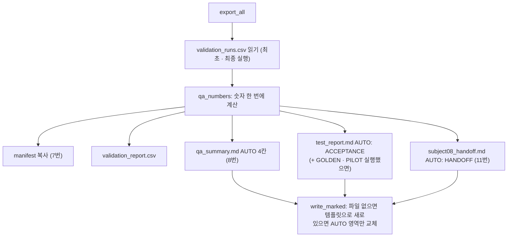

# `src/qa/reports.py` 코드 리뷰

> v4.1 · 501줄 · 산출물 7 · 8 · 9 · 11번을 자동으로 만드는 곳

## 1. 한 줄 요약

manifest · 작업 이력 · Validation 결과 · 자동 테스트 결과를 모아 **산출물 5개 파일**을 만들어요. 문서 안의 `<!-- AUTO:이름:START -->` ~ `<!-- AUTO:이름:END -->` 사이만 다시 쓰기 때문에, 팀이 **직접 적은 메모는 다시 만들어도 지워지지 않아요.**

## 2. 입력 · 출력 · 실행

| 만드는 파일 | 산출물 | 내용 |
|---|:-:|---|
| `manifests/dataset_manifest.csv` | 7번 | `data/manifests`의 작업대장을 프로젝트로 **복사** |
| `reports/validation_report.csv` | 8번 보조 | 이미지별 Validation 결과 (validator `write_report_csv`) |
| `reports/qa_summary.md` | 8번 | 1 전체 데이터 · 2 자동 Validation(최초 → 최종) · 3 Human QA · 4 최종 판정 |
| `reports/test_report.md` | 9번 | 1 Golden · 2 Pilot · 3 Final Acceptance (7개 확인 항목) |
| `docs/subject08_handoff.md` | 11번 | 2~7장 FINAL Dataset · 형식 · Class · QA 결과 · 출처 분포 |

| 실행 | 부르는 곳 |
|---|---|
| 프로그램 **검사 > 산출물 생성** | main_window `export_reports()` → `export_all()` |
| 프로그램 **검사 > 검출 모델 단계 인계** | main_window `make_handoff()` → `export_reports()` 후 `make_handoff_package()` |
| 터미널 | `python -m tools.make_reports --data data` → `export_all()` |

## 3. 구조

| 줄 | 내용 |
|--:|---|
| 1~26 | 설명 · import · `CRITICAL_TYPES`(`pair` · `format`) |
| 33~58 | ⓪ `_block()` · `write_marked()`(AUTO 영역만 교체) · `_pct()` |
| 65~69 | ① `export_manifest()` |
| 76~105 | ② `qa_numbers()`: QA Summary · Acceptance · Handoff가 함께 쓰는 숫자 |
| 108~227 | ② `qa_summary_blocks()` · `QA_TEMPLATE` |
| 234~332 | ③ `_test_block()` · `acceptance_block()` · `TEST_TEMPLATE`(FAIL-01 기록 포함) |
| 339~443 | ④ `handoff_block()` · `HANDOFF_TEMPLATE` |
| 446~462 | ④ `make_handoff_package()`: `handoff_subject08/` 폴더 만들기 |
| 469~501 | ⑤ `export_all()`: 위를 한 번에 |

### 흐름 그림 (`export_all`)



## 4. 핵심 코드 읽기

### 4.1 자동 영역만 바꾸고 사람이 쓴 글은 지킨다

```python
text = path.read_text(encoding="utf-8")
for name, body in blocks.items():
    pattern = re.compile(rf"<!-- AUTO:{name}:START -->.*?<!-- AUTO:{name}:END -->", re.S)
    if pattern.search(text):
        text = pattern.sub(lambda _: _block(name, body), text)
    else:
        text = text.rstrip() + "\n\n" + _block(name, body) + "\n"
```

- `<!-- ... -->`는 Markdown에서 **화면에 보이지 않는 주석**이에요. 이걸 "여기부터 여기까지는 프로그램 자리"라는 표지판으로 써요.
- `.*?`(가장 짧게 맞추기)와 `re.S`(줄바꿈도 포함)로 START ~ END 사이만 찾아 바꿔요. 그 밖의 "5. 메모", "Pilot 중 발견된 문제(FAIL-01)" 같은 글은 그대로 남아요.
- `sub()`에 문자열이 아니라 `lambda`를 넘긴 건, 본문에 `\1`이나 `\g` 같은 글자가 있어도 정규식 치환 기호로 잘못 읽히지 않게 하려는 거예요.

### 4.2 "QA 완료" 판정은 세 조건이 모두 맞아야

```python
done = n["pass_now_valid"] == total and n["fail_now"] == 0 and review_now == 0 and total > 0
verdict = "QA 완료" if done else "진행 중"
```

- 900장이 **QA PASS이면서 지금 Validation에서도 통과**하고, Validation FAIL이 0이고, 남은 REVIEW가 0이어야 해요.
- `pass_now_valid`는 "PASS인데 지금 Validation에 걸리는 사진"을 뺀 수예요. PASS 도장만 받고 파일이 깨진 사진은 완료로 세지 않아요.
- 완료가 아니면 이유를 붙여 줘요. 예: `진행 중 (QA PASS 미완료 12장 · 미해결 REVIEW 2장)`.

### 4.3 알아둘 점 ①: REVIEW 사유 "제기된 이미지"는 줄 수로 센다

```python
"reasons_ever": Counter(h["review_reason"] for h in history_rows
                        if h["status"] == STATUS_REVIEW and h["review_reason"]),
```

- 표 제목은 "제기된 **이미지**"인데, 코드는 이력의 **줄 수**를 세요. 한 사진을 REVIEW 상태로 두 번 저장하면 2로 세어져요.
- 실제 결과에서도 이 칸은 10 / 1 / 29로 나왔고, 실제 이미지 수는 7 / 1 / 19(합계 27장)예요. 팀이 이 차이를 찾아서 `reports/qa_summary.md` 5.3에 직접 바로잡아 두었어요.
- 고친다면 `(file_name, review_reason)` 짝을 `set`으로 먼저 모은 뒤 세면 이미지 수가 돼요.

### 4.4 알아둘 점 ②: Handoff 폴더를 다시 만들 때 옛 라벨이 남을 수 있다

```python
for p in src.iterdir():
    if p.is_file() and not (dst / p.name).exists():
        shutil.copy2(p, dst / p.name)
```

- `handoff_subject08/final_dataset/`에 **같은 이름 파일이 이미 있으면 복사하지 않아요.** 이미지는 바뀌지 않으니 괜찮지만, **라벨 TXT**는 문제가 될 수 있어요. Handoff 폴더를 한 번 만든 뒤 FINAL 라벨을 고치고 다시 만들면, 폴더 안에는 **고치기 전 TXT가 그대로** 남아요.
- 반대로 FINAL에서 빠진 사진도 Handoff 폴더에서는 지워지지 않아요.
- 문서 4개(manifest · class_guide · bbox_guide · handoff)는 조건 없이 매번 덮어써요. 그래서 "문서 숫자는 최신인데 라벨은 옛것"인 상태가 될 수 있어요.
- 안전하게 하려면 다시 만들기 전에 `handoff_subject08/` 폴더를 지우거나, 라벨은 항상 덮어쓰게 바꾸면 돼요. 받는 쪽 검출 모델 단계에서도 받은 900장을 `03_audit_subject7_final.py`로 파일 수 · 짝 · Class별 박스 수까지 다시 대조했어요. 이렇게 넘겨주는 쪽과 받는 쪽이 한 번씩 확인하면 이런 실수를 잡을 수 있어요.

### 4.5 Acceptance는 7개 조건이 모두 PASS여야

```python
checks = [
    (f"{total}장 이미지 탐색 가능", total > 0),
    ("이미지와 TXT Pair 정상 (FINAL)", n["final_pairs"] == total and total > 0),
    ("저장 후 Reload 정상 (Golden · Pilot)", reload_ok),
    ("미처리 REVIEW 없음", c["REVIEW"] == 0),
    ("Critical Error 없음", n["critical"] == 0),
    ("Validation 오류 없음", n["fail_now"] == 0),
    (f"{total}장 전체 QA PASS", c["PASS"] == total and total > 0),
]
```

- 하나라도 아니면 `NOT YET`이에요. "거의 다 됐음" 같은 중간 판정이 없어요.
- **Critical Error**는 `pair`(이미지-TXT 짝 깨짐)와 `format`(TXT 형식 깨짐)이에요. 학습 코드가 아예 읽지 못하는 오류라서 따로 셉니다.
- `reload_ok`는 Golden · Pilot을 **둘 다** 돌렸을 때만 True예요. 테스트를 안 돌리고 산출물만 만들면 Acceptance는 통과하지 못해요.
