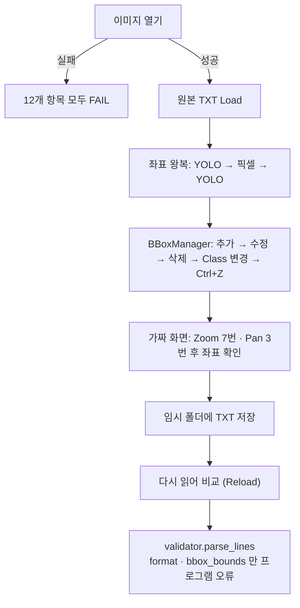

# `src/qa/self_test.py` 코드 리뷰

> v4.1 · 190줄 · 산출물 9번 Test Report의 Golden 20 · Pilot 50 자동 테스트

## 1. 한 줄 요약

실제 김치 사진과 TXT로 **프로그램 기능 12가지가 맞게 동작하는지** 자동으로 확인해요. 마우스를 직접 움직이지 않는 대신, **화면이 실제로 쓰는 코드**(`BBoxManager` · canvas 좌표 변환 · YOLO 저장/읽기 · validator)를 그대로 불러서 시험해요. 원본은 바꾸지 않고 **임시 폴더**에서만 저장해요.

> 데이터가 맞는지는 QA Summary(8번), **프로그램이 맞는지는 Test Report(9번)** 예요.

## 2. 입력 · 출력 · 실행

| 구분 | 내용 |
|---|---|
| 입력 | 작업 목록(`ws.items`) · 장수(`classes.yaml`의 `golden_test_size` 20 · `pilot_test_size` 50) · Class 목록 · validator |
| 출력 | 결과 dict (항목별 통과 수 · 실패 목록 · 데이터 확인 메모) → `reports.py`가 `reports/test_report.md` 1 · 2장에 기록 |
| 실행 | 프로그램 메뉴 **검사 > 자동 테스트** 또는 `python -m tools.make_reports --data data --tests` |

12개 항목: 이미지 열기 · 기존 YOLO TXT Load · 기존 BBox 표시(좌표 변환) · BBox 추가 · BBox 수정 · BBox 삭제 · Class 변경 · Zoom · Pan · YOLO TXT 저장 · 저장 후 Reload · Validation

## 3. 구조

| 줄 | 내용 |
|--:|---|
| 1~31 | 설명 · import · `TESTS`(12개) · `PROGRAM_CHECKS`(`format` · `bbox_bounds`) |
| 34~48 | `_View`: 화면 없이 canvas의 좌표 변환 · Zoom 코드를 빌려 쓰는 가짜 화면 |
| 51~61 | `pick_sample()`(간격을 두고 n장) · `_close()`(오차 허용 비교) |
| 64~162 | `check_one()`: 이미지 한 장으로 12개 항목 |
| 165~190 | `run_tests()`: n장 반복 · 항목별 통과 수 · 실패 · 메모 · 소요 시간 |

### 흐름 그림 (`check_one` · 이미지 한 장)



## 4. 핵심 코드 읽기

### 4.1 화면 없이 화면 코드를 시험하는 법

```python
class _View:
    """화면 없이 ImageCanvas 의 좌표 변환 · Zoom 코드를 그대로 쓰기 위한 가짜 화면"""
    to_image = ImageCanvas.to_image
    to_canvas = ImageCanvas.to_canvas
    zoom_at = ImageCanvas.zoom_at
```

- `ImageCanvas`는 tkinter 창이 있어야 만들 수 있어요. 그런데 Zoom · Pan에서 중요한 건 **좌표 계산 세 함수**뿐이에요.
- 그래서 그 함수들만 **빌려 와서** `scale` · `off_x` · `off_y`만 가진 가짜 객체에 붙였어요. 진짜 화면이 쓰는 코드와 **똑같은 코드**를 시험하니, 시험용으로 따로 짠 코드가 아니에요.

### 4.2 Zoom: 마우스 아래 지점이 제자리에 있나

```python
anchor = v.to_image(cx, cy)
ok = True
for f in (1.25, 1.25, 1.25, 4.0, 4.0, 0.5, 0.8):
    v.zoom_at(f, cx, cy)
    ok &= _close(v.to_image(cx, cy), anchor, 1e-6)
```

- 확대 · 축소를 7번 섞어서 해도 **마우스가 가리키던 원본 좌표가 그대로인지**(오차 0.000001 이하) 확인해요. canvas 4.3의 "마우스 아래 고정 Zoom"이 맞게 동작한다는 증거예요.

### 4.3 Validation 항목: 프로그램 오류와 데이터 문제를 구분

```python
PROGRAM_CHECKS = ("format", "bbox_bounds")      # 프로그램이 만든 TXT 에서 나오면 안 되는 오류
```

```python
program_errors = [m_ for c, m_ in errors if c in PROGRAM_CHECKS]
data_errors = sorted({c for c, _ in errors if c not in PROGRAM_CHECKS})
r["Validation"] = (not program_errors, ...)
```

- 프로그램이 저장한 TXT에서 **형식 오류나 좌표 범위 오류**가 나오면 프로그램 버그예요(canvas가 박스를 이미지 밖으로 못 나가게 하니까요). 이건 FAIL로 세요.
- 반면 원본에 Class 4가 있었다면 `unused_class`가 나와요. 이건 **데이터** 문제라서 FAIL이 아니라 "데이터 확인 필요" 메모로 Test Report에 따로 적어요.

### 4.4 알아둘 점: 고르는 사진과 시험 범위

```python
def pick_sample(items, n, offset=0):
    n = min(n, len(items))
    step = len(items) / n
    return [items[(int(i * step) + offset) % len(items)] for i in range(n)]
```

- 무작위가 아니라 **일정한 간격**으로 골라서, 몇 번을 돌려도 같은 사진이 나오고 여러 데이터셋이 고루 섞여요.
- Pilot은 `offset = max(1, 900 // (2 × 50)) = 9`로 Golden과 다른 자리에서 시작해요. 그래도 900장 기준으로 계산하면 **Pilot 50장 중 10장이 Golden 20장과 같은 사진**이에요(Golden은 45장 간격 · Pilot은 18장 간격이라 45 · 135 · 225 … 번째가 겹쳐요). 그래서 서로 다른 사진은 70장이 아니라 **60장**이에요.
- 시험하지 **않는** 것도 있어요.
  - 실제 마우스 드래그(`bbox_editor`)와 저장 버튼 흐름(`main_window.save_labels` · 교차검수 · REVIEW)은 자동 테스트에 들어 있지 않아요. 이건 README 기반 Acceptance Test에서 사람이 확인했어요(`reports/test_report.md` 4장).
  - validator의 scene_type 규칙(`check_scene`)도 부르지 않아요.
