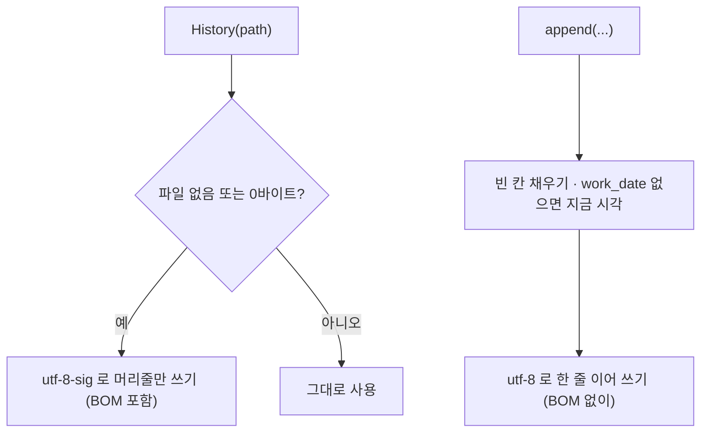

# `src/records/history.py` 코드 리뷰

> v4.1 · 49줄 · 작업 이력 `label_history.csv` (지우거나 고치지 않는 작업 일지)

## 1. 한 줄 요약

manifest는 **지금 상태**만 남기기 때문에, **누가 · 언제 · 무엇을** 했는지는 이 파일에 한 줄씩 **계속 쌓아요.** 저장 버튼을 누를 때마다 한 줄이 늘고, 이미 쓴 줄은 지우거나 고치지 않아요.

```csv
work_date,file_name,action,user,role,status,qa_status,review_reason,scene_type,bbox_count
2026-10-07 10:12:05,a.jpg,work_save,박건,worker,EDITED,WAIT,,kimchi_with_target,3
2026-10-07 11:30:41,a.jpg,qa_pass,최용훈,reviewer,EDITED,PASS,,kimchi_with_target,3
```

## 2. 입력 · 출력 · 실행

| 구분 | 내용 |
|---|---|
| 파일 | `data/manifests/label_history.csv` (10칸) · 제출용 `manifests/label_history.csv`는 사람이 복사해 올림 (산출물 생성은 `dataset_manifest.csv`만 자동 복사) |
| `action` | `work_save`(1차 검수 저장) · `qa_pass`(QA PASS) · `qa_reject`(검수자 반려) |

| 이 기록을 쓰는 곳 | 무엇에 쓰나 |
|---|---|
| main_window `write_records()` | 저장할 때마다 한 줄 추가 |
| reports `qa_numbers()` | 한 번이라도 REVIEW였던 이미지 · 반려 수 → QA Summary 3장 Human QA |
| merge_results | 이미지별 **가장 늦은 작업 시간** → 누구 결과가 이기나 · 충돌 판단 |

## 3. 구조

| 줄 | 내용 |
|--:|---|
| 1~13 | 설명 · CSV 예시 · action 3종 |
| 19~25 | 상수: `COLUMNS`(10칸) · `DATE_FORMAT` · `ACTION_*` |
| 28~34 | `__init__()`: 파일이 없거나 비어 있으면 머리줄만 써서 만들기 |
| 36~43 | `append()`: 한 줄 이어 쓰기 (시간 자동) |
| 45~49 | `read_all()` |

### 흐름 그림



## 4. 핵심 코드 읽기

### 4.1 처음엔 BOM, 이어 쓸 땐 BOM 없이

```python
with open(self.path, "w", encoding="utf-8-sig", newline="") as f:
    csv.writer(f).writerow(COLUMNS)
```

```python
# 이어쓰기는 BOM 없이 utf-8 로! (utf-8-sig 로 이어쓰면 중간에 BOM 이 끼어듭니다)
with open(self.path, "a", encoding="utf-8", newline="") as f:
    csv.DictWriter(f, fieldnames=COLUMNS).writerow(row)
```

- 엑셀은 파일 **맨 앞**에 BOM이 있어야 한글을 UTF-8로 알아봐요. 그래서 처음 만들 때만 `utf-8-sig`로 써요.
- 코드 주석은 "이어 쓸 때 `utf-8-sig`를 쓰면 중간에 BOM이 끼어든다"고 설명해요. 그런데 직접 시험해 보면, 파이썬(CPython)은 **비어 있지 않은 파일**에 이어 쓸 때는 `utf-8-sig`여도 BOM을 붙이지 않아요. 그러니 `utf-8`로 이어 쓰는 건 틀린 게 아니라 **안전한 습관**이고, 주석의 이유 설명만 사실과 조금 달라요. BOM이 실제로 문제가 되는 건 **0바이트 파일**에 `utf-8-sig`로 이어 쓰는 경우인데, `__init__()`가 빈 파일이면 머리줄부터 새로 쓰기 때문에 그 경우도 막혀 있어요.
- `validator.save_run()`도 같은 방식("새 파일이면 utf-8-sig, 아니면 utf-8")을 써요. 프로젝트 전체에 같은 규칙이에요.

### 4.2 시간은 프로그램이 찍는다

```python
row = {c: "" for c in COLUMNS}
row.update({k: ("" if v is None else str(v)) for k, v in fields.items()})
row["work_date"] = row["work_date"] or datetime.now().strftime(DATE_FORMAT)
```

- `DATE_FORMAT = "%Y-%m-%d %H:%M:%S"`로 **자릿수가 고정된** 시간을 찍어요. merge_results는 이 시간을 **문자열 그대로** 비교해서 누가 나중에 작업했는지 정해요. 형식이 고정돼 있어서 글자 순서와 시간 순서가 같아요.
- `work_date`를 넘기면 그 값을 써요. merge_results가 팀원 이력을 합칠 때 **원래 작업 시간을 그대로** 옮기기 위해서예요(합친 시각으로 바뀌면 안 돼요).

### 4.3 manifest와 history를 나눈 이유

| | manifest | history |
|---|---|---|
| 질문 | 이 사진은 **지금** 어떤 상태? | 이 사진에 **무슨 일이** 있었나? |
| 줄 수 | 이미지 1장 = 1줄 (900줄 고정) | 저장할 때마다 +1줄 |
| 고치기 | 덮어씀 | 이어 쓰기만 (지우지 않음) |

- "REVIEW였다가 PASS가 된 사진"은 manifest만 보면 지금 PASS라서 REVIEW였던 흔적이 없어요. history에는 남아 있어요.
- 그래서 QA Summary 3장의 "검토 대상"(27건)과 "교차검수 반려"(3건) 같은 숫자는 history에서 세요. REVIEW 사유별 "제기된 이미지" 칸은 이미지 수가 아니라 이력 **줄 수**로 세어지는 한계가 있어요([`reports.md`](../qa/reports.md) 4.3 참고).
