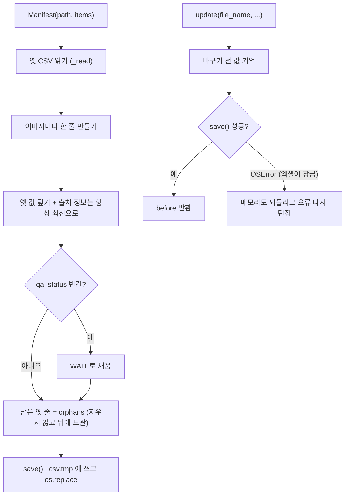

# `src/records/manifest.py` 코드 리뷰

> v4.1 · 109줄 · 산출물 7번 Dataset Manifest (`dataset_manifest.csv`)

## 1. 한 줄 요약

900장이 **지금** 어떤 상태인지 적는 작업대장이에요. **이미지 1장 = 1줄**이라서 저장할 때마다 줄이 늘어나지 않고 그 이미지의 줄만 바뀌어요. "누가 · 언제 · 무엇을"은 `history.py`(`label_history.csv`)에 따로 쌓아요.

## 2. 입력 · 출력 · 실행

직접 실행하지 않고 main_window · validator · reports · merge_results가 가져다 씁니다.

| 구분 | 내용 |
|---|---|
| 입력 | `data/manifests/dataset_manifest.csv` (없으면 새로 만듦) · 작업 공간의 이미지 목록(`ws.items`) |
| 출력 | 같은 CSV (8칸 · `utf-8-sig` · 엑셀에서 한글 안 깨짐) |
| 제출본 | `reports.py`가 프로젝트의 `manifests/dataset_manifest.csv`로 복사 (산출물 생성 시) |

| 함수 · 상수 | 하는 일 | 쓰는 곳 |
|---|---|---|
| `Manifest(path, items)` | 읽기 → 이미지 목록과 맞추기 → 바로 저장 | main_window (폴더 열기) · merge_results · make_reports |
| `get(file_name)` | 한 줄 읽기 (없으면 빈칸 줄) | main_window · validator |
| `update(file_name, **fields)` | 한 줄 갱신 + 즉시 저장 · 실패하면 되돌림 | main_window (`write_records`) |
| `counts()` | PASS · REVIEW · DONE · EDITED · 미작업 · QA 대기 수 | main_window (진행률) · reports |
| `orphans` | manifest에는 있는데 이미지가 없는 줄 | validator (Validation 보고) |
| `COLUMNS` · `STATUS_*` · `QA_*` | 8칸 순서 · 상태 값 | 거의 모든 모듈 |

## 3. 구조

| 줄 | 내용 |
|--:|---|
| 1~20 | 설명: CSV 예시 · status · qa_status · worker 뜻 |
| 26~34 | 상수: `COLUMNS`(8칸) · `STATUS_DONE/EDITED/REVIEW` · `QA_PASS/WAIT` |
| 38~55 | `__init__()`: 옛 CSV + 이미지 목록 맞추기 · orphan 보관 · 저장 |
| 58~77 | `_read()` · `save()` (임시 파일 → 교체) |
| 79~91 | `get()` · `update()` (저장 실패 시 메모리 되돌리기) |
| 94~109 | `image_rows()` · `counts()` |

### 흐름 그림



## 4. 핵심 코드 읽기

### 4.1 열 때마다 이미지 목록에 맞춰 줄을 맞춘다

```python
old = self._read()
for it in items:
    row = {c: "" for c in COLUMNS}
    row.update(old.pop(it.key, {}))
    row.update(file_name=it.key, source_dataset=it.source_dataset,
               original_split=it.original_split)
    row["qa_status"] = row["qa_status"] or QA_WAIT
    self.rows[it.key] = row
self.orphans = old                  # manifest 에는 있는데 이미지가 없는 줄 (Validation 에서 보고)
self.rows.update(old)               # 지우지 않고 뒤에 남겨 둠
self.save()
```

- 사람이 고르는 칸(scene_type · worker · status · review_reason)은 **옛 CSV 값을 그대로** 가져와요.
- 출처 칸(`source_dataset` · `original_split`)은 **폴더 위치에서 매번 다시** 채워요. 사람이 CSV를 잘못 고쳐도 다음에 열 때 바로잡혀요.
- `old.pop()`으로 짝을 찾은 줄을 꺼내고 나면 `old`에는 **이미지가 없는 줄**만 남아요. 이 줄을 지우지 않고 `orphans`로 보관하는 이유는, 원본을 잘못 옮겨서 생긴 문제일 수 있기 때문이에요. 조용히 지우지 않고 Validation의 `manifest` 오류로 사람에게 보여 줘요.

### 4.2 엑셀이 파일을 잠가도 화면과 CSV가 어긋나지 않게

```python
def update(self, file_name, **fields):
    before = dict(self.rows[file_name])
    self.rows[file_name].update({k: ("" if v is None else str(v)) for k, v in fields.items()})
    try:
        self.save()
    except OSError:
        self.rows[file_name] = before            # 파일에 못 썼으면 메모리도 원래대로
        raise
    return before
```

- 윈도우에서 엑셀로 CSV를 열어 두면 파일이 잠겨서 저장이 실패해요(README 14장 주의사항).
- 그때 메모리 값만 바뀌면 화면의 "QA PASS"와 CSV의 "WAIT"가 서로 달라져요. 그래서 **저장에 실패하면 메모리도 원래대로 되돌리고** 오류를 위로 던져요.
- main_window의 `write_records()`가 이 오류를 받아 "TXT는 저장했지만 manifest 기록 실패, 엑셀을 닫고 다시 저장"이라고 안내해요.

### 4.3 진행률 숫자는 manifest에서 바로 센다

```python
"PASS": sum(r["qa_status"] == QA_PASS for r in rows),
"TODO": sum(not r["status"] for r in rows),
"WAIT_QA": sum(r["status"] in (STATUS_DONE, STATUS_EDITED) and r["qa_status"] != QA_PASS
               for r in rows),
```

- `True`는 1, `False`는 0으로 더해지는 파이썬 성질을 이용해 조건에 맞는 줄 수를 세요.
- **REVIEW는 QA 대기에 넣지 않아요.** 검수자가 PASS할 수 있는 건 DONE · EDITED뿐이고, REVIEW는 먼저 팀이 판단해야 하기 때문이에요(validator도 "REVIEW인데 PASS"를 오류로 봐요).
- `image_rows()`로 orphan 줄을 빼고 세기 때문에 전체 수는 실제 이미지 수(900)와 같아요.
