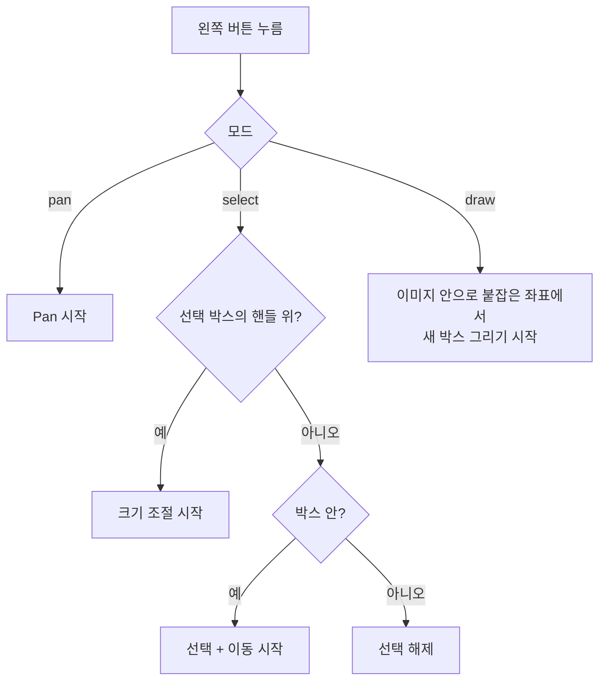

# `src/ui/canvas.py` 코드 리뷰

> v4.1 · 402줄 · 이미지와 BBox를 그리고 Zoom · Pan · 마우스를 처리하는 화면

## 1. 한 줄 요약

**좌표계가 두 개**라는 것만 기억하면 돼요. BBox는 항상 **원본 이미지 좌표**로 저장하고, 화면에 그릴 때만 **Canvas 좌표**로 바꿔요. Zoom은 `scale`을, Pan은 `offset`을 바꾸는 것뿐이에요.

```
Canvas = 원본 × scale + offset
원본   = (Canvas − offset) ÷ scale
```

## 2. 입력 · 출력 · 실행

`main_window.py`가 `ImageCanvas(...)`를 만들 때 콜백 함수들을 넘겨줘요. canvas는 오른쪽 패널이나 상태줄을 직접 고치지 않고 **"무엇이 바뀌었는지"만 알려요.**

| 받는 것 | 뜻 |
|---|---|
| `manager` | `BBoxManager` (박스 데이터) |
| `class_style(id)` | Class 번호 → (이름, 색). 설정 파일을 몰라도 되게 함수로 받음 |
| `get_class()` | 새 박스에 쓸 현재 Class |
| `on_select` · `on_edit(msg)` · `on_live` · `on_status(text)` | 선택 변경 · 편집 완료 · 드래그 중 · 상태줄 글 |

| 메서드 | 하는 일 | 쓰는 곳 |
|---|---|---|
| `to_image()` · `to_canvas()` · `clamp()` | 좌표 변환 · 이미지 안으로 붙잡기 | bbox_editor · main_window · **self_test** |
| `render()` · `draw_boxes()` | 이미지 + 박스 다시 그리기 / 박스만 다시 그리기 | main_window |
| `zoom_at()` · `fit_to_window()` | 마우스 위치 기준 확대 · 창에 맞추기 | 휠 · 단축키 · **self_test** |

## 3. 구조

| 줄 | 내용 |
|--:|---|
| 1~39 | 설명(좌표계 두 개) · 상수: 최소 박스 4px · Zoom 1.25배 · 최대 2000% · 커서 모양 |
| 42~79 | `ImageCanvas.__init__()`: 콜백 · `scale` · `off_x` · `off_y` · `fit_mode` |
| 85~93 | ① `set_image()` · `set_mode()` |
| 99~116 | ② 좌표 변환: `to_image()` · `to_canvas()` · `clamp()` · `event_to_image()` |
| 122~190 | ③ 그리기: `render()`(보이는 부분만 잘라 확대) · `draw_boxes()`(선택 박스 맨 위 · 핸들 8개) |
| 196~247 | ④ Zoom · Pan |
| 253~402 | ⑤ 마우스: 왼쪽(선택 · 이동 · 그리기) · 오른쪽 / 가운데(언제든 Pan) · 휠(Zoom) · 창 크기 변경 |

### 흐름 그림 (왼쪽 버튼 누름)



## 4. 핵심 코드 읽기

### 4.1 좌표 변환 세 줄이 전부

```python
def to_image(self, cx, cy):
    return (cx - self.off_x) / self.scale, (cy - self.off_y) / self.scale

def to_canvas(self, ix, iy):
    return ix * self.scale + self.off_x, iy * self.scale + self.off_y

def clamp(self, ix, iy):
    """원본 좌표를 이미지 안쪽(0 ~ w, 0 ~ h)으로 붙잡아 둡니다."""
    return min(max(ix, 0.0), float(self.img_w)), min(max(iy, 0.0), float(self.img_h))
```

- 확대해서 그렸어도 박스는 항상 원본 좌표로 저장돼요. 그래서 **Zoom 배율과 상관없이 저장되는 TXT가 같아요.**
- `self_test.py`는 화면 없이 이 함수들을 그대로 빌려 써서(`_View` 클래스) "Zoom · Pan을 해도 좌표 왕복이 정확한가"를 시험해요.

### 4.2 확대해도 느려지지 않는 이유: 보이는 부분만 자르기

```python
# 핵심 아이디어: 전체 이미지를 확대하지 않고 '화면에 보이는 부분만' 잘라서 확대
# → 2000% 로 확대해도 메모리/속도 문제가 없습니다.
s = self.scale
x0, y0 = self.clamp(*self.to_image(0, 0))
x1, y1 = self.clamp(*self.to_image(cw, ch))
left, top = int(x0), int(y0)
right, bottom = min(self.img_w, int(x1) + 1), min(self.img_h, int(y1) + 1)

if right > left and bottom > top:
    region = self.pil_image.crop((left, top, right, bottom))
```

- 4K 사진을 2000%로 통째로 키우면 수십억 픽셀이 돼서 메모리가 터져요.
- 그래서 **화면 네 귀퉁이가 원본의 어디인지** 계산하고, 그 부분만 잘라서 화면 크기로 키워요. 화면에 보이는 픽셀 수는 배율과 상관없이 거의 같아요.
- 3배 이상 확대하면 `NEAREST`(픽셀을 또렷하게)로, 평소에는 `BILINEAR`(부드럽게)로 키워요. 작은 이물의 경계를 픽셀 단위로 맞출 때 흐리지 않게 하려는 거예요.
- `self.tk_image`에 그림을 **붙잡아 두는** 것도 중요해요. tkinter는 파이썬 변수에서 사라진 그림을 화면에서도 지워 버려요.

### 4.3 마우스 아래 지점을 고정한 채로 Zoom

```python
new_scale = min(max(self.scale * factor, self.fit_scale() * 0.2), MAX_SCALE)
...
self.off_x = cx - (cx - self.off_x) * new_scale / self.scale
self.off_y = cy - (cy - self.off_y) * new_scale / self.scale
self.scale = new_scale
```

- 휠을 굴릴 때 마우스가 가리키는 이물이 화면 밖으로 도망가지 않게, 그 지점의 원본 좌표가 **확대 전후에 같은 화면 위치**에 오도록 offset을 다시 계산해요.
- 배율은 "창에 맞춘 크기의 20%"부터 "2000%"까지만 허용해요.

### 4.4 이동만 이미지 밖 좌표를 쓴다

```python
ix, iy = self.event_to_image(event)
if self.editor.drag_type == "move":       # 이동은 이미지 밖 좌표도 필요 (clamp 는 editor 가)
    ix, iy = self.to_image(event.x, event.y)
```

- 그리기 · 크기 조절은 마우스 좌표를 **이미지 안으로 붙잡아서** 넘겨요. 그래서 박스가 이미지 밖으로 나갈 수 없어요.
- 이동은 붙잡지 않은 좌표를 넘기고, `bbox_editor`가 박스 크기를 유지한 채 이미지 안에 두어요. 이렇게 역할을 나눠서, 이동 중에 박스가 찌그러지지 않아요.
- 프로그램이 만든 박스는 이렇게 처음부터 이미지 밖으로 나갈 수 없어요. 그래서 `self_test`는 프로그램이 저장한 TXT에서 `format` · `bbox_bounds` 오류가 나오면 **프로그램 버그**로 봐요.
