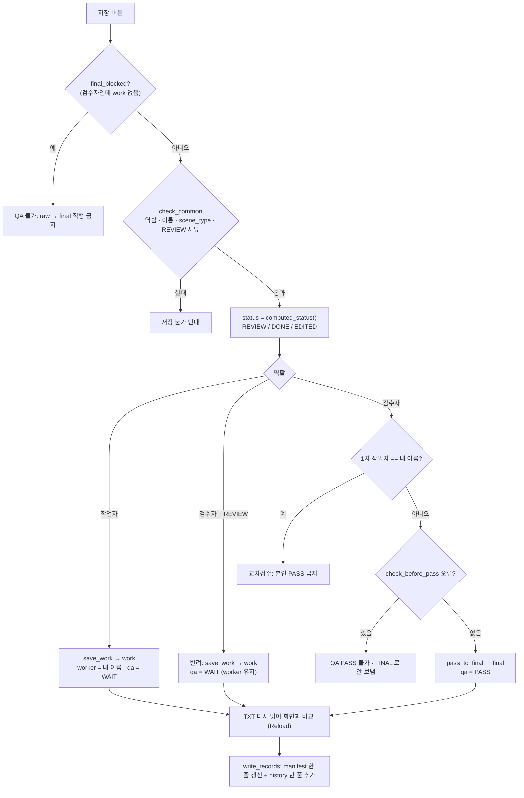

# `src/ui/main_window.py` 코드 리뷰

> v4.1 · 1,310줄 · 프로그램의 "지휘자" (화면 · 버튼 · 저장 흐름)

## 1. 한 줄 요약

화면 배치, 메뉴, 단축키, 그리고 **버튼을 누르면 어느 모듈에 일을 시킬지**를 정하는 파일이에요. 실제 일(TXT 쓰기 · 검사 · 기록)은 다른 모듈이 해요. 이 파일에서 가장 중요한 건 **저장 버튼 하나가 역할에 따라 세 가지로 갈리는 흐름**이에요. 작업자 저장, 검수자 반려, 검수자 QA PASS가 모두 `save_labels()` 한 함수에서 정해져요.

> 1,310줄을 한 번에 읽기는 어려워서, 이 문서는 **8장 저장 · 교차검수 흐름**을 중심으로 읽어요. 화면 만들기(1장)나 이벤트 연결(2장)은 tkinter 코드라서 구조 표로만 정리했어요.

## 2. 입력 · 출력 · 실행

`main.py`가 `classes.yaml`을 읽어 만든 `config`로 `MainWindow(root, config)`를 만들어요.

| 버튼 · 메뉴 | 부르는 함수 | 일을 시키는 모듈 |
|---|---|---|
| 파일 > data 폴더 열기 (Ctrl+O) | `open_folder` → `load_folder` | yolo_loader (`build_workspace`) · manifest · history |
| 이미지 이동 (A / D · 목록 클릭) | `move_to` → `load_image` | yolo_loader (`find_label_to_load` · `read_yolo_file`) |
| **저장 (Ctrl+S) · 저장 후 다음 (Ctrl+Enter)** | **`save_labels`** | yolo_writer · validator · manifest · history |
| 검사 > 전체 Validation (F7) | `run_validation` → `validate_now` | validator · validation_window |
| 검사 > 자동 테스트 | `run_self_tests` | self_test |
| 검사 > 산출물 생성 · Handoff | `export_reports` · `make_handoff` | reports |
| 파일 > 결과 묶음 · 합치기 | `pack_results` · `merge_results` | tools/merge_results |

## 3. 구조

| 줄 | 내용 |
|--:|---|
| 1~20 | 설명: 모듈 분담 · 작업 흐름(raw → work → final) |
| 22~44 | import (BBox · 기록 · 검사 · 저장 모듈) |
| 46~91 | 상수: 색 · `STAGE_STYLE`(라벨 출처 배지) · **`FILTERS`(목록 필터 6종)** · `row_style()` |
| 94~152 | `__init__()`: 작업 공간 변수 · `raw_sig`(원본 지문) · 화면 변수 · 시작 시 "선택 이동" 모드 |
| 154~188 | 0장 도우미: Class 이름 · 색 · 현재 manifest 줄 · REVIEW 사유 |
| 190~462 | 1장 화면 구성: 메뉴 · 왼쪽(작업자 정보 · 이미지 목록 · scene_type) · 가운데(Canvas) · 오른쪽(Class 선택 · BBox 정보 · 검수 상태 · BBox 목록) · 도구 막대 |
| 463~512 | 2장 단축키 · 이벤트 연결 (입력칸에 글자를 치는 중에는 알파벳 단축키 양보) |
| 514~603 | 3장 data 폴더 열기 · 이미지 목록 · 필터 · 진행률 |
| 605~657 | 4장 이미지 열기: 라벨 고르기(work > final > raw) · **원본 지문 저장** · `final_blocked()` |
| 659~741 | 5장 화면 갱신: 헤더 배지 · **`computed_status()`(DONE / EDITED / REVIEW 자동 판정)** |
| 743~813 | 6장 역할 · 이름 · REVIEW 체크 → 저장 버튼 글자 · 색 바꾸기 |
| 815~921 | 7장 모드 · Class 바꾸기 · 삭제 · 되돌리기 |
| **923~1085** | **8장 저장: `check_common()` · `save_labels()` · `write_records()` · `save_and_next()` · Reload · RAW 되돌리기** |
| 1087~1234 | 9장 Validation · 자동 테스트 · 산출물 · Handoff · 결과 묶음 · 합치기 |
| 1236~1310 | 10장 저장 안 한 변경 확인 · 이전 / 다음 · 단축키 안내 · 종료 |

### 흐름 그림 (`save_labels`)



## 4. 핵심 코드 읽기

### 4.1 DONE / EDITED는 사람이 고르지 않는다: 원본 지문 비교

```python
raw_boxes, _ = read_yolo_file(it.label_path(STAGE_RAW), self.img_w, self.img_h)
self.raw_sig = label_signature(raw_boxes, self.img_w, self.img_h)
```

```python
def computed_status(self):
    """REVIEW 체크 → REVIEW, 아니면 원본(raw)과 같으면 DONE, 다르면 EDITED"""
    if self.review_var.get():
        return STATUS_REVIEW
    return STATUS_DONE if self.current_sig() == self.raw_sig else STATUS_EDITED
```

- 이미지를 열 때(`load_image`) **원본 raw 라벨의 지문**을 만들어 둬요. 저장할 때 지금 화면의 박스 지문과 비교해요.
- **지문**(`yolo_loader.label_signature`)은 `(Class, 중심 x, 중심 y, 너비, 높이)`를 소수점 4자리로 반올림해 정렬한 목록이에요. 박스 순서가 바뀌거나 아주 작게 흔들린 건 "수정"으로 세지 않아요.
- 작업자가 DONE과 EDITED를 직접 고르게 하면 "고쳤는데 DONE"이라고 잘못 고를 수 있어요. 그래서 **프로그램이 자동으로 판정**해요. QA Summary의 "기존 라벨 52%(469장) 수정"은 이렇게 세어진 숫자예요.

### 4.2 교차검수: 본인이 1차 검수한 사진은 PASS할 수 없다

```python
else:                                            # QA PASS
    if not self.rules.get("allow_self_review", False) and row["worker"] == name:
        messagebox.showwarning("교차검수", f"{name} 님이 1차 검수한 이미지입니다.\n"
                               "교차검수 원칙에 따라 다른 검수자가 QA PASS 해야 합니다.")
        return False
```

- `row["worker"]`는 manifest에 적힌 **1차 검수자**예요. 지금 검수자 이름과 같으면 PASS를 막아요.
- 규칙은 `configs/classes.yaml`의 `rules.allow_self_review: false`에서 와요. 코드를 고치지 않고 설정만으로 켜고 끌 수 있어요. 값이 없으면 기본값도 `False`(막기)라서, 설정을 실수로 지워도 안전한 쪽으로 동작해요.
- **반려**할 때는 `fields`에 `worker`를 넣지 않아요(988줄). 검수자가 반려해도 1차 작업자 이름이 그대로 남아서, 다시 고쳐 온 사진을 같은 작업자가 PASS하는 일이 생기지 않아요.

### 4.3 QA PASS 직전 검사: 통과 못 하면 final로 안 보낸다

```python
lines = format_yolo_lines(boxes, self.img_w, self.img_h)
errors, warnings = self.validator.check_before_pass(lines, scene, self.img_w, self.img_h)
if errors:
    messagebox.showerror("QA PASS 불가", "아래 문제를 고친 뒤 다시 저장하세요.\n\n"
                         + "\n".join(errors[:12]))
    self.set_status(f"✖ 검사 실패 {len(errors)}건 → FINAL 로 보내지 않았습니다.")
    return False
if warnings and not messagebox.askyesno("확인", "\n".join(warnings) + "\n\nQA PASS 할까요?"):
    return False
```

- 파일에 쓰기 **전에**, 화면의 박스를 TXT 줄로 바꿔 검사해요. F7 전체 검사와 같은 `parse_lines()`를 쓰니 기준이 같아요.
- **오류**(Class 번호 · 좌표 범위 · scene_type 불일치)는 막고, **경고**(2px 미만 박스 · 같은 박스 중복 · other_review)는 사람에게 물어봐요. "틀린 것"과 "이상해 보이는 것"을 구분하는 거예요.

### 4.4 저장한 뒤 다시 읽어서 확인 (Reload 검증)

```python
reloaded, bad = read_yolo_file(path, self.img_w, self.img_h)
same = len(reloaded) == len(boxes) and not bad and all(
    a["cls"] == b["cls"] and all(abs(a[k] - b[k]) < 0.5 for k in ("x1", "y1", "x2", "y2"))
    for a, b in zip(reloaded, boxes))
```

- 저장한 TXT를 **곧바로 다시 읽어서** 화면의 박스와 비교해요. 좌표 오차는 0.5픽셀까지 허용해요.
- 픽셀 → 0~1 → 픽셀로 바꾸는 과정에서 계산이 틀렸다면 여기서 바로 "⚠ 다름"이 떠요. 이건 실제 작업 중에 매번 하는 확인이고, Test Report의 "저장 후 Reload" 항목은 `self_test.py`가 **임시 폴더**에서 같은 확인을 자동으로 시험한 결과예요.

### 4.5 TXT와 기록이 따로 실패할 수 있다

```python
def write_records(self, it, fields, action, role, name, bbox_count):
    try:
        self.manifest.update(it.key, **fields)
        ...
        self.history.append(file_name=it.key, action=action, user=name, role=role, ...)
        return True
    except OSError as e:
        messagebox.showwarning("manifest 기록 실패",
                               "TXT 는 저장했지만 dataset_manifest.csv 에 기록하지 못했습니다.\n"
                               "엑셀에서 파일을 닫고 같은 이미지를 다시 저장해 주세요.\n\n" + str(e))
        return False
```

- 저장은 **TXT 먼저, 기록(manifest · history)은 나중**에 해요. 엑셀이 CSV를 잠그고 있으면 TXT는 저장됐는데 기록만 실패할 수 있어요.
- 이때 숨기지 않고 "TXT는 저장, 기록 실패"를 정확히 알려 주고, 같은 이미지를 다시 저장하게 해요. `manifest.update()`가 실패하면 메모리 값도 되돌리기 때문에, 화면과 CSV가 서로 다른 상태로 남지 않아요.

### 4.6 이미지 목록 필터: manifest 한 줄로 판단

```python
FILTERS = {
    "전체": lambda r, me: True,
    "미작업 (1차 검수 전)": lambda r, me: not r["status"],
    "QA 대기 (DONE · EDITED)": lambda r, me: r["status"] in (STATUS_DONE, STATUS_EDITED) and r["qa_status"] != QA_PASS,
    "REVIEW": lambda r, me: r["status"] == STATUS_REVIEW,
    "QA PASS": lambda r, me: r["qa_status"] == QA_PASS,
    "내가 1차 검수한 것": lambda r, me: bool(me) and r["worker"] == me,
}
```

- 필터 하나가 **"manifest 한 줄 → 보일지 말지"를 정하는 작은 함수(lambda)** 예요. 새 필터가 필요하면 한 줄만 추가하면 돼요.
- 작업자는 "미작업", 검수자는 "QA 대기"만 켜 두면 자기 할 일만 보여요. A / D 이동도 필터 목록 안에서만 움직여요(`neighbor()`).
- 저장 후 필터 조건이 바뀌면(예: QA 대기 → PASS) `save_and_next()`가 목록을 다시 만들어요.
