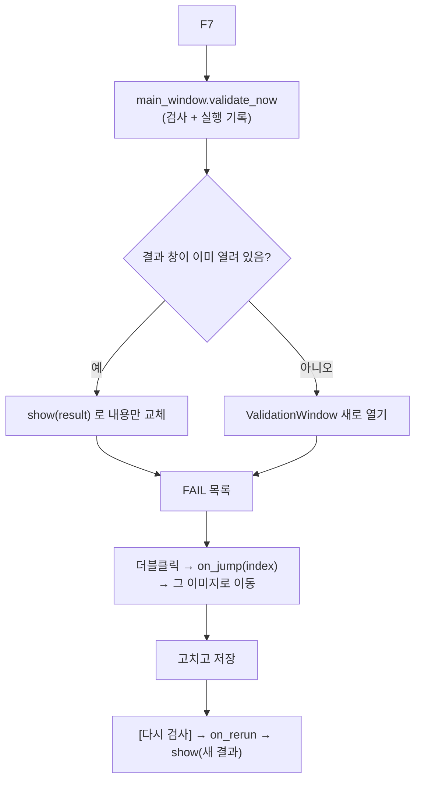

# `src/ui/validation_window.py` 코드 리뷰

> v4.1 · 96줄 · F7 전체 Validation 결과 창

## 1. 한 줄 요약

`validator.validate_dataset()`의 결과를 **보여 주기만** 하는 창이에요. 위에는 요약(전체 · PASS · FAIL · 오류 종류별 건수), 아래에는 FAIL 목록이 있어요. 목록을 **더블클릭하면 그 이미지로 바로 이동**하고, 고친 뒤 **[다시 검사]** 를 누르면 같은 창에서 결과가 바뀌어요.

## 2. 입력 · 출력 · 실행

| 구분 | 내용 |
|---|---|
| 입력 | `ValidationResult` · `on_jump(index)` (이미지로 이동) · `on_rerun()` (다시 검사 후 새 결과 반환) |
| 출력 | 화면만 (파일을 쓰지 않음 · 실행 기록은 main_window의 `validate_now()`가 `save_run`으로 남김) |
| 여는 곳 | main_window `run_validation()` (F7) · 이미 열려 있으면 새로 만들지 않고 `show()`로 내용만 바꿈 |

## 3. 구조

| 줄 | 내용 |
|--:|---|
| 1~16 | 설명 · import (`ERROR_TYPES`만 가져옴) |
| 19~63 | `__init__()`: 요약 글 · 오류 종류 필터 · FAIL 목록 · [다시 검사] · [닫기] |
| 65~74 | `show(result)`: 요약 3줄 만들기 |
| 76~86 | `fill_list()`: 오류 종류 필터 적용 |
| 88~96 | `on_double()` · `rerun()` |

### 흐름 그림



## 4. 핵심 코드 읽기

### 4.1 검사는 하지 않고 함수만 받는다

```python
def __init__(self, parent, result, on_jump, on_rerun):
```

- 창은 이미지 목록이나 manifest를 직접 알지 못해요. **이동하는 법(`on_jump`)과 다시 검사하는 법(`on_rerun`)을 함수로 받아서** 부르기만 해요.
- 그래서 검사 규칙이 바뀌어도 이 파일은 고칠 필요가 없어요. 검사는 validator, 이동은 main_window가 맡아요.

### 4.2 짝 없는 파일은 이동할 수 없다

```python
def on_double(self, event):
    sel = self.listbox.curselection()
    if sel and sel[0] < len(self.rows) and self.rows[sel[0]]["index"] is not None:
        self.on_jump(self.rows[sel[0]]["index"])
```

- FAIL 목록에는 이미지 말고도 **짝 없는 파일**(원본 없이 남은 final TXT 등)과 manifest orphan 줄이 있어요. 이런 항목은 열 이미지가 없어서 `index`가 `None`이에요. 더블클릭해도 아무 일도 일어나지 않아요.
- 이미지로 이동할 때 main_window의 `jump_to()`는, 그 이미지가 지금 목록 필터에 없으면 **필터를 "전체"로 바꾼 뒤** 이동해요. 그래서 "QA 대기" 필터를 켜 둔 상태에서도 FAIL 이미지로 갈 수 있어요.

### 4.3 오류 종류로 걸러 보기

```python
want = self.type_var.get()
code = next((k for k, v in ERROR_TYPES.items() if v == want), None)
self.rows = [r for r in self.result.failed
             if code is None or any(c == code for c, _ in r["errors"])]
```

- 콤보박스에는 한글 이름("BBox 이미지 경계 초과")이 보이고, 결과에는 코드(`bbox_bounds`)가 들어 있어요. `ERROR_TYPES`에서 이름 → 코드로 되찾아 비교해요.
- "전체"는 `ERROR_TYPES`에 없어서 `code`가 `None`이 되고, 모든 FAIL이 보여요.
- 오류 종류 이름이 validator 한 곳(`ERROR_TYPES`)에만 있으니, 이름을 바꿔도 이 창은 자동으로 따라가요.
