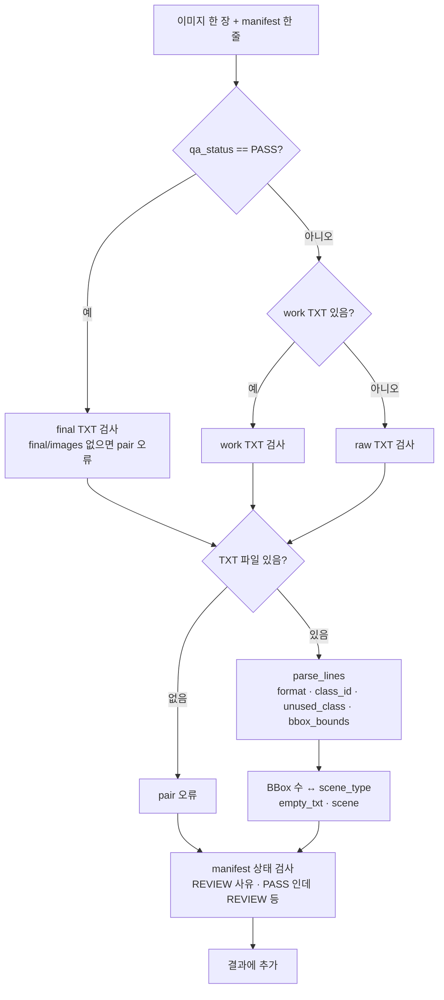

# `src/validation/validator.py` 코드 리뷰

> v4.1 · 330줄 · 산출물 8번 QA Summary의 Validation 숫자가 나오는 곳

## 1. 한 줄 요약

검사를 **세 단계**로 해요. ① 프로그램이 켜질 때 설정 파일(`classes.yaml`)을 검사하고, ② 검수자가 QA PASS하기 직전에 한 장을 검사하고, ③ F7을 누르면 900장 전체를 **8가지 오류 종류**로 검사해요. 체온계처럼 "언제 재느냐"만 다르고, TXT 한 줄을 읽는 방법은 `parse_lines()` 하나로 같아요.

## 2. 입력 · 출력 · 실행

직접 실행하지 않습니다. 각 단계를 부르는 곳이 달라요.

| 함수 · 클래스 | 하는 일 | 쓰는 곳 |
|---|---|---|
| `validate_config(data)` | `classes.yaml` 검사 → 오류 메시지 목록 (빈 목록 = 통과) | main.py (시작 시) |
| `LabelValidator.parse_lines()` | TXT 줄 → (BBox 수, 오류, 경고) | 아래 두 함수 · self_test |
| `LabelValidator.check_scene()` | scene_type과 BBox 수가 말이 되는지 | `check_before_pass` |
| `LabelValidator.check_before_pass()` | QA PASS 직전 검사 (+ 2px 미만 박스 경고) | main_window (`save_labels`) |
| `validate_dataset(ws, manifest, validator)` | 900장 전체 검사 → `ValidationResult` | main_window (F7) · make_reports |
| `save_run()` | 실행할 때마다 `data/manifests/validation_runs.csv`에 한 줄 | main_window · make_reports |
| `read_runs()` · `write_report_csv()` | 실행 기록 읽기 · `reports/validation_report.csv` 쓰기 | reports.py |

## 3. 구조

| 줄 | 내용 |
|--:|---|
| 1~21 | 설명: 3단계 · 오류 종류 8가지 · "빈 TXT는 무조건 오류가 아님" |
| 27~40 | 상수: `COORD_EPS`(1e-4) · `TINY_BOX_PX`(2) · `ERROR_TYPES` 8개 · `NORMAL_SCENE` |
| 47~93 | ① `validate_config()` |
| 100~183 | ② `LabelValidator`: `parse_lines()` · `check_scene()` · `check_before_pass()` |
| 190~218 | ③ `ValidationResult`: `failed` · `pass_count` · `fail_count` · `by_type()` |
| 226~287 | ③ `validate_dataset()`: 이미지마다 검사 → 짝 없는 파일 · orphan 검사 |
| 294~330 | ④ `save_run()` · `read_runs()` · `write_report_csv()` |

### 흐름 그림 (`validate_dataset` · 이미지 한 장)



전체 이미지를 다 본 뒤에는 **짝 없는 파일**(final · work에 TXT나 이미지는 있는데 원본이 없음)과 manifest orphan 줄을 따로 모아요.

## 4. 핵심 코드 읽기

### 4.1 한 줄 검사: 형식 → Class → 좌표 순서

```python
if len(parts) != 5:
    errors.append(("format", f"{no}줄: 값이 5개가 아닙니다. ({len(parts)}개)"))
    continue
try:
    cls = int(parts[0])
    xc, yc, w, h = map(float, parts[1:])
except ValueError:
    errors.append(("format", f"{no}줄: 숫자가 아닌 값이 있습니다."))
    continue
count += 1

if not (0 <= cls < len(self.classes)):
    errors.append(("class_id", f"{no}줄: 없는 Class 번호입니다. ({cls})"))
elif not self.classes[cls]["enabled"]:
    errors.append(("unused_class", ...))
```

- **형식이 틀리면 `continue`** 로 다음 줄로 넘어가요. 숫자가 아닌 줄에서 좌표 검사를 하면 프로그램이 멈추기 때문이에요.
- Class 4(고무장갑)는 번호 자체는 맞기 때문에 `class_id`가 아니라 **`unused_class`** 로 따로 세요. Class 기준서대로 임의로 지우지 않고 REVIEW로 보내기 위해서예요.
- 좌표는 `COORD_EPS = 1e-4`만큼 봐줘요. 소수점 6자리로 저장하면서 1.0000001처럼 아주 조금 넘는 값이 생길 수 있어서, 이걸 오류로 세지 않으려는 거예요.
- 똑같은 줄이 두 번 나오면 오류가 아니라 **경고**예요. 실수일 가능성이 높지만, 데이터가 망가진 건 아니기 때문이에요.

### 4.2 빈 TXT는 무조건 오류가 아니다

```python
if scene_type == NORMAL_SCENE and box_count > 0:
    errors.append(("scene", ...))
if scene_type != NORMAL_SCENE and box_count == 0:
    errors.append(("empty_txt", ...))
```

- BBox가 0개라도 scene_type이 `normal_kimchi`(검출 대상 없음)면 **정상**이에요.
- 반대로 이물이 있다고 고른 사진(`kimchi_with_target` 등)에 박스가 0개면 "확인 필요"예요.
- 즉, **TXT만 보지 않고 사람이 고른 scene_type과 함께** 판단해요.
- 같은 규칙이 `check_scene()`(160~164줄)과 `validate_dataset()`(255~259줄) **두 곳에** 적혀 있어요. 한쪽만 고치면 "저장할 때는 통과, F7에서는 실패"처럼 결과가 어긋날 수 있으니, 고칠 때는 두 곳을 함께 봐야 해요.
- 참고로 900장에는 `normal_kimchi`가 0장이었어요(README 14장 알려진 제한사항). 그래서 실제 데이터에서는 `scene` 오류가 나올 수 없었어요. Golden · Pilot 자동 테스트(`self_test.py`)도 `parse_lines()`만 부르고 scene_type 규칙은 시험하지 않아요. 이 규칙은 **아직 검증되지 않은 부분**으로 남아 있어요.

### 4.3 지금 쓰이는 라벨만 검사한다

```python
if row["qa_status"] == QA_PASS:
    stage, label = STAGE_FINAL, it.label_path(STAGE_FINAL)
    if not it.final_image_path.is_file():
        errors.append(("pair", "QA PASS 인데 final/images 에 이미지가 없습니다."))
elif it.label_path(STAGE_WORK).is_file():
    stage, label = STAGE_WORK, it.label_path(STAGE_WORK)
else:
    stage, label = STAGE_RAW, it.label_path(STAGE_RAW)
```

- 한 이미지에 raw · work · final 라벨이 함께 있을 수 있어요. 이때 **지금 이 이미지의 대표 라벨 하나만** 검사해요.
  - PASS면 final을 검사해요(학습에 실제로 들어갈 파일이에요).
  - 1차 검수만 끝났으면 work를 검사해요.
  - 아직 아무도 손대지 않았으면 raw를 검사해요.
- 그래서 첫 Validation에서는 **raw 원본의 오류**가 보이고, 검수가 끝날수록 그 숫자가 줄어요. QA Summary의 "Validation 최초 → 최종" 비교가 이 흐름에서 나와요. (이번 900장은 최초 실행부터 8종 모두 0건이었어요. 원본의 문제는 형식이 아니라 **라벨 내용**(누락 · Class 오분류 · 좌표)에 있었고, 그건 사람의 검수로 고쳤어요.)
- QA PASS 이미지는 **TXT와 이미지 한 쌍**이 다 있는지도 확인해요.

### 4.4 실행할 때마다 한 줄씩 남긴다

```python
row = {"run_at": result.run_at, "total": result.total, "pass": result.pass_count,
       "fail": result.fail_count, **result.by_type(),
       "failed_files": ";".join(r["file_name"] for r in result.failed)}
with open(runs_path, "a", encoding="utf-8-sig" if new else "utf-8", newline="") as f:
```

- `validation_runs.csv`에는 F7을 누를 때마다 한 줄이 쌓여요. 첫 줄과 마지막 줄을 비교하면 "처음엔 몇 건이었고 지금은 몇 건"인지 증명할 수 있어요.
- **인코딩**: 새 파일일 때만 `utf-8-sig`(엑셀용 BOM)로 쓰고, 이어 쓸 때는 `utf-8`로 써요. 엑셀은 파일 맨 앞에 BOM이 있어야 한글을 알아보는데, 그건 처음 한 번이면 충분해요. (참고: 파이썬은 비어 있지 않은 파일에 `utf-8-sig`로 이어 써도 BOM을 다시 붙이지 않아요. 그래도 `utf-8`로 이어 쓰는 게 의도가 분명한 습관이에요. `history.py`도 같은 규칙이에요.)
- `by_type()`은 한 이미지에 같은 종류 오류가 여러 줄 있어도 **1건**으로 세요(`set` 사용). 그래서 "오류 종류별 이미지 수"가 돼요.
