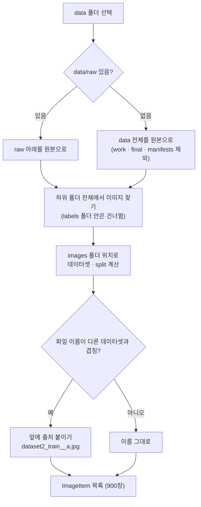

# `src/yolo/yolo_loader.py` 코드 리뷰

> v4.1 · 279줄 · data 폴더를 900장 작업 목록으로 만드는 곳 ("읽기"만 담당)

## 1. 한 줄 요약

`data/raw` 아래에 흩어진 데이터셋 폴더들을 **하나의 작업 목록(900장)** 으로 모으고, 이미지마다 raw · work · final 라벨이 **어디에 있는지** 계산하고, YOLO TXT를 **픽셀 좌표 BBox**로 읽어 와요. 디스크에 쓰는 일은 하지 않아요(쓰기는 `yolo_writer.py`가 해요).

## 2. 입력 · 출력 · 실행

직접 실행하지 않고 거의 모든 모듈이 가져다 써요.

| 함수 · 클래스 | 하는 일 | 쓰는 곳 |
|---|---|---|
| `build_workspace(folder)` | data 폴더 → `Workspace` (이미지 목록 · 출처 · 겹치는 이름 처리) | main_window · merge_results · make_reports |
| `Workspace` | `raw_dir` · `work_dir` · `final_dir` · `manifest_path` · `history_path` · `runs_path` · `is_raw()` | yolo_writer · validator · reports |
| `ImageItem` | 이미지 한 장: `key`(통합 이름) · `source_dataset` · `original_split` · `label_path(stage)` · `final_image_path` | 거의 모든 모듈 |
| `find_label_to_load(item)` | 화면에 띄울 라벨 고르기 (work > final > raw) | main_window |
| `read_yolo_file(path, w, h)` | TXT → BBox 목록 (픽셀) + 형식 오류 줄 번호 | main_window · self_test |
| `yolo_to_bbox()` | YOLO 0~1 → 픽셀 `(x1, y1, x2, y2)` | `read_yolo_file` · self_test |
| `label_signature()` | BBox 목록 → 비교용 지문 (DONE / EDITED 판정) | main_window |

## 3. 구조

| 줄 | 내용 |
|--:|---|
| 1~29 | 설명: 담당 · data 폴더 구조 그림 · "읽기만 함" |
| 31~50 | 상수: `STAGE_*` · `LOAD_PRIORITY`(work > final > raw) · 이미지 확장자 · `WORKSPACE_DIRS` |
| 57~63 | ① `yolo_to_bbox()` |
| 70~107 | ② `Workspace`: 폴더 경로 · CSV 경로 · `is_raw()` |
| 110~151 | ② `ImageItem`: `label_path()` · `final_image_path` · `origin_text` |
| 158~207 | ③ `dataset_label()` · `build_workspace()` |
| 214~223 | ④ `find_label_to_load()` |
| 230~264 | ⑤ `read_yolo_file()` |
| 267~279 | `label_signature()` |

### 흐름 그림 (`build_workspace`)



## 4. 핵심 코드 읽기

### 4.1 단계별 라벨 위치: raw는 원래 자리, work · final은 한 폴더

```python
def label_path(self, stage):
    """단계별 라벨 경로.  raw 는 데이터셋 안의 원래 TXT, work / final 은 통합 폴더"""
    if stage == STAGE_RAW:
        return self.dataset_dir / "labels" / self.original_split / (self.path.stem + ".txt")
    if stage == STAGE_WORK:
        return self.ws.work_dir / "labels" / self.label_name
    if stage == STAGE_FINAL:
        return self.ws.final_dir / "labels" / self.label_name
```

- **raw**는 받은 폴더 모양 그대로(`이물검출_학습데이터2/labels/train/a.txt`) 읽어요. 원본은 옮기지도 고치지도 않아요.
- **work · final**은 데이터셋이 여러 개여도 **한 폴더**(`data/work/labels`, `data/final/labels`)에 모아요. YOLO 학습 폴더 모양과 같고, 검출 모델 단계로 넘기기 쉬워요.
- 한 폴더에 모으면 서로 다른 데이터셋의 `a.jpg`가 부딪칠 수 있어요. 그래서 `build_workspace()`가 **겹치는 이름만** 앞에 출처를 붙여요(`dataset2_train__a.jpg`). 겹치지 않는 이름은 그대로 두니 원본 파일명을 최대한 지켜요.

### 4.2 화면에는 어떤 라벨을? work > final > raw

```python
LOAD_PRIORITY = (STAGE_WORK, STAGE_FINAL, STAGE_RAW)
```

```python
for stage in LOAD_PRIORITY:
    path = item.label_path(stage)
    if path.exists():
        return stage, path
return None, None
```

- **work가 가장 먼저**예요. 1차 검수나 반려로 work에 저장된 게 있다면, 그게 가장 최근에 고친 라벨이에요.
- 그다음이 final(QA PASS), 마지막이 raw(아무도 손대지 않은 원본)예요.
- 이 순서가 맞으려면 QA PASS 때 **work의 TXT를 지워야** 해요. 그래서 `yolo_writer.pass_to_final()`이 work TXT를 정리해요. 두 파일이 짝으로 움직이는 규칙이에요.

### 4.3 TXT 읽기: 고칠 수 있는 건 고치고, 못 읽는 줄은 알려 준다

```python
# utf-8-sig: 윈도우 메모장이 붙이는 BOM 문자도 자동으로 제거
with open(label_path, "r", encoding="utf-8-sig") as f:
```

```python
x1, y1, x2, y2 = yolo_to_bbox(xc, yc, w, h, img_w, img_h)
# 이미지 밖으로 살짝 삐져나온 값은 테두리 안으로 정리
x1, x2 = max(0.0, x1), min(float(img_w), x2)
y1, y2 = max(0.0, y1), min(float(img_h), y2)
if x2 - x1 <= 0 or y2 - y1 <= 0:
    bad_lines.append(line_no)
    continue
```

- **BOM**: 윈도우 메모장으로 저장한 TXT는 맨 앞에 눈에 안 보이는 글자(BOM)가 붙을 수 있어요. `utf-8-sig`로 읽으면 자동으로 지워져요. 안 지우면 첫 줄의 `0`이 `\ufeff0`이 되어 숫자로 읽히지 않아요.
- **잘라내기(clip)**: 박스가 이미지 밖으로 조금 나가 있으면, 화면에 보일 때 테두리 안으로 잘라요. 잘라 보니 너비나 높이가 0 이하라면 그 줄은 "형식 오류"로 알려 줘요.
- 형식이 틀린 줄은 **건너뛰고 줄 번호만** 돌려줘요. main_window가 상태줄에 "⚠ 형식 오류 줄 [3] 건너뜀"으로 보여 줘요.

### 4.4 DONE / EDITED 판정용 지문

```python
sig.append((b["cls"], round(xc, digits), round(yc, digits), round(w, digits), round(h, digits)))
return sorted(sig)
```

- 박스마다 `(Class, 중심 x, 중심 y, 너비, 높이)`를 소수점 4자리로 반올림하고, 목록을 정렬해요. 박스 **순서**나 아주 작은 오차는 무시하고, 내용이 같은지만 봐요.
- **알아둘 점**: 원본도 `read_yolo_file()`로 읽은 뒤에 지문을 만들어요. 그래서 원본 TXT에 ① 형식이 틀린 줄이 있거나 ② 이미지 밖으로 나간 박스가 있었다면, 읽는 순간 그 줄은 빠지고 박스는 잘려요. 그 상태로 아무것도 안 고치고 저장하면 지문이 같아서 **DONE**으로 판정돼요. 하지만 저장된 TXT는 원본과 달라요(줄이 빠지고 좌표가 잘림). "DONE = 원본 TXT 파일과 똑같다"가 아니라 **"프로그램이 읽은 박스와 같다"** 라는 뜻이에요. 이런 사진은 원본 상태일 때 F7 Validation에서 `format` · `bbox_bounds` 오류로 따로 잡혀요. 이번 900장은 최초 Validation에서 두 오류 모두 0건이었어요.
