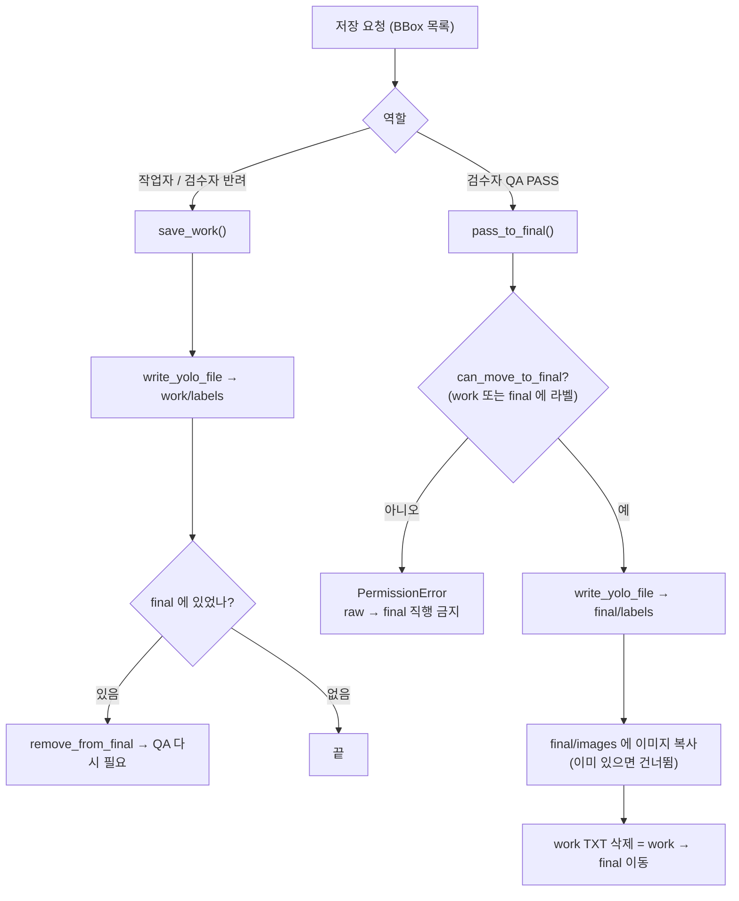

# `src/yolo/yolo_writer.py` 코드 리뷰

> v4.1 · 129줄 · 산출물 3번(FINAL YOLO 라벨)이 실제로 만들어지는 곳

## 1. 한 줄 요약

화면의 BBox를 **YOLO TXT로 저장**하고, 역할에 따라 **work(1차 검수)** 또는 **final(QA PASS)** 로 보냅니다. raw에 쓰기 금지, raw → final 직행 금지, 반쪽 TXT 금지라는 세 가지 안전 장치가 모두 이 파일에 있습니다.

## 2. 입력 · 출력 · 실행

직접 실행하지 않고 `main_window.py`(저장 버튼)와 `tools/merge_results.py`(합치기)가 가져다 씁니다.

| 함수 · 상수 | 하는 일 | 쓰는 곳 |
|---|---|---|
| `bbox_to_yolo()` | 픽셀 `(x1, y1, x2, y2)` → YOLO `(xc, yc, w, h)` 0~1 | main_window (정보 패널) |
| `format_yolo_lines()` | BBox 목록 → TXT 줄 목록 (저장 전 검사에도 사용) | main_window (QA PASS 전 검사) |
| `write_yolo_file()` | TXT 쓰기 · raw 경로 거부 · 임시 파일 후 교체 | `save_work` · `pass_to_final` |
| `save_work()` | `data/work/labels/a.txt` 저장 + final에 있었으면 빼기 | main_window (작업자 저장 · 검수자 반려) |
| `can_move_to_final()` | work 또는 final에 라벨이 있어야 True | main_window (`final_blocked`) |
| `pass_to_final()` | `data/final/labels` + `data/final/images` 한 쌍 저장 → work TXT 정리 | main_window (QA PASS) |
| `remove_from_final()` | final의 TXT · 이미지 복사본 삭제 | `save_work` · merge_results |
| `ROLE_WORKER` · `ROLE_REVIEWER` | `"worker"` · `"reviewer"` | main_window · history |

## 3. 구조

| 줄 | 내용 |
|--:|---|
| 1~16 | 설명: 담당 · 안전 장치 3가지 |
| 18~25 | import · 역할 상수 |
| 32~47 | ① 좌표 변환: `bbox_to_yolo()` · `format_yolo_lines()` |
| 54~68 | ② TXT 쓰기: `write_yolo_file()` |
| 75~97 | ③ `is_in_final()` · `remove_from_final()` · `save_work()` |
| 100~129 | ③ `can_move_to_final()` · `pass_to_final()` |

### 흐름 그림



## 4. 핵심 코드 읽기

### 4.1 반쪽 TXT가 남지 않게: 임시 파일 → 한 번에 교체

```python
label_path = Path(label_path)
if ws is not None and ws.is_raw(label_path):
    raise PermissionError(f"raw 폴더는 원본 보관용이라 저장할 수 없습니다.\n{label_path}")

label_path.parent.mkdir(parents=True, exist_ok=True)
tmp_path = label_path.with_suffix(".txt.tmp")
with open(tmp_path, "w", encoding="utf-8") as f:
    for line in format_yolo_lines(boxes, img_w, img_h):
        f.write(line + "\n")
os.replace(tmp_path, label_path)
```

- **raw 거부**: `ws.is_raw()`(yolo_loader)가 경로가 `data/raw` 안인지 확인해요. 그래서 버튼을 잘못 눌러도 원본은 바뀌지 않아요. README 11장의 "raw 수정 금지"를 코드로 막는 부분이에요.
- **`os.replace`**: `a.txt.tmp`를 다 쓴 다음 이름을 바꿔치기해요. 쓰는 도중에 프로그램이 꺼져도 `a.txt`는 이전 내용 그대로 남아요. 반만 쓰인 TXT가 학습 데이터에 섞이는 사고를 막아 줘요.
- **BBox가 0개**면 빈 파일이 만들어져요. 이게 "검출 대상 없음(normal_kimchi)"을 뜻하고, 맞는지는 validator가 scene_type과 함께 판단해요.

### 4.2 final에는 QA PASS 데이터만: 다시 저장하면 final에서 뺀다

```python
def save_work(item, boxes, img_w, img_h):
    path = item.label_path(STAGE_WORK)
    write_yolo_file(path, boxes, img_w, img_h, item.ws)
    revoked = remove_from_final(item)
    return path, revoked
```

- QA PASS가 끝난 이미지를 작업자가 다시 고치거나 검수자가 반려하면, 고친 라벨은 아직 아무도 검수하지 않은 상태예요. 그래서 **final에서 빼고 work로 돌려보내요.** 이렇게 해서 "final = QA PASS만"이라는 규칙이 늘 지켜져요.
- `revoked`(뺐는지 여부)는 main_window가 받아서 상태줄에 "final 에서 뺌 → QA 다시 필요"라고 보여 줘요.

### 4.3 raw → final 직행 금지

```python
def can_move_to_final(item):
    return item.label_path(STAGE_WORK).is_file() or item.label_path(STAGE_FINAL).is_file()
```

- work에 1차 검수 결과가 있거나, 이미 final에 있는 이미지(검수자가 재확인하는 경우)만 True예요.
- final에는 work를 거친 파일만 들어가므로, 두 경우 모두 **1차 검수를 거친 파일**이에요. raw를 바로 PASS시키는 "검수 건너뛰기"는 여기서 막혀요.
- 이 함수는 `pass_to_final()` 안에서도 한 번 더 확인해요. 화면(main_window의 `final_blocked`)에서 한 번, 저장 함수에서 한 번, 이렇게 **두 겹으로** 막아요.

### 4.4 QA PASS = TXT와 이미지를 한 쌍으로

```python
img_dst = item.final_image_path
img_dst.parent.mkdir(parents=True, exist_ok=True)
if not img_dst.exists():
    shutil.copy2(item.path, img_dst)            # 원본 이미지는 그대로, 복사본만 final 로

work_path = item.label_path(STAGE_WORK)
if work_path.is_file():
    os.remove(work_path)                         # work → final 이동 완료
```

- YOLO 학습 폴더는 `images/a.jpg`와 `labels/a.txt`가 **같은 이름으로 짝**이어야 해요. 그래서 PASS할 때 이미지도 함께 복사해요. 원본은 **복사(copy2)** 만 하고 옮기지 않아요.
- work의 TXT를 지우는 이유는 라벨을 읽는 순서가 **work → final → raw**이기 때문이에요(yolo_loader `LOAD_PRIORITY`). work에 옛 TXT가 남아 있으면 PASS한 final 대신 그걸 화면에 띄우게 돼요.
