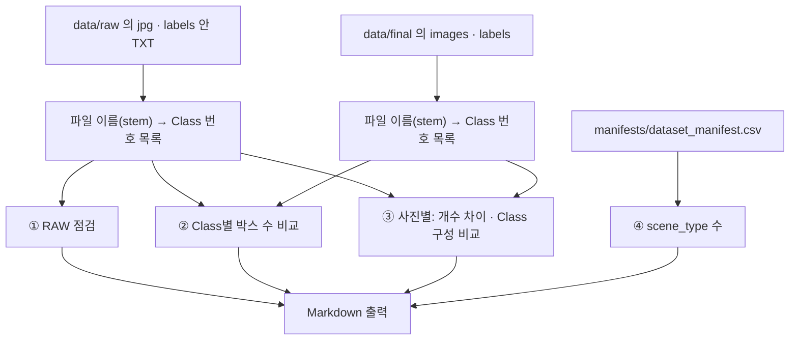

# `tools/label_stats.py` 코드 리뷰

> v4.1 · 112줄 · RAW(원본) vs FINAL(최종) 라벨 통계 · **읽기만 함**

## 1. 한 줄 요약

원본 라벨과 최종 라벨을 비교해서, QA Summary에 아직 없던 숫자(Class별 박스 수 증감 · 박스가 늘거나 줄어든 사진 수 · scene_type별 수)를 **Markdown 표로 출력**해요. 어떤 파일에도 쓰지 않아요.

## 2. 입력 · 출력 · 실행

| 구분 | 내용 |
|---|---|
| 입력 | `data/raw/**/labels/**/*.txt` · `data/raw/**/*.jpg` · `data/final/labels` · `data/final/images` · 프로젝트 `manifests/dataset_manifest.csv` |
| 출력 | 화면(표준 출력)에 Markdown 4장 · `>`로 파일에 저장 가능 |
| 결과를 쓴 곳 | `reports/qa_summary.md` 5.4 ~ 5.6 · `docs/subject08_handoff.md` 8장 (사람이 옮겨 적음) |

```bash
python -m tools.label_stats --data data                           # 화면에 출력
python -m tools.label_stats --data data > reports/label_stats.md  # 파일로 저장
```

## 3. 구조

| 줄 | 내용 |
|--:|---|
| 1~20 | 설명 · `CLASS_NAMES` · `SCENE_NAMES` (코드 안에 직접 적은 이름) |
| 23~38 | `read_labels()`(TXT → Class 번호 목록) · `collect()` |
| 41~64 | `main()` ① RAW 최초 점검: 이미지 · TXT · 짝 · Empty TXT · Class 4 |
| 66~72 | ② Class별 박스 수 RAW → FINAL 증감 |
| 74~96 | ③ 이미지 단위 변경 내역 (늘어남 · 줄어듦 · Class 구성 변경) |
| 98~108 | ④ scene_type별 이미지 수 (manifest) |

### 흐름 그림



## 4. 핵심 코드 읽기

### 4.1 사진 한 장의 변화를 "개수"와 "Class 구성"으로 본다

```python
for stem, f_ids in fin.items():
    r_ids = raw.get(stem, [])
    diff = len(f_ids) - len(r_ids)
    if diff > 0:
        more += 1; added += diff
    elif diff < 0:
        less += 1; removed -= diff
    if Counter(f_ids) != Counter(r_ids) and diff == 0:
        cls_changed += 1
    if Counter(f_ids) == Counter(r_ids) and diff == 0:
        same += 1
```

- `Counter([1, 1, 2])`는 `{1: 2, 2: 1}`처럼 **Class별 개수**를 세요. 두 Counter가 같으면 "박스 개수와 Class 구성이 같다"는 뜻이에요.
- 좌표는 비교하지 않아요. 그래서 **좌표만 조정한 사진**(QA Summary의 "좌표만 조정 240장")은 여기서 "같음"으로 세어져요. 출력에도 "BBox 좌표만 조정한 경우는 '개수 · Class 동일'에 포함"이라고 적혀 있어요.
- 좌표까지 바뀌었는지는 manifest의 `EDITED`(main_window의 지문 비교)로 알 수 있어요. 그래서 QA Summary 5장은 두 숫자를 맞춰 봤어요. "개수 · Class 변경 229장 + 좌표만 조정 240장 = EDITED 469장"이에요.

### 4.2 알아둘 점: 이 도구만 따로 정한 규칙들

이 도구는 프로그램 본체(`yolo_loader` · `classes.yaml`)를 쓰지 않고 **혼자 파일을 읽어요.** 그래서 본체와 규칙이 다른 곳이 있어요.

| 항목 | 본체 | label_stats | 영향 |
|---|---|---|---|
| Class 이름 | `classes.yaml` | 코드 안 `CLASS_NAMES` | yaml에서 이름을 바꾸면 통계 표 이름은 그대로 |
| TXT 인코딩 | `utf-8-sig` (BOM 제거) | `utf-8` | BOM이 붙은 TXT는 첫 줄이 `0 ...`으로 읽혀 **그 줄의 박스를 세지 않음** |
| 이미지 확장자 | jpg · jpeg · png · bmp | `*.jpg`만 | 다른 확장자 사진은 RAW 이미지 수에서 빠짐 |
| 파일 이름 짝 | 겹치면 `dataset2_train__a.jpg`로 바꿈 | 원래 이름(stem) 그대로 | 이름이 바뀐 사진은 RAW와 짝을 못 찾아 "박스가 늘어난 사진"으로 셈 |

- 이번 900장에서 확인된 것: RAW 이미지 / TXT가 900 / 900으로 맞았고(QA Summary 5.4), `dataset_manifest.csv`에 이름이 바뀐(`__`가 들어간) 사진이 0장이에요. BOM이 붙은 원본 TXT가 있었는지는 원본이 Git에 없어서 이 리뷰에서는 확인하지 못했어요.
- 다른 데이터에 다시 쓸 때는 위 네 가지를 먼저 확인하세요. 특히 **결과가 0이나 이상한 숫자로 나오면 에러가 없어도 경로부터 의심하라**는 README 12장 안내가 같은 이유예요.
