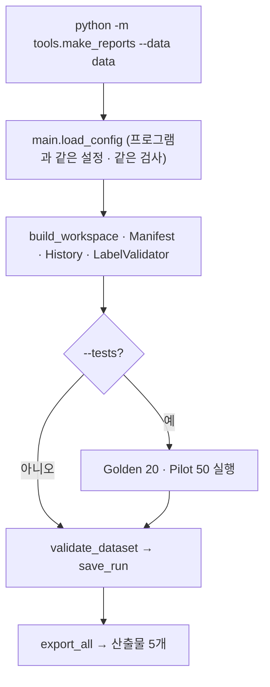

# `tools/make_reports.py` 코드 리뷰

> v4.1 · 71줄 · 화면 없이 산출물만 다시 만들기 (명령어 버전)

## 1. 한 줄 요약

프로그램 메뉴 **검사 > 산출물 생성**과 같은 일을 **터미널에서** 해요. 팀장이 `merge_results.py`로 5명의 결과를 합친 뒤, 화면을 열지 않고 최종 숫자를 뽑을 때 써요.

## 2. 입력 · 출력 · 실행

| 구분 | 내용 |
|---|---|
| 입력 | `--data` 폴더(`raw` · `work` · `final` · `manifests`) · `configs/classes.yaml` |
| 출력 | `manifests/dataset_manifest.csv` · `reports/validation_report.csv` · `reports/qa_summary.md` · `reports/test_report.md` · `docs/subject08_handoff.md` (AUTO 영역만) + `data/manifests/validation_runs.csv`에 실행 기록 한 줄 |

```bash
python -m tools.make_reports --data data            # Validation + 산출물
python -m tools.make_reports --data data --tests    # Golden · Pilot 자동 테스트까지
```

## 3. 구조

| 줄 | 내용 |
|--:|---|
| 1~17 | 설명 · 사용법 · 만드는 파일 |
| 19~32 | 경로 설정(`sys.path`) · import (`main.load_config` 재사용) |
| 35~47 | `main()`: 인자 · 설정 · 작업 공간 · manifest · history · validator |
| 49~56 | `--tests`면 Golden · Pilot 실행 |
| 58~67 | Validation → 실행 기록 → `export_all()` → 결과 출력 |

### 흐름 그림



## 4. 핵심 코드 읽기

### 4.1 프로그램과 "똑같은 함수"를 부른다

```python
from main import CONFIG_PATH, load_config                      # noqa: E402
from src.qa.reports import export_all                          # noqa: E402
from src.qa.self_test import run_tests                         # noqa: E402
```

```python
result = validate_dataset(ws, manifest, validator)
save_run(result, ws.runs_path)
...
written, n = export_all(PROJECT_DIR, ws, manifest, history.read_all(), result,
                        config["classes"], config["review_reasons"], golden, pilot)
```

- 설정 읽기(`load_config`)부터 검사(`validate_dataset`), 산출물(`export_all`)까지 **화면 버튼이 부르는 함수와 같은 함수**를 그대로 불러요. 그래서 터미널로 만든 숫자와 프로그램으로 만든 숫자가 다를 수 없어요.
- Pilot의 `offset` 계산도 main_window와 같은 식(`max(1, len(items) // (2 * p))`)을 써요. 같은 사진으로 시험해요.
- `# noqa: E402`는 "import가 파일 맨 위에 있지 않다"는 코드 검사 경고를 끄는 표시예요. `sys.path`에 프로젝트 폴더를 먼저 넣어야 `src`를 찾을 수 있어서 import를 아래에 두었어요.

### 4.2 알아둘 점: 이 명령도 기록을 남긴다

- 산출물만 만드는 것 같지만, `save_run()`이 `validation_runs.csv`에 **실행 기록 한 줄**을 추가해요. QA Summary의 "최초 실행 → 최종 실행" 비교에서 이 줄이 **최종 실행**이 돼요.
- `Manifest(...)`를 만들 때도 출처 칸을 최신으로 맞추고 **바로 저장**해요(`manifest.md` 4.1). 읽기만 하는 명령이 아니에요.
- 같은 이유로 산출물을 만들 때 엑셀로 `dataset_manifest.csv`를 열어 두면 실패할 수 있어요(README 14장).
