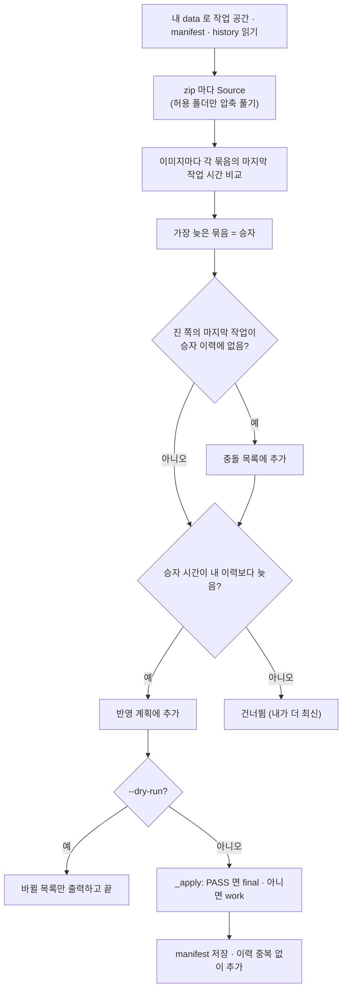

# `tools/merge_results.py` 코드 리뷰

> v4.1 · 257줄 · 5명이 각자 PC에서 한 작업을 하나로 합치는 도구

## 1. 한 줄 요약

원본 900장은 Git에 올리지 않기 때문에, 각자 **결과(TXT · CSV)만 zip으로 묶어(pack)** 주고받고, 팀장이 **하나의 data 폴더로 합쳐요(merge)**. 같은 이미지를 두 사람이 고쳤다면 `label_history.csv`의 시간을 비교해 **가장 나중 작업이 이겨요**(Last write wins).

## 2. 입력 · 출력 · 실행

| 구분 | 내용 |
|---|---|
| pack 입력 | 내 `data/work/labels` · `data/final/labels` · `data/manifests`의 `.txt` · `.csv` |
| pack 출력 | `이름_날짜.zip` (원본 이미지 · `final/images` 없음 → 용량이 아주 작음) |
| merge 입력 | 내 `data/raw`(원본) + 팀원 zip 여러 개 (또는 data 폴더) |
| merge 출력 | 내 `data/work` · `data/final` · `dataset_manifest.csv` 갱신 · `label_history.csv`에 이력 추가 · 화면에 충돌 목록 |

```bash
# 팀원: 내 결과 묶음 (프로그램: 파일 > 내 결과 묶음 만들기)
python -m tools.merge_results pack --data data --out ../박건_1007.zip

# 팀장: 먼저 미리보기 → 이상 없으면 합치기
python -m tools.merge_results merge --data data ../박건_1007.zip ../이승훈_1007.zip --dry-run
python -m tools.merge_results merge --data data ../박건_1007.zip ../이승훈_1007.zip
```

프로그램 메뉴(`main_window.py`의 `pack_results` · `merge_results`)도 이 파일의 `pack()` · `merge()`를 그대로 불러요. 메뉴의 합치기는 항상 dry-run 결과를 먼저 보여 주고, 확인을 받은 뒤에 실제로 합쳐요(터미널에서는 `--dry-run`을 직접 붙여야 해요).

## 3. 구조

| 줄 | 내용 |
|--:|---|
| 1~28 | 설명: 왜 필요한가 · 충돌 규칙 · 사용법 |
| 39~48 | 경로 · import · `PACK_DIRS` (묶음에 넣는 폴더 3개) |
| 55~67 | ① `pack()` |
| 74~103 | ② 도우미: `_safe_extract()` · `_read_csv()` · `_latest_by_file()` |
| 106~132 | ② `Source`: 팀원 묶음 하나 (압축 풀기 · 이력 · manifest · 마지막 작업) |
| 135~212 | ② `merge()`: 이미지별 승자 고르기 → 충돌 출력 → 반영 → 이력 모으기 |
| 215~232 | ② `_apply()`: 한 이미지를 work 또는 final로 반영 |
| 239~257 | ③ 명령어 (`pack` · `merge` · `--dry-run`) |

### 흐름 그림 (`merge`)



## 4. 핵심 코드 읽기

### 4.1 묶음에는 결과만, 풀 때는 허용된 폴더만

```python
PACK_DIRS = ("work/labels", "final/labels", "manifests")
```

```python
parts = Path(name).parts
if ".." in parts or name.startswith("/") or len(parts) < 2:
    continue
if "/".join(parts[:-1]) not in PACK_DIRS:
    continue
```

- **pack**: 세 폴더의 `.txt` · `.csv`만 넣어요. 회사 사진이 zip에 들어가지 않으니 메신저로 주고받아도 원본이 밖으로 나가지 않아요(README 14장 "데이터 외부 유출 금지").
- **merge**: zip 안의 파일 이름에 `..`이 있거나 `/`로 시작하면 건너뛰어요. 이런 이름은 압축을 풀 때 **원하는 폴더 밖**(예: `../../raw/...`)에 파일을 쓸 수 있어요. 이를 "Zip Slip"이라고 불러요. 허용된 세 폴더가 아니면 아예 꺼내지 않아요.

### 4.2 누가 이기나: 마지막 작업 시간

```python
candidates = [(s.latest[name], s) for s in srcs if name in s.latest and name in s.rows]
when, best = max(candidates, key=lambda c: c[0])
```

- `s.latest[name]`은 그 묶음의 `label_history.csv`에서 이 이미지의 **가장 늦은 `work_date`** 예요.
- 시간을 **문자열 그대로** 비교해요. `"2026-10-07 11:30:41"`처럼 자릿수가 고정된 형식(`history.py`의 `DATE_FORMAT`)이라, 글자 순서와 시간 순서가 같아요. 형식이 하나라도 다르면(예: `10/7`) 비교가 틀어지니, 시간은 꼭 프로그램이 찍게 해야 해요.

### 4.3 진짜 충돌만 경고한다

```python
lost = {s.name for w, s in candidates
        if s is not best and w > master_latest.get(name, "")
        and s.last_event(name) not in best.events.get(name, ())}
```

진 쪽이 있다고 다 충돌은 아니에요. 아래 세 조건을 **모두** 만족할 때만 충돌로 경고해요.

1. 승자가 아니고,
2. 그 작업이 내(팀장) data보다 새것이고,
3. 진 쪽의 **마지막 작업이 승자의 이력에 없을 때**.

예를 들어 B가 A의 결과를 먼저 합친 뒤 이어서 고쳤다면, B의 이력에 A의 작업이 이미 들어 있어요. 이건 B가 A의 작업을 **알고 덮어쓴** 거라 충돌이 아니에요. 반대로 A와 B가 서로 모르고 같은 사진을 고쳤다면 경고가 떠요. 그래서 팀장은 그 사진만 프로그램에서 다시 확인하면 돼요.

### 4.4 반영할 때도 "final = QA PASS만" 규칙 유지

```python
if row.get("qa_status") == QA_PASS:
    dst = item.label_path(STAGE_FINAL)
    ...
    if not img.exists():
        shutil.copy2(item.path, img)                    # 이미지는 내 raw 에서 복사
    work = item.label_path(STAGE_WORK)
    if work.is_file():
        work.unlink()
else:
    dst = item.label_path(STAGE_WORK)
    ...
    remove_from_final(item)                             # QA 대기로 돌아갔으면 final 에서 빼기
```

- 프로그램에서 저장할 때(`yolo_writer.py`)와 **같은 규칙**을 따라요. PASS면 final TXT와 이미지 한 쌍을 만들고 work를 정리해요. 아니면 work에 두고 final에서 빼요.
- `final/images`는 zip에 없으니 **내 PC의 raw에서 다시 복사**해요. 그래서 merge는 원본 900장이 있는 PC에서만 할 수 있어요.

### 4.5 이력은 지우지 않고 모두 모은다

```python
seen = {tuple(r.get(c, "") for c in HISTORY_COLUMNS) for r in master_rows}
...
if key not in seen and r.get("file_name") in items:
```

- manifest는 이긴 쪽 값으로 **덮어쓰지만**, 이력은 모든 사람의 줄을 **합쳐요**. 그래서 QA Summary의 Human QA 숫자(누가 몇 장 검수했는지)가 합친 뒤에도 정확해요.
- 열 개 칸이 모두 같은 줄은 한 번만 넣어요. 같은 zip을 두 번 합쳐도 이력이 두 배가 되지 않아요.
