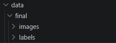
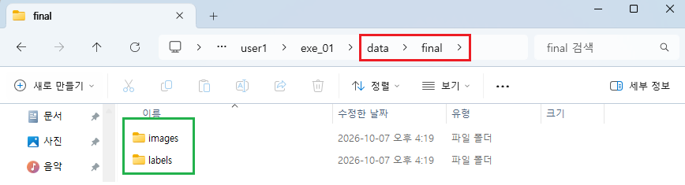
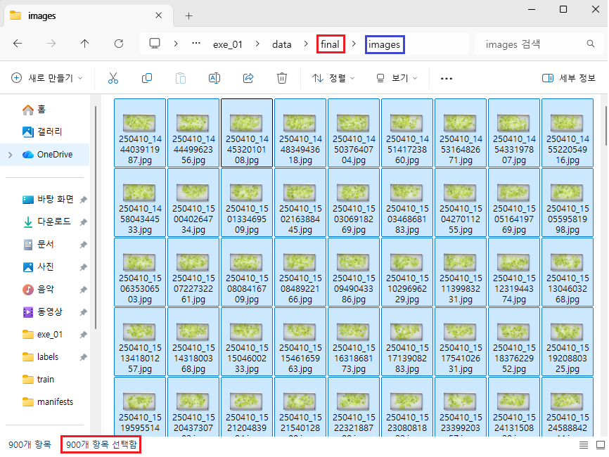
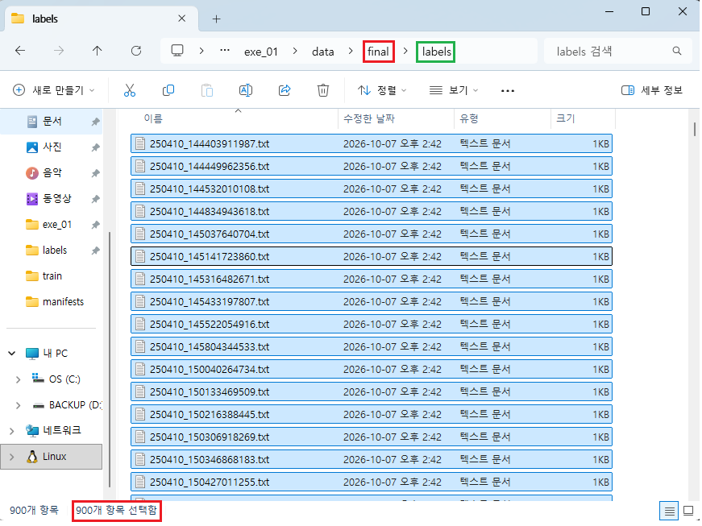
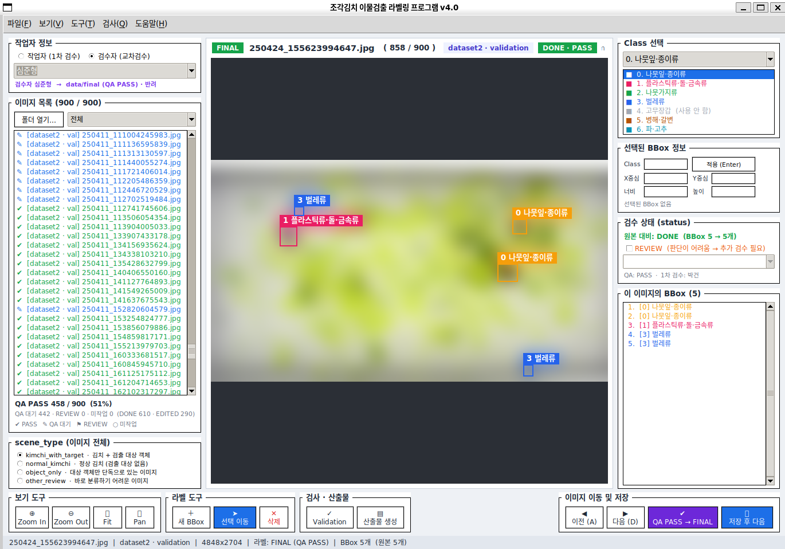
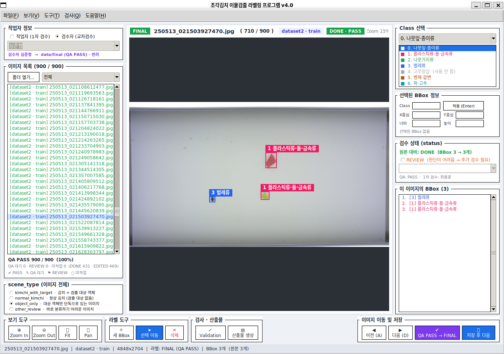
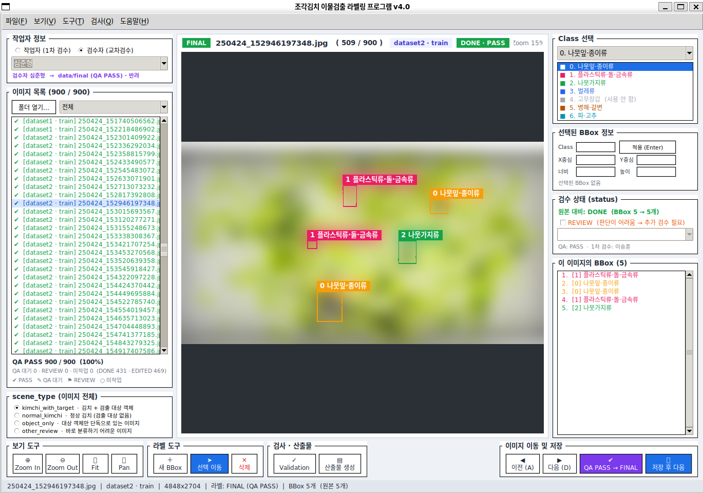
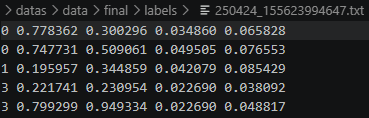
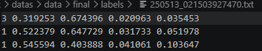
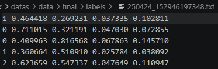

# FINAL YOLO 라벨 증빙 (3번 산출물)

> 라벨 검수 단계 **3번 산출물** 증빙 문서입니다. 실제 900장 데이터(JPG · TXT)는 Git 에 올리지 않고,
> `final/` 폴더 구조 · 파일 수 · 대표 검수 화면 · 대표 YOLO TXT 캡처로 증빙합니다.
> 화면 캡처는 v4.0 프로그램 화면이며, v4.1 과 기능 · 화면이 동일합니다.

## ✅ 증빙 체크리스트

- [x] `data/final/images/` 에 최종 이미지 900장이 있다.
- [x] `data/final/labels/` 에 최종 TXT 900개가 있다.
- [x] `final/` 폴더 구조 캡처를 준비했다.
- [x] 이미지 900장 파일 수가 보이는 캡처를 준비했다.
- [x] TXT 900개 파일 수가 보이는 캡처를 준비했다.
- [x] 대표 검수 완료 화면 3~5장을 준비했다.
- [x] 대표 YOLO TXT 2~3개를 준비했다.

---

## 1️. `final/` 폴더 구조 캡처

### vscode 

### file_explorer

---

## 2️. 최종 이미지 900장

### images 폴더 · 파일 수 900장

---

## 3️. 최종 TXT 900개
### labels 폴더 · 파일 수 900개

---

## 4. 대표 검수 완료 화면 (3장)

### 검수 완료 화면 ① 

### 검수 완료 화면 ② 

### 검수 완료 화면 ③ 

---

## 5️. 대표 YOLO TXT (3개)

### YOLO TXT ①

### YOLO TXT ②

### YOLO TXT ③

---
